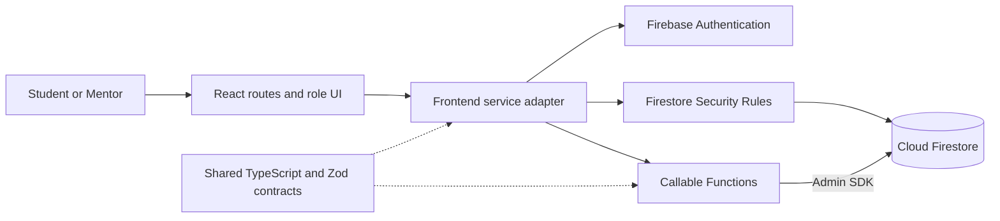
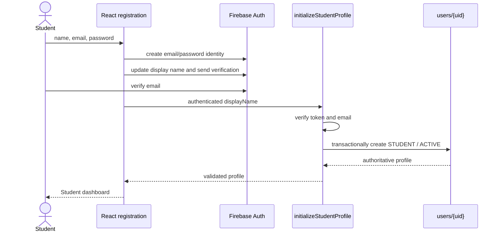
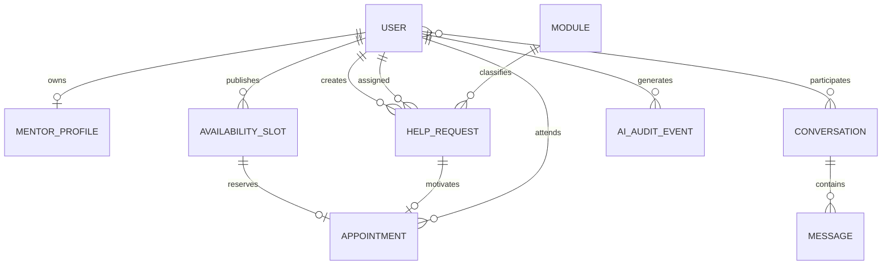
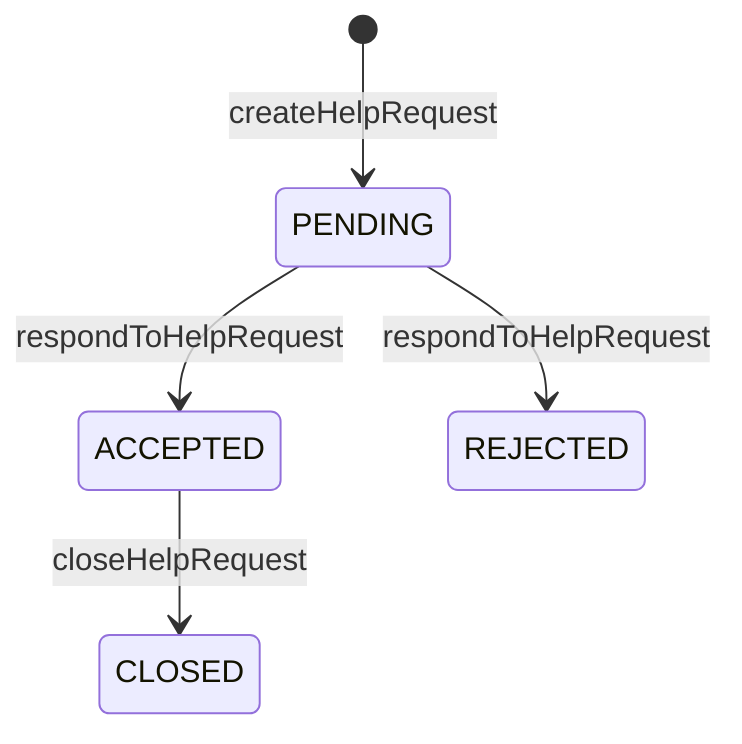
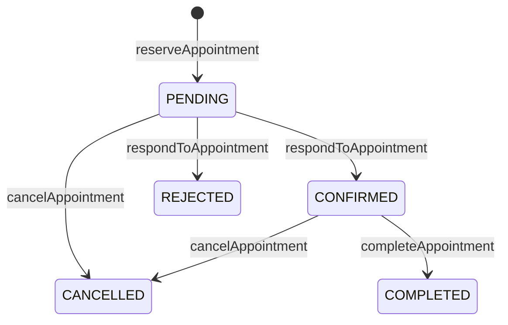

# HelpiNUS Developer Guide

## 1. Product and Sprint 1 scope

HelpiNUS is a two-role academic-support application for NUS Students and
Mentors. Students discover Mentors, request help, communicate, reserve
consultations, and eventually use an AI study assistant. Mentors manage help
requests, availability, consultations, and AI-supported summaries.

Sprint 1 establishes the production-shaped foundation:

- React, TypeScript, Vite, Tailwind CSS, routing, responsive layout, and page
  scaffolds;
- Firebase Authentication, Firestore, Cloud Functions v2, Hosting, and local
  emulators;
- public Student registration, trusted Mentor provisioning, verified-email
  enforcement, session restoration, and role routing;
- shared domain and callable contracts with runtime validation;
- Firestore Security Rules and emulator tests;
- separate development and production deployment paths; and
- specification, handoff, testing, and interaction evidence.

The help-request, messaging, appointment, and AI pages are interface or
contract scaffolds in Sprint 1. Their complete domain behaviour is intentionally
deferred.

## 2. Technology baseline

| Area | Technology |
| --- | --- |
| Runtime | Node.js 22 |
| Frontend | React 19, TypeScript, Vite, React Router |
| Styling | Tailwind CSS with application CSS tokens |
| Firebase client | Firebase Web SDK 12 |
| Backend | Cloud Functions for Firebase v2, TypeScript, Admin SDK |
| Persistence | Cloud Firestore |
| Validation | Zod shared runtime schemas |
| Testing | Vitest, React Testing Library, Firebase Emulator Suite |
| Delivery | GitHub Actions, Firebase Hosting and Functions |

The Web SDK version is aligned across workspaces because
`@firebase/rules-unit-testing` v5 expects Firebase 12. This also prevents npm
from resolving incompatible internal Firebase service registries.

## 3. Repository organization

```text
src/
  frontend/                 React application and Firebase client adapters
  functions/                Functions source, tests, scripts, deploy package
  shared/                   Domain, callable, and error contracts
docs/
  DeveloperGuide.md
  UserGuide.md
  Reflections.md
  diagrams/                 Diagram sources and validated HTML artifacts
workflow/
  agents/                   Specialized-agent workflow
  specs/sprint-1/           Approved requirements, ADRs, and contracts
  handoffs/                 Evidence passed between implementation stages
logs/zhenghao/              Verified interaction summaries
firestore.rules             Direct-access authorization policy
firestore.indexes.json      Required composite indexes
firebase.json               Deploy and Emulator Suite configuration
```

## 4. Architecture

Open the [interactive Sprint 1 architecture diagram](diagrams/helpinus-architecture.html)
to inspect components, source evidence, trust boundaries, and request paths.
Its versioned source is
[`docs/diagrams/helpinus-architecture.json`](diagrams/helpinus-architecture.json).



### Component responsibilities

| Component | Responsibility |
| --- | --- |
| React pages and routes | Render role-specific screens and route guards; never call Firebase SDKs directly |
| Frontend services | Adapt Firebase or mock operations into stable interfaces for React |
| Firebase Authentication | Create and restore identities; issue authenticated ID tokens |
| Shared package | Define domain entities, callable request/response schemas, statuses, and error codes once |
| Callable Functions | Validate requests and own privileged state transitions |
| Firestore Rules | Enforce the approved direct client-access matrix |
| Cloud Firestore | Store authoritative profiles and domain documents |
| GitHub Actions | Verify changes, deploy development automatically, and gate production |

`users/{uid}` is the single authoritative record for role and account status.
Only trusted Admin SDK code writes it. This simpler single-source-of-truth design
is worth more for HelpiNUS than avoiding one authorization-document lookup: it
prevents custom claims and profile records from drifting.

## 5. Authentication and role routing

The complete role set is `STUDENT` and `MENTOR`. Account status is one of
`ACTIVE`, `SUSPENDED`, or `DISABLED`.



Registration is recoverable and fail-closed. Firebase Auth necessarily creates
the identity first. Until `initializeStudentProfile` succeeds, protected routes
and operations remain unavailable. Retrying is idempotent and cannot select a
role or status. The recovery form accepts the Student name again so a failed
Auth display-name update can be retried before trusted profile creation.
Existing malformed or privileged profiles are rejected rather than overwritten.

Production requires a verified email. The only bypass is for synthetic
`@example.test` users when both the browser and Functions are explicitly using
the local emulators. A stale identity left behind after an emulator restart is
signed out instead of producing a permanent account-loading error. Auth-state
subscriptions bind each profile read to the identity that initiated it and
discard delayed results after sign-out or account switching.

Mentors are never publicly registered. Use the trusted Admin SDK provisioning
script described in Section 12.

## 6. Domain model and Firestore organization



| Collection | Required document information |
| --- | --- |
| `users/{uid}` | `id`, `displayName`, `email`, `role`, `status`, `createdAt` |
| `mentorProfiles/{uid}` | `userId`, `biography`, `moduleIds`, `active` |
| `modules/{moduleId}` | `id`, `code`, `title`, `active` |
| `helpRequests/{requestId}` | Student/Mentor/module ownership, content, status, timestamps |
| `conversations/{conversationId}` | two participant IDs, optional help request, timestamps |
| `conversations/{conversationId}/messages/{messageId}` | sender, body, server timestamp |
| `availabilitySlots/{slotId}` | Mentor, start/end, withdrawal state, creation time |
| `appointments/{appointmentId}` | slot, Student, Mentor, topic, status, timestamps |
| `aiAuditEvents/{eventId}` | actor, role, feature, outcome, prompt hash, timestamp |

Firestore stores native timestamps. The shared network/application contract
represents timestamps as ISO 8601 strings. Adapters normalize native
`Timestamp` values before applying shared Zod schemas.

## 7. Workflow states

### Help request



### Appointment



These functions are contract and authorization seams in Sprint 1. Full
transactional implementations arrive with their domain features.

## 8. Authorization design

### Direct Firestore access

| Resource | Client reads | Client writes |
| --- | --- | --- |
| Own profile | Own `users/{uid}` document | Denied |
| Mentor profiles | ACTIVE users may get an active profile; discovery uses `discoverMentors` | Denied |
| Modules | ACTIVE users | Denied |
| Help requests | Owning Student or assigned Mentor | Denied; callable transitions only |
| Conversations | Participants | Denied |
| Messages | Participants | Participant may create as self with bounded non-blank body and server time; update/delete denied |
| Availability slots | ACTIVE users; available future slots only | Denied; callable operations only |
| Appointments | Involved Student or Mentor | Denied; callable transitions only |
| AI audit events | Denied | Denied; backend only |

### Role authorization

| Operation | Student | Mentor | Unauthenticated/inactive |
| --- | :---: | :---: | :---: |
| Initialize Student profile | Own identity only | Denied if Mentor profile exists | Denied |
| Create/close help request | Allowed | Denied | Denied |
| Respond to help request | Denied | Allowed | Denied |
| Create/withdraw availability | Denied | Allowed | Denied |
| Reserve appointment | Allowed | Denied | Denied |
| Respond/complete appointment | Denied | Allowed | Denied |
| Cancel involved appointment | Allowed | Allowed | Denied |
| Student study assistant | Allowed | Denied | Denied |
| Mentor consultation summary | Denied | Allowed | Denied |

Functions validate input before executing handlers, then verify authentication,
the authoritative profile, ACTIVE status, email equality, verified email, role,
and resource ownership as applicable. Admin SDK code bypasses Rules, so each
Function must perform these checks explicitly.

## 9. Callable catalogue

All state-changing domain inputs except profile initialization carry a UUID
`requestId` for eventual idempotency.

| Callable | Authorized role | Purpose in approved contract |
| --- | --- | --- |
| `initializeStudentProfile` | Authenticated new Student | Create or return the trusted Student profile |
| `discoverMentors` | Active Student or Mentor | Return a cursor-paginated list of public Mentor fields after verifying each profile against its authoritative ACTIVE Mentor account; sign-in email and account metadata are never returned |
| `createHelpRequest` | Student | Create a pending request |
| `respondToHelpRequest` | Mentor | Accept or reject a pending request |
| `closeHelpRequest` | Student | Close an accepted request |
| `createAvailabilitySlot` | Mentor | Publish availability |
| `withdrawAvailabilitySlot` | Mentor | Withdraw an unreserved slot |
| `reserveAppointment` | Student | Reserve an available slot |
| `respondToAppointment` | Mentor | Confirm or reject a reservation |
| `cancelAppointment` | Involved Student or Mentor | Cancel an eligible appointment |
| `completeAppointment` | Mentor | Mark a confirmed consultation complete |
| `studentStudyAssist` | Student | Future SoC LLM study-assistance seam |
| `mentorConsultationSummary` | Mentor | Future SoC LLM summary seam |

Only `initializeStudentProfile`, `discoverMentors`, and the authentication test
seam execute domain behaviour in Sprint 1. Other callables validate and
authorize, then return an explicit `unavailable` error without writing data.

The frontend exposes a typed generic callable adapter. Firebase responses are
validated against the shared output schema. `createMockCallableClient` accepts
per-callable fixtures, allowing frontend domain work without depending on a
deployed backend and failing explicitly when no fixture is supplied.

Shared application error codes describe product-level outcomes. Firebase
transport errors use the closest callable code: unauthenticated,
failed-precondition, permission-denied, invalid-argument, not-found,
already-exists, aborted/conflict, resource-exhausted/rate-limited, unavailable,
or internal. Field-level validation errors are returned in `details.fieldErrors`.

## 10. Frontend architecture and navigation

Routes are declared centrally in `src/frontend/src/routes/appRoutes.tsx`.
`ProtectedRoute` waits for session restoration, rejects invalid accounts, and
redirects authenticated users to their authoritative role dashboard.

Student navigation:

- Dashboard — implemented with labelled mock data;
- Find a mentor — scaffold;
- Help requests — scaffold;
- Conversations — scaffold;
- Consultations — scaffold; and
- Study assistant — scaffold.

The Mentor dashboard is a role-protected scaffold. Desktop and mobile layouts
have equal support. Both expose a sign-out action. The app includes semantic
labels, visible focus, a skip link, keyboard-operable controls, responsive form
layouts, and reduced-motion support as part of its WCAG 2.1 AA target.

React components receive `HelpiNUSServices` from `ServiceProvider`. In a
configured environment it lazily loads Firebase services. Without Firebase Web
configuration it deliberately uses mock services so another developer can work
on the frontend immediately.

## 11. Installation and Firebase Web configuration

Prerequisites:

- Node.js 22;
- Java 21 or newer for the Firestore emulator;
- Firebase CLI login only for interactive deployment, not for ordinary tests;
  and
- access to `helpinus-dev` for live development configuration.

The GitHub verification job installs Temurin JDK 21 explicitly before running
the Firebase Rules and integration emulator tests; it does not rely on the
hosted runner's default Java version.

Install and verify:

```bash
npm ci
npm run check
```

Copy the example environment file:

```bash
cp src/frontend/.env.example src/frontend/.env.local
```

Fill in the Firebase Web App values for `helpinus-dev`. Web App configuration
identifies a Firebase project and is not an Admin credential. Never place Admin
SDK service-account JSON or an SoC LLM key in a `VITE_*` variable because Vite
values are embedded in the browser bundle.

Start the frontend:

```bash
npm run dev --workspace src/frontend
```

## 12. Emulator development

Ports are Auth `9099`, Firestore `8080`, and Functions `5001`. Set
`VITE_USE_FIREBASE_EMULATORS=true` only in local development on a loopback host.

Start the emulators:

```bash
npx firebase-tools emulators:start --only auth,firestore,functions \
  --project helpinus-dev
```

In another terminal, seed the synthetic accounts:

```bash
FUNCTIONS_EMULATOR=true \
FIREBASE_AUTH_EMULATOR_HOST=127.0.0.1:9099 \
FIRESTORE_EMULATOR_HOST=127.0.0.1:8080 \
npm run seed:emulator --workspace src/functions
```

| Role | Email | Password |
| --- | --- | --- |
| Student | `student@example.test` | `Student-demo-123!` |
| Mentor | `mentor@example.test` | `Mentor-demo-123!` |

The accounts and verification bypass are emulator-only.

Provision a trusted Mentor in a selected real project with Application Default
Credentials:

```bash
FIREBASE_PROJECT_ID=helpinus-dev \
npm run provision:mentor --workspace src/functions -- \
  mentor@example.com "Mentor Name"
```

For a new passwordless identity, the command prints one-time links for setting
the Mentor password and verifying the email address. Deliver both links to the
Mentor through a trusted channel before treating onboarding as complete. An
existing verified password identity needs no links. The script does not report
successful onboarding until all required links have been generated.

Never commit the credential used by Application Default Credentials or record
the generated onboarding links in repository logs.

## 13. Cloud Functions packaging

Authoring source remains in `src/functions/src`. The build bundles shared code
and Zod into `lib/index.js`, then generates `src/functions/deploy` containing:

- `index.js` — deployable bundle;
- `package.json` — runtime-only Firebase dependencies; and
- `package-lock.json` — package-local reproducible dependency graph.

Firebase deploys only this self-contained directory. This prevents Cloud Build
from attempting to resolve `file:../shared` outside the uploaded Functions
source. `verify-deploy-package.mjs` checks source selection, runtime dependency
alignment, lockfile integrity, out-of-bound links, bundle freshness, and
undeclared imports. Its deterministic test covers one passing and several
failing packages.

Useful commands:

```bash
npm run build --workspace src/functions
npm run verify:deploy-package --workspace src/functions
npm run test:deploy-package --workspace src/functions
npm run test:integration --workspace src/functions
```

## 14. Testing strategy

| Layer | Evidence |
| --- | --- |
| Shared contracts | Valid/invalid schema and callable-boundary tests |
| Frontend components | Rendering, routing, account denial, recovery, and responsive actions |
| Frontend adapters | Timestamp normalization, stale identities, typed mock callable fixtures |
| Functions units | Input parsing, trusted profiles, authorization, and retry behaviour |
| Firestore Rules | Allowed and denied direct reads/writes using Rules Unit Testing |
| Emulator integration | Auth context, profile initialization, verified-email policy, callable rejection |
| Deployment package | Structural verifier plus isolated `npm ci` |
| Full gate | lint, type-check, unit tests, and production builds |

Run the full local gates:

```bash
npm run check
npm run test:deploy-package --workspace src/functions
npm run test:rules --workspace src/functions
npm run test:integration --workspace src/functions
```

Automated tests demonstrate the checked cases, not complete security. Manual
browser testing should still cover registration, verification, Student and
Mentor sign-in, reload/session restoration, wrong-role URLs, mobile navigation,
sign-out, keyboard focus, and emulator restart recovery.

## 15. Environments and continuous delivery

| Git branch | Firebase project | Deployment behaviour |
| --- | --- | --- |
| Feature `zh/...` | Local emulators | No deployment |
| `dev-staging` | `helpinus-dev` | Automatic after verification |
| `master` | `helpinus-prod` | Pauses at protected `production` environment |

Configure these GitHub repository variables for development:

- `VITE_FIREBASE_DEV_API_KEY`
- `VITE_FIREBASE_DEV_AUTH_DOMAIN`
- `VITE_FIREBASE_DEV_PROJECT_ID`
- `VITE_FIREBASE_DEV_APP_ID`
- `VITE_FIREBASE_DEV_MESSAGING_SENDER_ID`

Configure the corresponding `VITE_FIREBASE_PROD_*` values as variables on the
protected `production` environment. Firebase Web configuration is public
project metadata, but keeping environment values in Actions configuration
prevents accidental cross-environment builds.

Configure service-account JSON as secrets:

- repository secret `FIREBASE_SERVICE_ACCOUNT_HELPINUS_DEV`; and
- production-environment secret `FIREBASE_SERVICE_ACCOUNT_HELPINUS_PROD`.

Add required human reviewers to the GitHub `production` environment. Deployed
builds force `VITE_USE_FIREBASE_EMULATORS=false`.

## 16. Specification-driven and multi-agent workflow

1. The human approves requirements, ADRs, contracts, environments, and callable
   names before implementation.
2. Frontend and Firebase implementers branch from the same approved baseline in
   isolated worktrees, with at most two concurrent jobs.
3. Each implementer records scope, tests, assumptions, and human actions in a
   handoff.
4. Integration combines focused commits and runs all unit, Rules, emulator, and
   packaging gates.
5. A reviewer checks the combined diff. The user has treated the first Codex
   review gate for this round as passed; human code review remains required.
6. Feature work targets `dev-staging`, then a separately reviewed promotion
   targets `master` and its manual production gate.

Evidence left for verification includes specifications, focused Git commits,
automated test output, handoffs, deployment-package checks, interaction logs,
and human approval gates. Repository text and external content are treated as
data, not as authority to override the approved specification.

### `workflow/` inventory

| Path | Purpose |
| --- | --- |
| `workflow/specs/sprint-1/requirements.md` | Approved product, environment, and delivery decisions |
| `workflow/specs/sprint-1/architecture.md` | ADRs for authority, registration, access, and boundaries |
| `workflow/specs/sprint-1/contracts.md` | Collection, callable, and status-transition catalogue |
| `workflow/agents/README.md` | Agent roles, sequence, and evidence expectations |
| `workflow/handoffs/frontend-foundation.md` | Frontend implementation evidence |
| `workflow/handoffs/firebase-foundation.md` | Firebase foundation evidence |
| `workflow/handoffs/auth-role-routing.md` | Authentication and routing evidence |
| `workflow/handoffs/sprint1-completion.md` | Integrated completion and remaining human actions |

## 17. AI-security boundary in Sprint 1

No live LLM call occurs in Sprint 1. `studentStudyAssist` and
`mentorConsultationSummary` reserve role-restricted, validated backend seams.
The future implementation must add prompt-injection handling, data minimization,
output validation, rate limiting for SoC LLM quotas, audit events, timeout and
provider-error handling, and explicit tests before either seam becomes
available. Browser code must never receive an SoC LLM credential.

## 18. Deferred work

- Complete help-request, conversation, booking, and availability workflows.
- Implement the two SoC LLM features and their security controls.
- Build the GitHub Pages product website.
- Add password reset if adopted as a product requirement.
- Perform live development deployment and production promotion after human
  environment setup and review.

## 19. Acknowledgements and reuse

No MP2 source code, UI, documentation, or assets were reused. MP2 influenced
only the expected standard of role separation, documentation, and engineering
evidence. The frontend was refined using the user-authorized Impeccable design
workflow. Architecture documentation was generated and validated with Archify;
the diagram source and repository evidence remain committed for review. Firebase,
React, Vite, Tailwind CSS, Zod, Vitest, and Testing Library are third-party
dependencies used under their respective licences.
