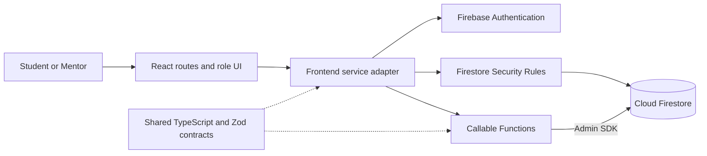
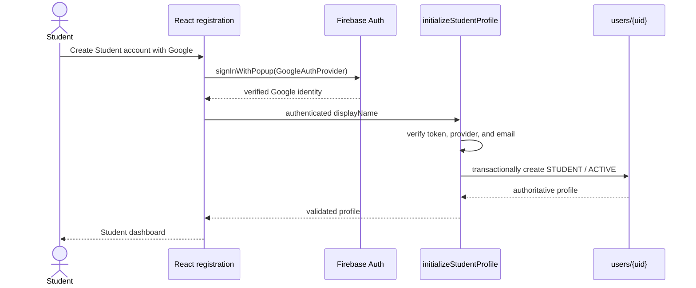
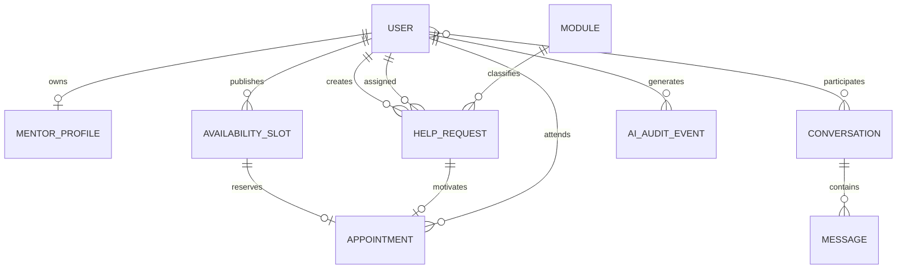
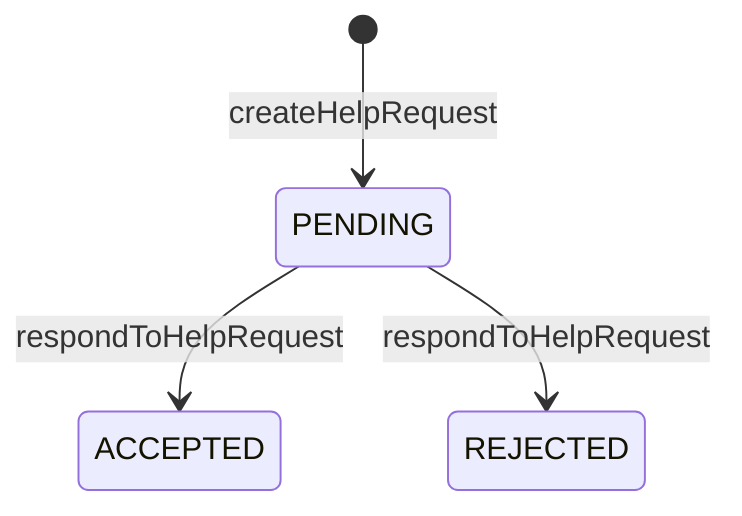
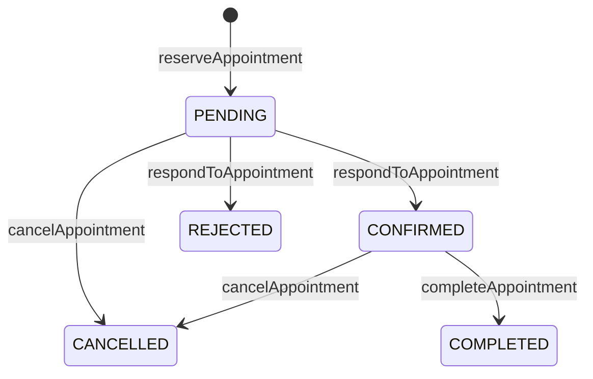

# HelpiNUS Developer Guide

## 1. Product and Sprint 1 scope

HelpiNUS is a two-role academic-support application for NUS Students and
Mentors. Students discover Mentors, request help, communicate, reserve
consultations, and eventually use an AI study assistant. Mentors manage help
requests, availability, consultations, and AI-supported summaries.

Sprint 1 establishes the production-shaped foundation:

- React, TypeScript, Vite, Tailwind CSS, routing, responsive layout, and page
  scaffolds;
- Firebase Authentication, Firestore, Cloud Functions v2, Hosting, and local
  emulators;
- Google-only Student/Mentor registration and sign-in with one role per UID,
  session restoration, and role routing;
- shared domain and callable contracts with runtime validation;
- Firestore Security Rules and emulator tests;
- separate development and production deployment paths; and
- specification, handoff, testing, and interaction evidence.

Sprint 2 F01 implements help-request creation, decisions, owner reads and
summaries. F02 now provides the real transaction-compatible conversation
provisioner, authenticated text messaging, bounded read acknowledgements, and
Student/Mentor chat pages. S2-D1-F03 implements the separate Student Study
Assistant boundary; appointments and the Mentor AI feature remain outside this
Developer 1 feature.

## 2. Technology baseline

| Area | Technology |
| --- | --- |
| Runtime | Node.js 22 |
| Frontend | React 19, TypeScript, Vite, React Router |
| Styling | Tailwind CSS with application CSS tokens |
| Firebase client | Firebase Web SDK 12 |
| Backend | Cloud Functions for Firebase v2, TypeScript, Admin SDK |
| Persistence | Cloud Firestore |
| Validation | Zod shared runtime schemas |
| Testing | Vitest, React Testing Library, Firebase Emulator Suite |
| Delivery | GitHub Actions, Firebase Hosting and Functions |

The Web SDK version is aligned across workspaces because
`@firebase/rules-unit-testing` v5 expects Firebase 12. This also prevents npm
from resolving incompatible internal Firebase service registries.
The F02 lockfile correction removes the stale nested frontend Firebase 13
entry and resolves Firebase 12.19.0 for both workspaces while preserving the
frontend's declared `^12.0.0` range.

## 3. Repository organization

```text
src/
  frontend/                 React application and Firebase client adapters
  functions/                Functions source, tests, scripts, deploy package
  shared/                   Domain, callable, and error contracts
docs/
  DeveloperGuide.md
  UserGuide.md
  Reflections.md
  diagrams/                 Diagram sources and validated HTML artifacts
workflow/
  agents/                   Specialized-agent workflow
  specs/sprint-1/           Approved requirements, ADRs, and contracts
  handoffs/                 Evidence passed between implementation stages
logs/zhenghao/              Verified interaction summaries
firestore.rules             Direct-access authorization policy
firestore.indexes.json      Required composite indexes
firebase.json               Deploy and Emulator Suite configuration
```

## 4. Architecture

Open the [interactive Sprint 1 architecture diagram](diagrams/helpinus-architecture.html)
to inspect components, source evidence, trust boundaries, and request paths.
Its versioned source is
[`docs/diagrams/helpinus-architecture.json`](diagrams/helpinus-architecture.json).



### Component responsibilities

| Component | Responsibility |
| --- | --- |
| React pages and routes | Render role-specific screens and route guards; never call Firebase SDKs directly |
| Frontend services | Adapt Firebase or mock operations into stable interfaces for React |
| Firebase Authentication | Authenticate Google identities, restore sessions, and issue authenticated ID tokens |
| Shared package | Define domain entities, callable request/response schemas, statuses, and error codes once |
| Callable Functions | Validate requests and own privileged state transitions |
| Firestore Rules | Enforce the approved direct client-access matrix |
| Cloud Firestore | Store authoritative profiles and domain documents |
| GitHub Actions | Verify changes, deploy development automatically, and gate production |

`users/{uid}` is authoritative for Students and `mentors/{uid}` for Mentors.
Only trusted Admin SDK code writes those identity records. Registration and
authorization check both collections to enforce one role per UID rather than
trusting client-selected roles or custom claims. Legacy Mentor copies in
`users/{uid}` are handled as described in the rollout notes below.

## 5. Authentication and role routing

The complete role set is `STUDENT` and `MENTOR`. Account status is one of
`ACTIVE`, `SUSPENDED`, or `DISABLED`.



Registration is recoverable and fail-closed. Google authentication creates or
restores the Firebase identity first. Until `initializeStudentProfile`
succeeds, protected routes and operations remain unavailable. Retrying is
idempotent and cannot change an existing role or status. The recovery form accepts the
name only after Google authentication when that identity has no usable display name. Existing
malformed or privileged profiles are rejected rather than overwritten.

`/login` asks whether an account already exists. **Yes, sign in** opens
`/login?existing=1` with Student/Mentor sign-in choices; **No, create an account**
opens `/register` with an explicit account-type selector and **Continue with Google**.
Both registration and login always call `signInWithPopup(GoogleAuthProvider)`;
registration never silently reuses a previous Firebase session.

Sign-in resolves existing authoritative `users/{uid}` (Student) and
`mentors/{uid}` (Mentor) records. Registration uses the corresponding
`initializeStudentProfile` or `initializeMentorProfile` callable to create a
missing `ACTIVE` profile on the authenticated UID. Both callables read both
identity records in the same transaction before writing, so concurrent
cross-role registration cannot create two roles. Tokens must indicate Google
authentication. Dashboard role switching and the client `selectRole` API have
been removed. A
single-flight guard prevents concurrent Google pop-ups. Popup closure is a
quiet cancellation, while blocked pop-ups, unauthorized domains, disabled
providers, network failures, and callable failures receive bounded messages.
Raw Firebase errors are never rendered. A stale identity left behind after an
emulator restart is signed out instead of producing a permanent account-loading
error. Auth-state subscriptions bind each profile read to the identity that
initiated it and discard delayed results after sign-out or account switching.

Partial setup shows the authenticated Google email and allows changing Google
accounts. Name recovery is bound to the UID and role confirmed by the current
registration popup; refresh requires Google confirmation again. Password
management remains delegated to Google. Emulator versus real OAuth selection
is unchanged in `firebase.ts` and `firebaseConfig.ts`.

### Existing accounts and rollout

No account data is deleted or automatically assigned a different role. Existing
Student-only and Mentor-only accounts continue to work. Legacy `MENTOR` records
in `users/{uid}` may be copied idempotently to `mentors/{uid}` through Mentor
registration; the legacy copy is retained and is not a second role. A UID with
a Student record and a Mentor record is denied protected access by both
callable authorization and Firestore Rules, with support-review guidance in the
UI. Support must review its ownership and dependent records before resolving
the conflict; there is no automatic winner or destructive migration.

In Firebase Authentication settings, keep **one account per email address** and
Google as the only public provider. The provider's email-to-UID association
then gives one role per Google email. The Admin SDK Mentor provisioning script
also refuses an existing Student identity. No live-account migration or cloud
configuration changes are performed by this feature.

## 6. Domain model and Firestore organization



| Collection | Required document information |
| --- | --- |
| `users/{uid}` | Authoritative Student identity: `id`, `displayName`, `email`, `role`, `status`, `createdAt`; may retain a legacy Mentor copy |
| `mentors/{uid}` | Authoritative Mentor identity with the same account fields |
| `mentorProfiles/{uid}` | `userId`, `biography`, `moduleIds`, `active` |
| `modules/{moduleId}` | `id`, `code`, `title`, `active` |
| `helpRequests/{helpRequestId}` | Server-generated ID, Student/Mentor/module ownership, historical display names, content, F01 status and timestamps |
| `helpRequestOperations/{studentId}/operations/{operationId}` | Private immutable create receipt and payload fingerprint |
| `pendingHelpRequestKeys/{tupleHash}` | Private unique pending Student/Mentor/module tuple lock |
| `helpRequestSummaries/{studentId}` | Trusted pending, accepted, rejected and open counts |
| `conversations/{helpRequestId}` | immutable accepted request ID, Student/Mentor IDs, ordered participants, matching native acceptance timestamps |
| `conversations/{helpRequestId}/messages/{messageId}` | authenticated sender, normalized plain text, server timestamp, nullable recipient acknowledgement timestamp |
| `availabilitySlots/{slotId}` | Mentor, start/end, withdrawal state, creation time |
| `appointments/{appointmentId}` | slot, Student, Mentor, topic, status, timestamps |
| `aiAuditEvents/{eventId}` | Reserved domain scaffold; the Mentor summary path does not write these records |

Firestore stores native timestamps. The shared network/application contract
represents timestamps as ISO 8601 strings. Adapters normalize native
`Timestamp` values before applying shared Zod schemas.

## 7. Workflow states

### Help request



### Appointment



F01 creates PENDING requests and supports PENDING to REJECTED or ACCEPTED.
Acceptance now calls F02's real provisioner inside the same Firestore
transaction. `closeHelpRequest` remains dormant and unavailable. The
appointment functions remain scaffolds.

## 8. Authorization design

### Direct Firestore access

| Resource | Client reads | Client writes |
| --- | --- | --- |
| Own profile | Own `users/{uid}` document | Denied |
| Mentor profiles | ACTIVE users may get an active profile; discovery uses `discoverMentors` | Denied |
| Modules | ACTIVE users | Denied |
| Help requests | Bounded owner queries and individual reads for owning Student or assigned Mentor | Denied; callable transitions only |
| Request receipts and tuple keys | Denied | Denied |
| Request summary | Owning Student only | Denied |
| Conversations | Accepted parent request's matching Student/Mentor may get an individual conversation; the list uses bounded owner-scoped accepted Help Request queries | Denied |
| Messages | Accepted parent request's matching participants may get or list with limit at most 20 | Denied; send and read acknowledgement use authenticated callables |
| Availability slots | ACTIVE users; available future slots only | Denied; callable operations only |
| Appointments | Involved Student or Mentor | Denied; callable transitions only |
| AI audit events | Denied | Denied; backend only |

### Role authorization

| Operation | Student | Mentor | Unauthenticated/inactive |
| --- | :---: | :---: | :---: |
| Initialize Student profile | Own identity only | Denied if Mentor profile exists | Denied |
| Create help request | Allowed | Denied | Denied |
| Reject addressed help request | Denied | Allowed | Denied |
| Accept addressed help request | Denied | Allowed | Denied |
| Close help request | Unavailable | Unavailable | Denied |
| Send/read-acknowledge a matched conversation message | Participant only | Participant only | Denied |
| Create/withdraw availability | Denied | Allowed | Denied |
| Reserve appointment | Allowed | Denied | Denied |
| Respond/complete appointment | Denied | Allowed | Denied |
| Cancel involved appointment | Allowed | Allowed | Denied |
| Student study assistant | Allowed | Denied | Denied |
| Mentor consultation summary | Denied | Designated development-test Mentor only while the B3 project, isolation, and exact-UID gates are enabled | Denied |

Functions validate input before executing handlers, then verify authentication,
the authoritative profile, ACTIVE status, email equality, verified email, role,
and resource ownership as applicable. Admin SDK code bypasses Rules, so each
Function must perform these checks explicitly.

## 9. Callable catalogue

F01 create/respond inputs use a UUID `operationId`; `helpRequestId` is the
server-generated persistent document ID. The S3-D2-01 Mentor AI input now
accepts only that ID. Other dormant domain contracts retain their existing
`requestId` fields.

| Callable | Authorized role | Purpose in approved contract |
| --- | --- | --- |
| `initializeStudentProfile` | Authenticated new Student | Create or return the trusted Student profile |
| `initializeMentorProfile` | Verified Google identity without a Student profile | Create or return the trusted Mentor identity and domain profile |
| `discoverMentors` | Active Student or Mentor | Return a cursor-paginated list of public Mentor fields after verifying each profile against its authoritative ACTIVE Mentor account; sign-in email and account metadata are never returned |
| `createHelpRequest` | Student | Create a pending request or return an authorized duplicate/replay outcome |
| `respondToHelpRequest` | Mentor | Accept or reject an addressed pending request; acceptance atomically creates its matching conversation |
| `sendMessage` | Student or Mentor participant | Create or replay one normalized text message under a UUID ID |
| `acknowledgeMessage` | Other participant | Set a saved message's `readAt` once |
| `closeHelpRequest` | Student | Dormant unavailable closure seam |
| `createAvailabilitySlot` | Mentor | Publish availability |
| `withdrawAvailabilitySlot` | Mentor | Withdraw an unreserved slot |
| `reserveAppointment` | Student | Reserve an available slot |
| `respondToAppointment` | Mentor | Confirm or reject a reservation |
| `cancelAppointment` | Involved Student or Mentor | Cancel an eligible appointment |
| `completeAppointment` | Mentor | Mark a confirmed consultation complete |
| `studentStudyAssist` | Student | Private source-grounded Study Assistant callable |
| `mentorConsultationSummary` | Designated development-test Mentor with an accepted conversation | Gated development callable returning a four-section, ephemeral brief; current page renders the fields as read-only text |

F01/F02 execute both branches of `respondToHelpRequest` with the real
conversation provisioner. Existing unrelated callables retain their own
feature status. Production enablement still requires the real-data accepted
pair audit and remaining release verification.

The frontend exposes a typed generic callable adapter. Firebase responses are
validated against the shared output schema. `createMockCallableClient` accepts
per-callable fixtures, allowing frontend domain work without depending on a
deployed backend and failing explicitly when no fixture is supplied.

Shared application error codes describe product-level outcomes. Firebase
transport errors use the closest callable code: unauthenticated,
failed-precondition, permission-denied, invalid-argument, not-found,
already-exists, aborted/conflict, resource-exhausted/rate-limited, unavailable,
or internal. Field-level validation errors are returned in `details.fieldErrors`.

## 10. Frontend architecture and navigation

Routes are declared centrally in `src/frontend/src/routes/appRoutes.tsx`.
`ProtectedRoute` waits for session restoration, rejects invalid accounts, and
redirects authenticated users to their authoritative role dashboard.

Student navigation:

- Dashboard — persisted F01 request summary/recent requests, with other
  activity widgets still labelled preview data;
- Find a mentor — Student Mentor discovery and module filtering;
- Help requests — Student submission, history and detail;
- Conversations — accepted request-linked list and message detail;
- Consultations — scaffold; and
- Study assistant — private grounded multi-turn questions, recent history,
  citations, idempotent recovery, and deletion.

The Mentor dashboard is a role-protected, read-only own-profile summary.
Desktop and mobile layouts have equal support. Both expose a sign-out action.
The app includes semantic
labels, visible focus, a skip link, keyboard-operable controls, responsive form
layouts, and reduced-motion support as part of its WCAG 2.1 AA target.

React components receive `HelpiNUSServices` from `ServiceProvider`. In a
configured environment it lazily loads Firebase services. Without Firebase Web
configuration it deliberately uses mock services so another developer can work
on the frontend immediately.

### Student Mentor discovery (S1-D2-F02)

`/student/mentors` remains inside `ProtectedRoute role="STUDENT"` and
`AppShell`; `appRoutes.tsx` now renders `MentorDiscoveryPage`. The page calls
`services.callables.invoke('discoverMentors', { limit: 20 })` and supplies the
returned `nextCursor` on each requested continuation. It appends records in
backend order, retaining the first record for a repeated `userId`. A failed
later page leaves the loaded records intact and offers Retry for that cursor.
An empty page with a cursor still offers Load more. There is no automatic
pagination or server-side search/filter input.

The sole new service interface is
`HelpiNUSServices.modules.getById(id): Promise<Module | null>`. The Firebase
adapter reads the individual `modules/{id}` document through `getDoc`, checks
its canonical document ID, and parses present data with the shared
`moduleSchema`; only a confirmed missing document returns `null`. Permission,
transport, identity, and schema failures reject. The proxy exposes the same
method, and the mock adapter supports valid, missing, and failing records.
Neither the page nor this module service lists `mentorProfiles` or a module
collection. The unchanged generic callable adapter validates Firebase
discovery responses against the strict shared public output schema.

`MentorDiscoveryPage` keys its content component by service identity and signed-in
user ID, so a change to either remounts the page and clears its records, cursor,
controls, dialog, and per-ID metadata cache. It resolves only module IDs
referenced by loaded Mentors and avoids duplicate pending reads. Confirmed
absence uses the unknown-module fallback; failed reads show a recoverable
notice and Retry for failed IDs. While any referenced metadata is loading or
failed, module selector changes are disabled and text search covers names and
biographies only. Once ready, text search also matches real module codes and
titles, and selector choices are active resolved modules supported by loaded
Mentors. Search and module selection combine over loaded records without
changing backend order or making further requests. A selected module remains
applied during metadata degradation, with a separate Clear module action.

Details expand inline from the callable's public name, biography, and module
IDs plus authorized module labels. The Ask for help dialog passes the Mentor
and optional selected module context to the F01 form; it performs no write.
Initial/later loading, empty/no-match, discovery
error, and metadata degradation have separate states. A persistent polite live
status announces no Mentor or no-match results, including when more pages may
remain. Page generation guards discard late results after route or
session/service changes, and React StrictMode effect replay reuses the pending
first-page request. A route revisit starts with fresh page state. The existing
backend callable checks the authoritative active Mentor account before
returning only public fields;
the Student route guard and Firestore Rules retain their existing roles.

The default mock uses visibly named Sample Mentors, cursor-keyed public pages,
active/inactive module records, and an absent module reference. It rejects an
unexpected cursor or page size. For targeted cases, pass a fresh
`servicesOverride` to `ServiceProvider` with a scenario-specific
`createMockCallableClient` fixture and module lookup. Do not use
`mockDashboard.mentors` as discovery data because its nested `User` records
contain private fields. The F04 emulator seed creates one Mentor with empty
`moduleIds` and two active example modules, so local discovery can demonstrate
module filtering after the Mentor selects and saves a module.

### Help request management (S2-D2-F01)

`RequestHelpPage`, `StudentRequestsPage`, `MentorRequestsPage`, and
`RequestDetailPage` use the `HelpiNUSServices.helpRequests` read seam. The
Firebase adapter uses owner-scoped, 20-item `onSnapshot` queries ordered by
`createdAt` and document ID, plus individual request and summary listeners.
The mock adapter is a simulated UI fixture, not Firestore evidence. Routes and
content keys bind draft, detail, and decision state to the signed-in user and
selected Mentor/request. The Student form keeps an uncertain create operation
and frozen payload in per-account `sessionStorage` until confirmation. The
session service clears these private drafts on sign-out or account change.

Before showing the selected Mentor's name or enabling a new request, the form
uses `getMentorRequestSelection` with the exact route Mentor ID. The callable
requires a current active, verified Student and reads the Mentor account and
profile with the Admin SDK. Its strict response contains only the current
public display name and supported canonical module IDs, or a generic
`unavailable` result. Route state and saved drafts cannot provide trusted
display data. Refresh and direct links repeat the lookup; `createHelpRequest`
still rechecks eligibility at commit time.

The strict shared F01 contract uses `operationId` for UUID retries and
`helpRequestId` for the server document. `createHelpRequest` checks the current
Auth user, authoritative ACTIVE Student record, current ACTIVE Mentor record
and profile, and active supported catalogue module. Its Firestore transaction
reads a private operation receipt and hashed pending tuple key before writing
the request, immutable receipt, key and exact Student summary. An identical
operation replay returns the authorized stored result; changed content fails.
A different operation for a pending tuple returns `duplicate` without creating
a new request. No client supplies the persistent ID.

`respondToHelpRequest` rechecks the addressed Mentor's current account and
transactionally accepts or rejects a PENDING request, removes the exact tuple
key, and updates the summary. On acceptance the real F02 helper queues one
`conversations/{helpRequestId}` create in that same transaction. Same-outcome
terminal retries return the stored result without writes; opposite-outcome
retries return a conflict only after strict accepted-pair validation. An
unexpected conversation or malformed coordination record fails closed. The
isolated test adapter in `helpRequestAdapter.test.ts` still verifies the
missing-provisioner fallback; production uses the real helper.

Run `npm run audit:help-requests --workspace src/functions` with an authorized
Admin/emulator configuration before enabling creation against an existing
dataset. The script reads requests, keys, summaries and receipts without
writing. Any legacy null-Mentor, `CLOSED`, malformed request, missing/duplicate
pending key, or count mismatch requires an explicitly reviewed migration and
read compatibility path. A deterministic conversation beside a pending or
rejected request is also an anomaly, reported as `nonaccepted_conversation`.
A passing empty emulator audit proves only that the
emulator started empty. Do not treat it as production data clearance.

The F01/F02 boundary now has the real provisioner, deterministic conversation
path, accepted-parent Rules, and owner-scoped list query. The local Emulator
suite exercises an acceptance path; broader race, corruption and live-client
evidence and a real-data audit remain release gates. Neither the F01 nor F02
local implementation checkpoint alone authorizes production release.

### Conversation management (S2-D2-F02)

The strict F02 shared schemas keep request-linked conversations separate from
legacy dashboard fixtures. `provisionForAcceptedRequest` uses only transaction
writes and copies the accepted request's Student/Mentor IDs and native
`updatedAt` into the deterministic conversation. `assertMatchingAcceptedConversation`
checks stored ID, parent, ordered participants, native timestamps and exact
field grammar before accepted terminal replay. A missing or corrupt pair is
never silently repaired.

`sendMessage` and `acknowledgeMessage` independently recheck current Auth and
eligibility from the current authoritative role profile (`users/{uid}` for
Students or `mentors/{uid}` for Mentors), the accepted request, matching
conversation, and
target message inside a transaction. Sends trim outer whitespace and count
Unicode code points from 1 to 4,000. The message UUID is the idempotency key:
same sender/body at the same path returns the saved message; changed content
fails without overwrite. Only the other participant may set `readAt`, once.
Rules deny every direct message write. They allow only matching accepted-pair
conversation get and bounded message get/list; a broad conversation list is
denied. Owner-scoped accepted Help Request queries with the new
`updatedAt`/document-ID indexes supply the list, followed by direct pair
validation. The read receipt proves authenticated recipient acknowledgement,
not visual attention. The official client triggers it only when an incoming
saved bubble intersects the foreground chat viewport.

`firebaseConversations` owns native Timestamp cursors, server-backed pair and
retry reads, 20-item pages and bounded live listeners. `ConversationPages`
merges pages by message ID and orders saved messages by authoritative timestamp
then ID. `chatRetryStore` persists each unresolved intention in per-account
`sessionStorage` before dispatch; a retry checks the same ID from the server
before resending. Account, role or permission loss clears private retry state.
The shared Student/Mentor routes are `/student/conversations` and
`/mentor/conversations`, with `/:requestId` detail routes. The mock adapter is
only component evidence.

The approved 2026-10-17 UI amendment is recorded in the F01 and F02
`UIAmendment.md` files. `HelpRequestPages` renders labelled metadata and a
separate question section for both roles; request cards expose an explicit
`View details` route. Decision confirmation uses a portalled modal with an
inert background, keyboard focus containment/return, and the existing
operation-ID recovery path. `ConversationPages` uses a compact expandable
request context, scrollable message panel, and a full-width composer row.
Its textarea grows from one line to a 168 px cap before vertical scrolling;
the send icon retains the accessible name `Send message`. Message and composer
text wrap without horizontal scrolling.

The approved second UI refinement is recorded in the F01 and F02
`UIRefinementRound2.md` files. The discovery dialog is centered in the
viewport with bounded height and a keyboard loop covering its link and Close
button. Accepted request detail keeps its status badge and conversation
action while clearing redundant success feedback; its primary link has white
text in normal, visited, hover and focus states. Conversation detail alone
removes the shell's content-width cap and gives message history flexible
viewport height. The textarea has an accessible name without a visible
label, and list cards separate labelled request, participant and module
details from the explicit conversation button. Request and conversation data
contracts are unchanged by this UI revision.

The approved third UI refinement is in the F01 and F02
`UIRefinementRound3.md` files. The discovery dialog uses a bold heading and
an action row with a 10 px gap, 44 px targets, and narrow-screen wrapping.
Conversation detail removes the separate large page heading and shared top
bar; its routed back link, participant/module/title context, and expandable
request question sit inside the edge-to-edge chat header. History flexes to
fill the remaining viewport and scrolls independently of the composer. The
expanded question has bounded height and keyboard-accessible internal
scrolling. At 400 px and below, the header previews the participant and
title on one line each; the complete title remains readable in the expanded
details. Since the mobile top bar is absent on this route, `AppShell`
passes its existing sign-out action through the outlet context to a
mobile-only header button. Other routes retain their shell layout and sign-out
controls. No conversation data contract changed.

Local `npm run check` at `305af72` used Node 22.23.3: root lint, typecheck,
unit tests and build passed; the earlier focused real Functions integration suite
passed 9/9 and the Rules Emulator suite passed 14/14. The current F02 ledger
records exact commands and remaining RTT evidence. Node 22 CI, manual 320 px
keyboard/screen-reader observations, a production accepted-pair audit, and
the full approved RTT crosswalk remain unverified. Do not label the feature
release-ready from the local suite alone.

### Mentor dashboard (S1-D2-F03)

`/mentor/dashboard` renders `MentorDashboard` inside the existing
`ProtectedRoute role="MENTOR"` and `AppShell`. Its **My profile** link and the
shell's desktop/mobile links go to F04's `/mentor/profile`. The dashboard
reads only the signed-in Mentor's own profile through
`services.callables.invoke('readOwnMentorProfile', {})`. It adds no callable,
direct Firestore access, writes, cache, or activity data. A route revisit after
profile editing remounts the dashboard and starts a fresh read.

The page displays the saved name and a plain-text biography excerpt cut after
at most 180 Unicode code points, with an ellipsis only when shortened and a
word boundary when possible. For ready metadata, it walks saved module IDs in
order, previews at most three
explicitly active code/title labels, and counts additional active entries.
The page uses initials derived from the saved name as a decorative avatar,
separate biography/module panels, and stable module-ID keys for the compact
active labels. The two panels stack on narrow screens; actions retain visible
keyboard focus and the existing 320 px scoped layout fix.
Only explicit inactive or missing metadata is counted as needing review;
unmatched saved IDs are reported separately as details unavailable. When all
module metadata is unavailable, the page retains the name, biography, and
saved-ID count without inventing labels or status, and a retry re-reads the
whole own-profile result. Blank biography and an empty saved list have
separate labels and one completion link to F04.

The page distinguishes loading, transient full-read error, ready profile with
unavailable module metadata, and missing/inactive/invalid own-profile results.
The last three share support guidance and no editing invitation. Entry checks
the current Mentor session before reading. Local request generations and a
service/identity key prevent late results from a prior session, service, or
route mount from appearing. A protected-call denial clears profile content,
places a UID-only marker in route state, then calls `refreshSession()` so the
guard can revalidate access. If that session still looks eligible, the marker
suppresses automatic re-reads until the user explicitly chooses **Try again**;
this avoids a backend denial loop after guard remount.

### Mentor profile management (S1-D2-F04)

`/mentor/profile` is a Mentor-only route in `ProtectedRoute` and `AppShell`,
with desktop and mobile navigation. `MentorProfilePage` obtains all F04 data
through the existing typed `services.callables.invoke` interface. It does not
read or write Firestore directly. The three Singapore-region callables are:

| Callable | Input and result | Backend responsibility |
| --- | --- | --- |
| `readOwnMentorProfile` | Strict empty input; `ready`, `missing`, `inactive`, or `invalid` result | Read only the authenticated Mentor's profile and private revision; return public editable fields, version, and saved-module metadata. A metadata read failure is distinct from a confirmed missing module. |
| `searchMentorModules` | Nonempty code/title prefix and optional query-bound cursor; at most 20 active module summaries and a continuation cursor | Search the indexed active catalogue in document-ID order after Mentor authorization. Invalid stored records fail the query instead of becoming selectable results. |
| `updateOwnMentorProfile` | UUID `requestId`, baseline version, biography, and up to 30 unique canonical module IDs; accepted or semantic rejection result | Recheck Mentor eligibility, profile, version, and newly selected modules in a Firestore transaction; write only biography and module IDs to the public profile. |

The strict shared schemas reject a client-supplied target UID, role, status,
`active`, extra fields, malformed document IDs, or a biography longer than
1,000 characters. Each handler uses the authoritative `mentors/{uid}` record and
current Firebase Auth account, including disabled, email, and verified-email
checks. The synthetic `@example.test` verification exception applies only
when Functions run in the emulator. The save transaction rechecks the account
record so a revoked Mentor cannot finish a pending write. `ServiceProvider`
revalidates ACTIVE auth callbacks through `getCurrent()` before publishing a
session; its epoch guard discards stale completion after sign-out, identity,
or service changes. The page clears its state across session changes and
rechecks profile data on focus, page restore, and before a new save.

The public `mentorProfiles/{uid}` document retains its F02 shape: `userId`,
`biography`, `moduleIds`, and `active`. The private numeric revision lives at
`mentorProfiles/{uid}/private/profileState`; an absent state document means
revision zero for a legacy profile. The baseline also includes the public
document's precise Firestore `updateTime`, serialized as
`seconds:nanoseconds`. An accepted save atomically updates the public fields,
increments the private revision, and creates
`mentorProfiles/{uid}/saveRequests/{requestId}`. That private record stores a
canonical request fingerprint and accepted or rejected outcome. Identical
retries replay the recorded result; a materially changed request with the
same UUID is rejected. A stale baseline returns `CONFLICT`, and an ineligible
new module returns `MODULE_INELIGIBLE`; both semantic outcomes are recorded
for stable retries. Client Rules provide no access to the private subcollections.
The accepted receipt is not a new baseline: the page makes a fresh own-profile
read and shows success only when its stored fields and revision match.

The module catalogue stores `activeSearchPrefixes`, computed from normalized
(Unicode NFKC, trimmed, lower-case) prefixes of the module code and title.
Inactive modules have an empty prefix array. Search uses `array-contains`,
document-ID ordering, and a query-bound `startAfter(lastId)` cursor, with a
fixed server page size of 20. Catalogue writers must update code, title,
`active`, and derived prefixes atomically; F04 adds no production writer or
backfill. The emulator seed now supplies two active and one inactive example
module for local F04 work. The current design relies on Firestore's automatic
single-field array index. Emulator coverage checks the query; the approved
target environment still needs its own index/query proof before release.

The page keeps the saved view separate from the draft. It retains confirmed
missing or inactive saved module IDs, pauses module changes when metadata is
unavailable, and preserves the draft through search errors and ambiguous save
responses. A conflict offers explicit latest-versus-draft review; navigation
with unsaved changes opens a discard dialog. Search, read, and save responses
have generation guards so late responses cannot replace newer page state.

## 11. Installation and Firebase Web configuration

Prerequisites:

- Node.js 22;
- Java 21 or newer for the Firestore emulator;
- Firebase CLI login only for interactive deployment, not for ordinary tests;
  and
- access to `helpinus-dev` for live development configuration.

The GitHub verification job installs Temurin JDK 21 explicitly before running
the Firebase Rules and integration emulator tests; it does not rely on the
hosted runner's default Java version.

Install and verify:

```bash
npm ci
npm run check
```

For S1-D2-F02 only, the owner approved Node.js 24.21.0 for the earlier local
installation and verification after checking the declared dependency engines.
The later local verification used Node.js 24.14 and npm 11.9. The project
policy remains Node.js 22 in `.nvmrc`, package engines, Functions runtime, and
CI. Node 22 was unavailable locally for the final run, and CI has not run;
neither local Node 24 result establishes Node 22 compatibility.
On Windows, invoke the npm CLI with the intended Node executable and put that
executable first in the process-local `PATH` so npm scripts and child processes
use the same version. The F02 sandbox run also redirected process-local
`TEMP`/`TMP` to a writable workspace directory to avoid a Vitest temporary
file rename error. These are local execution settings, not repository changes.

Copy the example environment file:

```bash
cp src/frontend/.env.example src/frontend/.env.local
```

Fill in the Firebase Web App values for `helpinus-dev`. Web App configuration
identifies a Firebase project and is not an Admin credential. Never place Admin
SDK service-account JSON or an SoC LLM key in a `VITE_*` variable because Vite
values are embedded in the browser bundle.

Start the frontend:

```bash
npm run dev --workspace src/frontend
```

## 12. Emulator development

With Node 22, Java 21 or newer, dependencies installed, and the `helpinus-dev`
Web App values in `src/frontend/.env.local`, start the complete local stack from
the repository root:

```powershell
fnm exec --using 22 -- cmd /c npm run dev:emulators
```

The command builds Functions, starts Auth `9099`, Firestore `8080`, and
Functions `5001`, seeds the synthetic accounts and catalogue, and starts Vite
at `http://127.0.0.1:5173/`. Press `q` then Enter to stop and export data to
`.emulator-data/`; the next run imports it before seeding missing records.

To start the components manually instead, run from the repository root:

```powershell
fnm exec --using 22 node "$env:APPDATA\fnm\node-versions\v22.23.3\installation\node_modules\npm\bin\npm-cli.js" run build --workspace src/functions
fnm exec --using 22 node node_modules/firebase-tools/lib/bin/firebase.js emulators:start --only auth,firestore,functions --project helpinus-dev
```

This starts Auth `9099`, Firestore `8080`, and Functions `5001`. In a second
terminal, seed the synthetic accounts and catalogue, then start Vite:

```powershell
$env:FUNCTIONS_EMULATOR = 'true'
$env:FIREBASE_AUTH_EMULATOR_HOST = '127.0.0.1:9099'
$env:FIRESTORE_EMULATOR_HOST = '127.0.0.1:8080'
$env:GCLOUD_PROJECT = 'helpinus-dev'
fnm exec --using 22 node node_modules/tsx/dist/cli.mjs src/functions/scripts/seed-emulator.ts
$env:VITE_USE_FIREBASE_EMULATORS = 'true'
$env:VITE_FIREBASE_DEV_API_KEY = 'fake-api-key'
$env:VITE_FIREBASE_DEV_AUTH_DOMAIN = 'helpinus-dev.firebaseapp.com'
$env:VITE_FIREBASE_DEV_PROJECT_ID = 'helpinus-dev'
$env:VITE_FIREBASE_DEV_APP_ID = 'demo-helpinus-dev'
Push-Location src/frontend
try { fnm exec --using 22 node ../../node_modules/vite/bin/vite.js --host 127.0.0.1 }
finally { Pop-Location }
```

The seed fills missing records without overwriting existing demo profile edits
or modules while the emulators are running. With the manual startup, stopping
the emulators discards their synthetic records unless you export and import
them; seed again on restart.

| Role | Mock Google identity |
| --- | --- |
| Student | `student@example.test` |
| Mentor | `mentor@example.test` |
| Jamie Tan (Student) | `jamie.tan@example.test` |
| Sample Aisha (Mentor) | `aisha@example.test` |

The seed links every identity to the mock `google.com` provider and marks its
email verified so Firestore Rules allow module reads. Select an identity in the
Auth Emulator's mock Google window; no real account or password is involved.
It creates two active module records (`CS2103T`, `CS2040S`) and one inactive
record (`CS3230`) when they are missing. Sample Aisha's new Mentor profile lists
the two active modules, allowing Jamie Tan to request help without profile
setup. The root `npm run dev:emulators` launcher supplies the same harmless
Firebase web configuration automatically so Vite uses the seeded emulators
rather than the mock Jamie Tan preview.

Provision a trusted Mentor in a selected real project with Application Default
Credentials:

```bash
FIREBASE_PROJECT_ID=helpinus-dev \
npm run provision:mentor --workspace src/functions -- \
  mentor@example.com "Mentor Name"
```

Before running the command, have the Mentor choose **Continue with Google** once
using the same email address. The script refuses to provision a missing,
disabled, unverified, non-Google, or email-mismatched Firebase identity. It
never creates an identity, password, reset link, or verification link. The
trusted `mentors/{uid}` record is the current Mentor role and status authority;
`users/{uid}` remains authoritative for Students. A legacy Mentor copy in
`users/{uid}` cannot establish a simultaneous Student role.

Never commit the credential used by Application Default Credentials.

## 13. Cloud Functions packaging

Authoring source remains in `src/functions/src`. The build bundles shared code
and Zod into `lib/index.js`, then generates `src/functions/deploy` containing:

- `index.js` — deployable bundle;
- `package.json` — runtime-only Firebase dependencies; and
- `package-lock.json` — package-local reproducible dependency graph.

Firebase deploys only this self-contained directory. This prevents Cloud Build
from attempting to resolve `file:../shared` outside the uploaded Functions
source. `verify-deploy-package.mjs` checks source selection, runtime dependency
alignment, lockfile integrity, out-of-bound links, bundle freshness, and
undeclared imports. Its deterministic test covers one passing and several
failing packages.

Useful commands:

```bash
npm run build --workspace src/functions
npm run verify:deploy-package --workspace src/functions
npm run test:deploy-package --workspace src/functions
npm run test:integration --workspace src/functions
```

## 14. Testing strategy

| Layer | Evidence |
| --- | --- |
| Shared contracts | Valid/invalid schema and callable-boundary tests |
| Frontend components | Rendering, routing, account denial, recovery, and responsive actions |
| Frontend adapters | Timestamp normalization, stale identities, typed mock callable fixtures |
| Functions units | Input parsing, trusted profiles, authorization, and retry behaviour |
| Firestore Rules | Allowed and denied direct reads/writes using Rules Unit Testing |
| Emulator integration | Auth context, profile initialization, verified-email policy, callable rejection |
| Deployment package | Structural verifier plus isolated `npm ci` |
| Full gate | lint, type-check, unit tests, and production builds |

Run the full local gates:

```bash
npm run check
npm run test:deploy-package --workspace src/functions
npm run test:rules --workspace src/functions
npm run test:integration --workspace src/functions
```

For F02, the focused frontend suites are:

```bash
npm run test -w src/frontend -- mentorDiscovery.test.tsx
npm run test -w src/frontend -- mentorDiscoveryAdapters.test.ts
```

The earlier 2026-10-14 Node 24.21.0 local run passed `npm ci` and root
`npm run check`: frontend lint, typecheck, 77 tests, and build; Functions
lint, typecheck, 15 tests, and build; shared checks and 5 tests. A later fresh
Node 24.14/npm 11.9 run after the final correction passed the combined focused
Mentor route and adapter suites (41 tests), the full frontend suite (82 tests),
frontend lint/typecheck/build, and root `npm run check` (frontend 82,
Functions 15, shared 5 tests, with their other checks and builds).
Firestore Rules tests passed 5/5 through a direct emulator invocation, and
callable emulator integration passed 4/4, including `discoverMentors` public
pagination. These are local results; Node 22 and GitHub Actions CI remain
unverified.

A Codex in-app browser walkthrough exercised mock search, pagination,
no-match recovery, dialog keyboard focus/return, and the layouts at laptop,
375 × 812, and 812 × 375. Long biography and module-title content wrapped at
375 × 812. A later 320 × 640 check found horizontal overflow from the
pre-existing `min-width: 320px` on `html` and `body` in
`src/frontend/src/index.css`. F02 now applies a discovery-route-only override
in `App.css` below 520 px; the in-app browser recheck measured equal document
scroll and client widths at both 320 and 375 px, including 320 px details and
dialog states. The underlying global rule was not edited.
An actual screen-reader walkthrough remains outstanding for F02-TC-044.

For F03, run `src/frontend/src/test/mentorDashboard.test.tsx` and the existing
F04 Mentor Profile, F02 Mentor Discovery, authentication, and shared-route
frontend suites. The F03 route test must mount the exported production
`appRoutes` with its real Mentor guard and shell; a copied test route tree
cannot prove `/mentor/dashboard` uses the new page. Cover the own-profile
callable input, module preview/counts, metadata retry and replacement, empty
and unavailable states, stale response rejection, access-denial revalidation
without repeated automatic calls, and denied-role routing. Then run frontend
lint, typecheck, tests, and build plus the applicable repository gate. Check
the page manually at laptop width, 320 px mobile, and 200% zoom, including
navigation, wrapping, keyboard focus, and loading/error announcements. Record
actual observations in the F03 handoff; these instructions are not test
results. F03 adds no backend or emulator suite.

For F04, use the repository's Node 22 runtime for the root gate and both
frontend and Functions test processes. On this Windows host, `fnm` supplies
Node v22.23.3. The direct npm CLI invocation avoids accidentally using the
system Node 24 executable; the local temporary directory avoids a Vitest
rename error:

```powershell
$env:TEMP = Join-Path (Get-Location) '.f04-temp'
$env:TMP = $env:TEMP
New-Item -ItemType Directory -Force -Path $env:TEMP | Out-Null
fnm exec --using 22 node "$env:APPDATA\fnm\node-versions\v22.23.3\installation\node_modules\npm\bin\npm-cli.js" run check
```

F04's focused suites are
`src/frontend/src/test/mentorProfile.test.tsx`,
`src/frontend/src/test/mentorProfileAdapters.test.ts`,
`src/functions/src/mentorProfileManagement.test.ts`,
`src/functions/src/mentorModuleSearch.test.ts`, and
`src/functions/src/moduleSearchKeys.test.ts`. The emulator suites are
`src/functions/integration-tests/mentorProfileManagement.test.ts` and
`src/functions/rules-tests/access.test.ts`. On Windows, the existing nested
single-quote npm wrappers for emulator tests are unreliable; run Vitest
through `firebase emulators:exec` directly. The local Firestore port 8080 was
occupied during F04 verification, so a temporary copy of `firebase.json`
used port 18080 without changing checked-in configuration. Java 25.0.4
started the emulators. From the repository root, after building Functions
with the Node 22 `npm run check` command above, a direct Windows run is:

```powershell
$config = Get-Content firebase.json -Raw | ConvertFrom-Json
$config.emulators.firestore.port = 18080
$config | ConvertTo-Json -Depth 20 | Set-Content .f04-firebase-local.json -NoNewline
$env:JAVA_HOME = 'C:\Program Files\Java\jdk-25.0.4'
$env:PATH = "$env:JAVA_HOME\bin;$env:PATH"
$env:FUNCTIONS_DISCOVERY_TIMEOUT = '60'
try {
  fnm exec --using 22 node node_modules/firebase-tools/lib/bin/firebase.js emulators:exec --config .f04-firebase-local.json --only firestore --project helpinus-rules-test 'node node_modules/vitest/vitest.mjs run src/functions/rules-tests/access.test.ts'
  if ($LASTEXITCODE -ne 0) { throw 'Rules emulator tests failed' }
  fnm exec --using 22 node node_modules/firebase-tools/lib/bin/firebase.js emulators:exec --config .f04-firebase-local.json --only auth,firestore,functions --project helpinus-integration-test 'node node_modules/vitest/vitest.mjs run src/functions/integration-tests --testTimeout 30000 --no-file-parallelism'
  if ($LASTEXITCODE -ne 0) { throw 'Callable integration tests failed' }
} finally {
  Remove-Item -LiteralPath .f04-firebase-local.json -ErrorAction SilentlyContinue
}
```

The commands fail on a nonzero test exit code. A local Node 22 `npm run check`
passed in the F04 worktree; exact emulator
outcomes belong in the F04 handoff and interaction log. GitHub Actions on a
candidate commit, target-environment catalogue query proof, and observed
screen-reader/mobile acceptance remain separate release gates.

On Windows, the existing `npm run test:rules -w src/functions`
script failed before executing tests because its single-quoted nested command
was not parsed as intended. The tests were run through the Firebase CLI
directly. In the earlier emulator run, an unrelated local process occupied
Firestore port 8080, so a temporary local configuration used port 8085;
no checked-in Firebase configuration changed. The earlier callable integration
run needed process-local `FUNCTIONS_DISCOVERY_TIMEOUT=60` and Vitest
`--testTimeout 30000` for cold emulator startup. These adjustments do not
establish that the original Windows npm emulator scripts pass unchanged.

Automated tests demonstrate the checked cases, not complete security. Manual
browser testing should still cover Google registration, Student and Mentor
sign-in, popup cancellation and blocking, missing-name recovery,
reload/session restoration, wrong-role URLs, mobile navigation, sign-out,
keyboard focus, and emulator restart recovery.

## 15. Environments and continuous delivery

| Git branch | Firebase project | Deployment behaviour |
| --- | --- | --- |
| Feature `zh/...` | Local emulators | No deployment |
| `dev-staging` | `helpinus-dev` | Automatic after verification |
| `master` | `helpinus-prod` | Pauses at protected `production` environment |

Configure these GitHub repository variables for development:

- `VITE_FIREBASE_DEV_API_KEY`
- `VITE_FIREBASE_DEV_AUTH_DOMAIN`
- `VITE_FIREBASE_DEV_PROJECT_ID`
- `VITE_FIREBASE_DEV_APP_ID`
- `VITE_FIREBASE_DEV_MESSAGING_SENDER_ID`

Configure the corresponding `VITE_FIREBASE_PROD_*` values as variables on the
protected `production` environment. Firebase Web configuration is public
project metadata, but keeping environment values in Actions configuration
prevents accidental cross-environment builds.

Configure Google authentication separately in both `helpinus-dev` and
`helpinus-prod` before deploying:

1. In **Firebase Console > Authentication > Sign-in method**, enable Google and
   configure the project's support email. Disable Email/Password so Google is
   the only public sign-in provider.
2. In **Authentication > Settings > Authorized domains**, add the Hosting
   domain for that environment. Add `localhost` only when intentionally testing
   the real development project locally; the standard local workflow uses the
   Auth Emulator instead.
3. Repeat the setup in the other Firebase project. Provider and domain settings
   are not shared between development and production.
4. Run a post-deployment Google sign-in smoke test in the selected environment.

Do not place OAuth client secrets, service-account credentials, or other private
keys in `VITE_*` variables. Production Google authentication remains unverified
until its provider configuration and deployed smoke test are completed.

Configure service-account JSON as secrets:

- repository secret `FIREBASE_SERVICE_ACCOUNT_HELPINUS_DEV`; and
- production-environment secret `FIREBASE_SERVICE_ACCOUNT_HELPINUS_PROD`.

Add required human reviewers to the GitHub `production` environment. Deployed
builds force `VITE_USE_FIREBASE_EMULATORS=false`.

## 16. Specification-driven and multi-agent workflow

1. The human approves requirements, ADRs, contracts, environments, and callable
   names before implementation.
2. Frontend and Firebase implementers branch from the same approved baseline in
   isolated worktrees, with at most two concurrent jobs.
3. Each implementer records scope, tests, assumptions, and human actions in a
   handoff.
4. Integration combines focused commits and runs all unit, Rules, emulator, and
   packaging gates.
5. A reviewer checks the combined diff. The user has treated the first Codex
   review gate for this round as passed; human code review remains required.
6. Feature work targets `dev-staging`, then a separately reviewed promotion
   targets `master` and its manual production gate.

Evidence left for verification includes specifications, focused Git commits,
automated test output, handoffs, deployment-package checks, interaction logs,
and human approval gates. Repository text and external content are treated as
data, not as authority to override the approved specification.

### `workflow/` inventory

| Path | Purpose |
| --- | --- |
| `workflow/specs/sprint-1/requirements.md` | Approved product, environment, and delivery decisions |
| `workflow/specs/sprint-1/architecture.md` | ADRs for authority, registration, access, and boundaries |
| `workflow/specs/sprint-1/contracts.md` | Collection, callable, and status-transition catalogue |
| `workflow/agents/README.md` | Agent roles, sequence, and evidence expectations |
| `workflow/handoffs/frontend-foundation.md` | Frontend implementation evidence |
| `workflow/handoffs/firebase-foundation.md` | Firebase foundation evidence |
| `workflow/handoffs/auth-role-routing.md` | Authentication and routing evidence |
| `workflow/handoffs/sprint1-completion.md` | Integrated completion and remaining human actions |

## 17. Student Study Assistant (S2-D1-F03)

S2-D1-F03 is owned by Zheng Hao (Developer 1) and is deliberately independent
of the Mentor AI feature. It does not import, call, mutate, or share collections
with `mentorConsultationSummary`. The frontend route is
`/student/study-assistant`; its generic callable adapter invokes four dedicated
contracts:

| Callable | Purpose |
| --- | --- |
| `studentStudyAssist` | Create on first send, continue a conversation, retrieve approved context, and commit one Student/assistant pair |
| `listStudentStudyAssistantConversations` | Return bounded newest-first conversation metadata pages |
| `readStudentStudyAssistantConversation` | Return one owned conversation and bounded message pages |
| `deleteStudentStudyAssistantConversation` | Idempotently tombstone and physically remove conversation content and send receipts |

The browser never talks to Firestore or a model directly. Shared Zod contracts
validate input and output on both sides of the callable adapter. The backend
then rechecks the current `ACTIVE` Student profile, feature kill switch, rate
window, ownership, tombstones, expiry, and idempotency receipt before committing
state. One leased send operation binds a request UUID to the conversation and
content hash; an uncertain client retry returns the saved output, while changed
content under the same UUID is rejected. Provider calls have a 15-second
default timeout capped at 30 seconds.

```text
Student UI -> typed callable -> Student authorization / rate / receipt
           -> approved static retrieval -> provider boundary
           -> strict provider-result validation -> trusted citation rebuild
           -> Firestore transaction -> plain-text UI + per-message sources
```

Only the most recent 12 messages, bounded to 16,000 characters, are supplied as
conversation context. Retrieval first searches the current question so an
explicit topic change wins; when that finds no approved chunk, it retries with
the bounded recent history only for a context-dependent follow-up. It is
deterministic keyword matching over an
immutable, versioned corpus; it does not browse or use embeddings. A generation
must contain content hashes, reviewer/approval metadata, an access class, review
state, and fixed HTTPS host/path prefixes. Invalid, tampered, quarantined,
private/internal-address, instruction-shaped, or invisible-control content
fails closed. The provider can cite only retrieved chunk IDs; the server
reconstructs public source metadata so a provider cannot mint a URL. Output is
strictly schema checked and React renders it as plain text.

All environments use the immutable
`nus-cs2030s-2021-s2_cs2103-ay2526s1-v1` corpus. Its concise reviewed chunks
cover the selected public CS2030S 2021 Semester 2 notes and CS2103/T AY2025/26
Semester 1 software-engineering textbook. Canonical citations are restricted to
`https://nus-cs2030s.github.io/2021-s2/` and
`https://nus-cs2103-ay2526s1.github.io/website/se-book-adapted/`; the runtime
never crawls either site. The server-only
`SoclaasStudentStudyAssistantProvider` calls the documented
OpenAI-compatible `POST /v1/chat/completions` endpoint with Bearer
authentication, `model: "default"`, bounded system/history/source messages,
and `reasoning_effort: "none"`. It reads `SOCLAAS_API_KEY_STUDENT` lazily from a
Firebase Secret Manager binding that is attached only to `studentStudyAssist`.
The fixed default base URL is `https://soclaas-api.comp.nus.edu.sg/v1`; an
override must still resolve to that exact HTTPS origin and `/v1` path. The
adapter has a 12-second network deadline inside the callable's 15-second
deadline, retries `429` and `5xx` responses at most three total attempts with
bounded backoff, maps provider failures to safe application errors, limits the
raw response size, and validates both the Chat Completions envelope and strict
grounded/insufficient-context JSON before persistence.

The local Functions emulator uses `FakeStudentStudyAssistantProvider` with the
same approved CS2030S/CS2103 corpus, so local and CI tests never require or
transmit a real key. The emulator cannot opt into the real adapter. Provider
credentials remain server-only and must never be put in a `VITE_` variable or
browser code.

Before enabling a deployed environment, a human must:

1. create the `SOCLAAS_API_KEY_STUDENT` Firebase secret for that Firebase project and
   ensure only the Functions runtime can access it;
2. approve immutable source generations and their exact HTTPS prefixes;
3. run the repeated semantic evaluation in
   `workflow/evaluations/S2-D1-F03-study-assistant-security.md`; and
4. configure and verify the physical-retention jobs described below, then set
   the server-side `STUDENT_STUDY_ASSISTANT_ENABLED=true`; and
5. explicitly approve deployment and a real-provider smoke test.

Production is disabled by default; the local emulator is enabled by default for
isolated verification. Development staging (`helpinus-dev`) is enabled through
the committed non-secret `src/functions/deploy/.env.helpinus-dev` configuration;
that file pins the public base URL and `default` model but never contains the
API key. Retrieval returns insufficient context when a question does not match
the approved CS2030S/CS2103 material. A future source importer must remain a
separately reviewed trusted process and enforce content-type and size bounds, bounded
same-allowlist redirects, DNS/IP checks against loopback, private, link-local,
metadata-service and internal destinations, deterministic Unicode
normalization/chunking, and human approval before generation activation. The
current static registry performs no network fetches.

### Persistence and retention

```text
studentStudyAssistantUsers/{uid}/studentStudyAssistantConversations/{conversationId}
  /studentStudyAssistantMessages/{messageId}
studentStudyAssistantUsers/{uid}/studentStudyAssistantSendOperations/{requestId}
studentStudyAssistantUsers/{uid}/studentStudyAssistantDeleteOperations/{requestId}
studentStudyAssistantDeletionTombstones/{uid}/studentStudyAssistantConversations/{conversationId}
studentStudyAssistantRateControls/{uid}
studentStudyAssistantAuditEvents/{eventId}
```

All direct client access is denied by Rules. Conversation activity rolls
`expiresAt` forward by 14 days. User deletion and the exported expiry-cleanup
seam recursively remove messages and related send receipts, blank conversation
title/preview content, and write a tombstone to prevent resurrection. Audit
events contain identifiers, result/reason, counts, generation, and timestamps,
not questions or answers, and target 30-day retention.

Malformed-schema, unauthenticated, and authorization boundary failures emit
feature-tagged structured platform logs with operation, category, safe reason,
and authenticated UID when present. They never include request content and do
not create one Firestore document per public rejection, avoiding a pre-rate-
limit write-amplification path. Durable Firestore audits are reserved for
bounded feature lifecycle events such as completed/replayed/failed sends,
deletion, provider-output rejection, and expiry cleanup.
Handler-level validation, ownership, concurrency, and rate-limit rejections are
durably coalesced to one deterministic metadata event per Student, minute
window, event, and reason. Repeated invalid-control, nonexistent-conversation,
or over-limit attempts therefore cannot grow the audit collection without
bound.

The cleanup policy exports its collection group, field, target interval (24
hours), and investigation threshold (72 hours), but this feature does not
silently create a production scheduler. An administrator must configure and
monitor an approved cadence and IAM policy, implement/export and deploy the
scheduled Functions that invoke the bounded conversation, audit,
delete-operation, and abandoned send-claim cleanup seams, and optionally
configure parent-document TTL. The repository declares the ascending
collection-group indexes needed by the delete-receipt and abandoned-claim
queries.
TTL alone does not recursively delete message subcollections. These jobs must
meet the 14-day content and 30-day metadata targets before production
enablement. The send and completed-result replay controls default to
20 and 60 invocations per minute respectively and can be tightened with
`STUDENT_STUDY_ASSISTANT_REQUESTS_PER_MINUTE` and
`STUDENT_STUDY_ASSISTANT_REPLAYS_PER_MINUTE`; these application safeguards are
not assertions about the provider's official quota.

### Verification

Focused verification spans shared schemas, Functions units, retrieval/provider
adversarial fixtures, Firestore Rules, callable emulator integration, frontend
interaction/recovery tests, deploy-package checks, and the isolated Playwright
journey in `app-verification/tests/student-study-assistant.spec.ts`. The browser
journey includes a delayed-response navigation race and a history-resolved
follow-up, and uses only the `helpinus-dev` emulators and synthetic accounts. Its
feature map and evidence live under `app-verification/` and `.verify-app/`.
Passing structural tests does not establish real-model safety; the semantic
rubric remains blocked until an approved corpus and authorized real-provider
evaluation exist.

## 18. SoCLaaS gateway and Mentor consultation draft (S3-D2-01 and S3-D2-02)

Sprint 1 reserved the AI callable names. S3-D2-01 has since implemented the
shared gateway and Mentor path **locally**, using synthetic tests. The separate
`soclaasConnectivityCheck` Milestone A callable was deployed to `helpinus-dev`
by Developer 2 for a genuine authenticated, key-visible `/models` catalog
request; its inference flag was unset. That catalog result does not approve a
chat model or verify context/output limits. The B3 Mentor callable was
deployed to `helpinus-dev`, and a controlled synthetic real-provider brief
passed through a local preview. That historical preview included editing;
the current `ConversationPages.tsx` renders the fields as read-only text.
The hosted UI has not yet shown that control.
The Student Study Assistant callable is implemented independently as described
above; a Student-shaped gateway test is not a test of that handler. General-user
enablement of the Mentor draft remains a separate gate.

### Backend boundaries and data flow

`src/functions/src/aiGateway.ts` owns a task-neutral `generate` operation,
`AiProvider.complete`, `AiCapacity.withAiCapacity`, a deterministic mock, and
the SoCLaaS HTTP adapter. It accepts server-built messages, actor/feature,
output-token bound, and absolute deadline. The adapter posts only to the fixed
`https://soclaas-api.comp.nus.edu.sg/v1/chat/completions` origin, with a
Firebase-bound `SOCLAAS_API_KEY` secret; redirects are rejected. Configuration
requires an exact approved model ID other than the portal's `default` selector
and independently verified context/output limits. The gateway checks the
serialized outbound JSON against its byte and model allowance before capacity
admission, bounds message count/length, response bytes and time, validates
optional usage, and returns safe `AI_CONFIG`, `AI_CAPACITY`, `AI_TIMEOUT`,
`AI_PROVIDER_LIMIT`, `AI_PROVIDER`, or `AI_RESPONSE` categories. Each provider
attempt must pass an injected capacity implementation. It does not read
conversations or contain a role-specific prompt. B3 makes no automatic retry.

`src/functions/src/mentorSummaryCallable.ts` exports the Firebase v2
`mentorConsultationSummary` callable through `index.ts`. Its outer gate checks
the authenticated UID, literal `helpinus-dev` runtime/approved-project values,
explicit B3 enablement and isolation flags, and a strictly parsed exact-UID
allowlist **before** reading the secret or Firestore or calling HTTP. This B3
gate is stricter than Milestone A's development-only authenticated catalog
callable. `src/functions/src/mentorConsultationSummary.ts` then verifies the
current Firebase Auth identity and authoritative ACTIVE Mentor profile,
accepted `helpRequests/{helpRequestId}` owner, and matching same-ID
`conversations/{helpRequestId}` pair before reading messages. It repeats the
identity and pair checks before returning a generated brief. Admin SDK reads
bypass Firestore Rules, so these handler checks are mandatory.

The callable input is strictly `{helpRequestId}` with a canonical document ID;
client notes, prompts, transcripts, paths, and extra keys are rejected. The
handler counts all and `createdAt`-ordered message rows around its bounded
query, failing with safe support guidance if ordering omits a malformed row
or the set changes. It selects at most the 30 most recent complete messages
and 12,000 body characters, further reduced by the verified model allowance,
then sends them chronologically with a deterministic document-ID tie break.
Each selected row must match the saved-message schema and the accepted pair.
Zero messages return `EMPTY_HISTORY` without provider use; omitted earlier
messages set `partialHistory=true`. Fixed server instructions request bare
four-field JSON and mark sender-labelled, JSON-framed conversation text as
untrusted data. The model gets no application tools or credentials. The parser
accepts bare or fenced JSON, or four recognized sections in the required order.
For JSON fields it normalizes nonempty string arrays; null or empty arrays in
the three non-summary fields become an explicit none-identified statement.
The resulting `summary`, `unresolvedQuestions`, `teachingApproaches`, and
`limitations` must all be nonempty plain-text strings within 8,000 combined
characters. Other invalid output returns safe `AI_RESPONSE`. These boundaries
limit what the application sends and accepts; they do not prove the live model
will always ignore malicious instructions or produce faithful prose. The
handler writes no message or other business record.

`src/functions/src/aiTestCapacity.ts` supplies B3's backend-only Firestore
reservation at `soclaasTestScope/mentorSummary`. An operator must precreate
the state document with `active: null` in the verified test project.
Transactions admit one active lease across instances. A crash lease expires
after 70 seconds, beyond the 40-second Function limit and 25-second provider
deadline; missing or corrupt state fails closed. The historical `attemptsUsed`
field is ignored by the current code. Consequently, the approved ten-attempt
total cap is **not implemented**. This lease is also not the planned C
per-user/aggregate daily quota or 30-day audit system.

### Frontend and safe local setup

The Mentor conversation detail in `ConversationPages.tsx` invokes the typed
`HelpiNUSServices.callables` adapter only when the Mentor clicks **Summarise
Conversation**. A pending call disables duplicate clicks. The page shows
separate loading, empty, support, access-loss, capacity, timeout, invalid
output, configuration, and provider states. A successful brief is a private,
read-only, plain-text four-field draft with a partial-history notice when
needed. It stays in page state and is neither sent nor saved. Account,
conversation, and navigation changes clear it and discard late results; the
chat remains available if generation fails.

For local development, keep `SOCLAAS_B3_ENABLED` and
`SOCLAAS_B3_ISOLATION_VERIFIED` unset. Emulator and component tests supply
synthetic configuration and fake HTTP. A controlled B3 provider test requires
an operator to verify an isolated, synthetic-only `helpinus-dev` project and
the exact test Firebase UIDs, approve a catalog-visible chat model and its
context/output limits, configure the server-only
`SOCLAAS_B3_APPROVED_PROJECT_ID`, `SOCLAAS_B3_ALLOWED_UIDS`,
`SOCLAAS_APPROVED_ORIGIN`, `SOCLAAS_APPROVED_MODEL_ID`,
`SOCLAAS_VERIFIED_CONTEXT_TOKENS`, `SOCLAAS_VERIFIED_OUTPUT_TOKENS`, and
`SOCLAAS_B3_MAX_OUTPUT_TOKENS`, and bind the replacement
Firebase-managed `SOCLAAS_API_KEY` secret. Only the operator's separate
approval may enable the B3 flags and authorize deployment and inference.
Never put that secret or server controls in `VITE_*`. The temporary first
Functions predeploy hook blocks any Functions deploy whose selected
`GCLOUD_PROJECT` is not exactly `helpinus-dev`; the callable also checks its
runtime project.

### Verification and remaining gates

The S3-D2-01 and S3-D2-02 handoffs record the approved SDD snapshot hashes
and their matching local backups **at the time of approval**. The final
reconciliation notes now appended to those worktree artifacts change their
bytes; they must not be represented as matching the approved snapshot hashes
or as newly approved. The older status headers and original requirements retain
their historical meaning. The revised SDD needs Developer 2 review and approval
before it can be published as an approved snapshot. No SDD or implementation
commit was made at the original S3-D2-01 handoff. A later authorized merge of
local `master` created merge commit `6ebd73a`; the current documentation edits
remain uncommitted.

On 2026-10-20 with Node 22.23.3, B1's gateway tests passed 24/24 and shared
contracts 13/13 in independent focused runs. B2's synthetic Auth/Firestore
Emulator suite passed 11/11. B3's synthetic Auth/Firestore Emulator suite
passed 5/5 and its frontend mock suite 7/7. The coordinator's B3
`npm run check` passed lint, typecheck, tests, and builds: frontend 304 tests/36 files,
Functions 91/14, shared 15/2. The Functions unit count excludes the separate
Emulator suites. Useful local checks from the repository root are:

```bash
npm exec --prefix src/functions -- vitest run src/aiGateway.test.ts
npm run test -w src/frontend -- mentorConversationSummary.test.tsx
npm run check
npm run verify:deploy-package --workspace src/functions
```

Run `integration-tests/mentorConsultationSummary.test.ts` and
`integration-tests/mentorSummaryCallable.test.ts` under local Auth/Firestore
Emulators with a synthetic demo project. The S3-D2-02 adversarial rerun was
recorded as passing 25/25 across those suites, with mocked SoCLaaS; its focused
frontend test was recorded as passing 7/7, and root `npm run check` passed.
Those historical results do not establish the current read-only fields as
editable. See
`verification-evidence/S3-D2-02-prompt-injection-tests-2026-10-21.md` for the
seven attack/discussion cases, review findings, and model-dependent limits.
The original managed browser journey used
`npm run verify:app -- --grep "Mentor sees a deliberate consultation draft
action"`. After the user authorized stopping the process occupying Firestore
port 8080, this journey passed in local Chromium, including a 390 × 720 viewport,
Enter-key activation, fail-closed configuration feedback, and continued chat
visibility. Evidence is in `.verify-app/runs/2026-10-20T10-43-54-954Z`.
The later controlled `helpinus-dev` test verified the deployed callable with
one synthetic real-provider four-section brief and local-preview editing; see
`verification-evidence/S3-D2-01-B3-local-positive-2026-10-21.md`. Full B3
acceptance still needs hosted-UI availability and the separate direct
signed-in foreign-Mentor authorization check. Provider alias limits remain
unverified beyond the approved trial ceilings. C shared Student/Mentor quotas
and audit, real-model prompt-injection behavior, provider handling for real
data, and release approval remain separate gates.

After merging local `master` on 2026-10-21, full Functions integration passed
128/128. The first full frontend run timed out on a Mentor draft UI test that
was later removed.
The managed Mentor browser run failed when the `helpinus-dev` Functions emulator
rejected its dotenv setup before loading the callable. Inspection found the
local B3 gate enabled, making the browser test's expected `AI_CONFIG` response
invalid for that setup. The browser journey was narrowed to action visibility
and no automatic generation, without activating the provider. The later
recorded rerun passed root `npm run check` (frontend 317/317, Functions source
103/103, shared 15/15) and the focused action-only browser journey 1/1 after
the dotenv alias and popup-readiness fixes. It did not restore or rerun the
removed draft-editing test; see
`verification-evidence/S3-D2-merge-2026-10-21.md`.

## 19. Deferred work

- Complete booking and availability workflows, and close outstanding
  verification gaps for the implemented help-request and conversation flows.
- Complete the approved Student corpus, semantic evaluation, retention
  scheduler, and controlled SoCLaaS smoke test for S2-D1-F03.
- Complete shared quotas and audit, outstanding Mentor B3 acceptance checks,
  and later security and release gates.
- Build the GitHub Pages product website.
- Keep password and account recovery delegated to Google.
- Perform live development deployment and production promotion after human
  environment setup and review.

## 20. Acknowledgements and reuse

No MP2 source code, UI, documentation, or assets were reused. MP2 influenced
only the expected standard of role separation, documentation, and engineering
evidence. The frontend was refined using the user-authorized Impeccable design
workflow. Architecture documentation was generated and validated with Archify;
the diagram source and repository evidence remain committed for review. Firebase,
React, Vite, Tailwind CSS, Zod, Vitest, and Testing Library are third-party
dependencies used under their respective licences.
