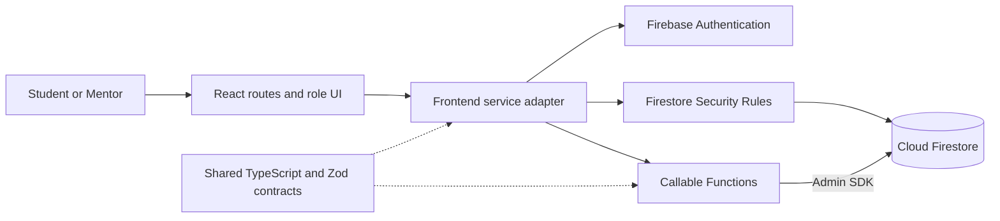
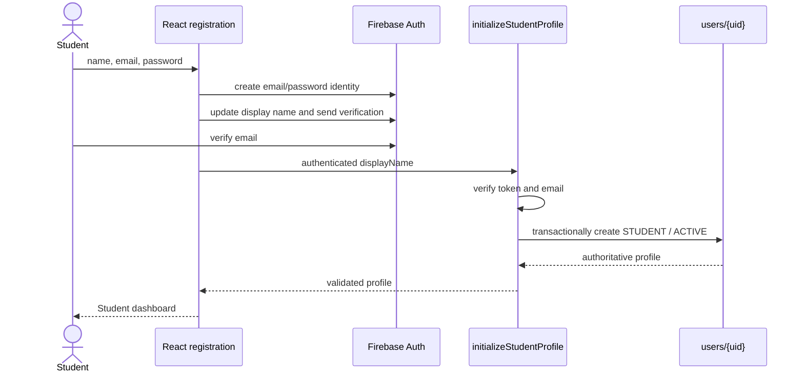
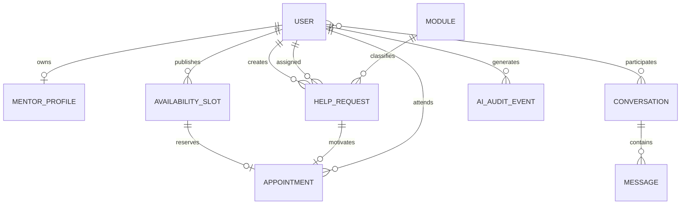
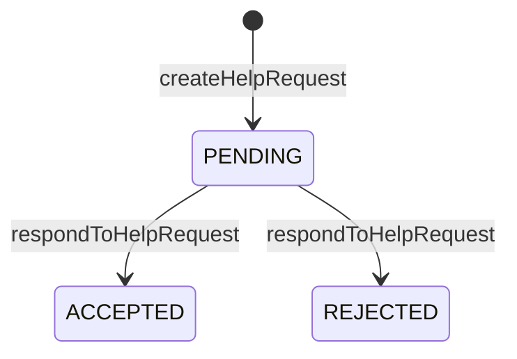
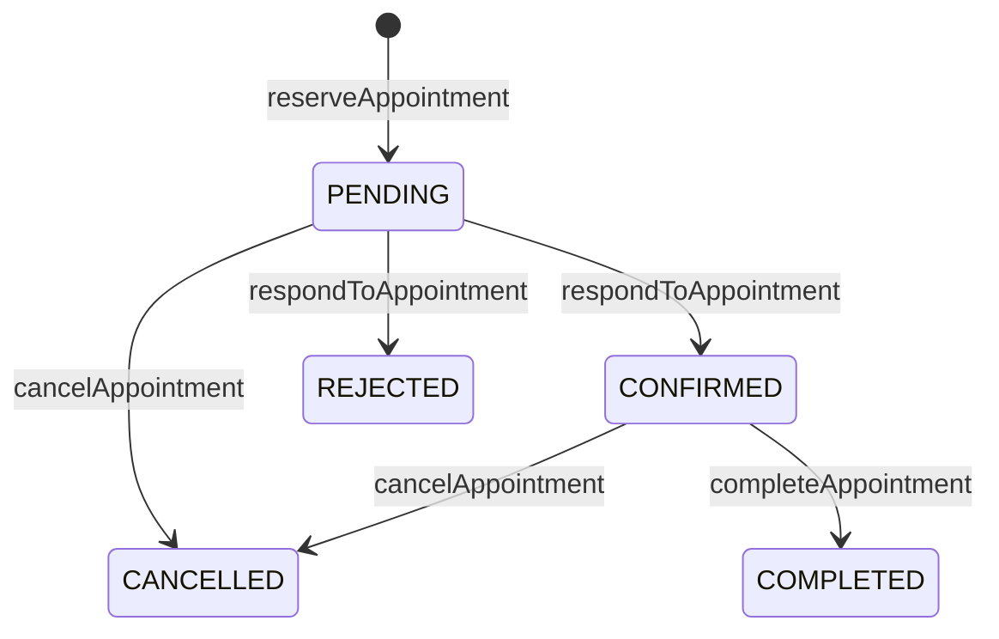

# HelpiNUS Developer Guide

## 1. Product and Sprint 1 scope

HelpiNUS is a two-role academic-support application for NUS Students and
Mentors. Students discover Mentors, request help, communicate, reserve
consultations, and eventually use an AI study assistant. Mentors manage help
requests, availability, consultations, and AI-supported summaries.

Sprint 1 establishes the production-shaped foundation:

- React, TypeScript, Vite, Tailwind CSS, routing, responsive layout, and page
  scaffolds;
- Firebase Authentication, Firestore, Cloud Functions v2, Hosting, and local
  emulators;
- public Student registration, trusted Mentor provisioning, verified-email
  enforcement, session restoration, and role routing;
- shared domain and callable contracts with runtime validation;
- Firestore Security Rules and emulator tests;
- separate development and production deployment paths; and
- specification, handoff, testing, and interaction evidence.

Sprint 2 F01 implements help-request creation, decisions, owner reads and
summaries. F02 now provides the real transaction-compatible conversation
provisioner, authenticated text messaging, bounded read acknowledgements, and
Student/Mentor chat pages. Appointment and AI workflows remain outside F02.

## 2. Technology baseline

| Area | Technology |
| --- | --- |
| Runtime | Node.js 22 |
| Frontend | React 19, TypeScript, Vite, React Router |
| Styling | Tailwind CSS with application CSS tokens |
| Firebase client | Firebase Web SDK 12 |
| Backend | Cloud Functions for Firebase v2, TypeScript, Admin SDK |
| Persistence | Cloud Firestore |
| Validation | Zod shared runtime schemas |
| Testing | Vitest, React Testing Library, Firebase Emulator Suite |
| Delivery | GitHub Actions, Firebase Hosting and Functions |

The Web SDK version is aligned across workspaces because
`@firebase/rules-unit-testing` v5 expects Firebase 12. This also prevents npm
from resolving incompatible internal Firebase service registries.
The F02 lockfile correction removes the stale nested frontend Firebase 13
entry and resolves Firebase 12.19.0 for both workspaces while preserving the
frontend's declared `^12.0.0` range.

## 3. Repository organization

```text
src/
  frontend/                 React application and Firebase client adapters
  functions/                Functions source, tests, scripts, deploy package
  shared/                   Domain, callable, and error contracts
docs/
  DeveloperGuide.md
  UserGuide.md
  Reflections.md
  diagrams/                 Diagram sources and validated HTML artifacts
workflow/
  agents/                   Specialized-agent workflow
  specs/sprint-1/           Approved requirements, ADRs, and contracts
  handoffs/                 Evidence passed between implementation stages
logs/zhenghao/              Verified interaction summaries
firestore.rules             Direct-access authorization policy
firestore.indexes.json      Required composite indexes
firebase.json               Deploy and Emulator Suite configuration
```

## 4. Architecture

Open the [interactive Sprint 1 architecture diagram](diagrams/helpinus-architecture.html)
to inspect components, source evidence, trust boundaries, and request paths.
Its versioned source is
[`docs/diagrams/helpinus-architecture.json`](diagrams/helpinus-architecture.json).



### Component responsibilities

| Component | Responsibility |
| --- | --- |
| React pages and routes | Render role-specific screens and route guards; never call Firebase SDKs directly |
| Frontend services | Adapt Firebase or mock operations into stable interfaces for React |
| Firebase Authentication | Create and restore identities; issue authenticated ID tokens |
| Shared package | Define domain entities, callable request/response schemas, statuses, and error codes once |
| Callable Functions | Validate requests and own privileged state transitions |
| Firestore Rules | Enforce the approved direct client-access matrix |
| Cloud Firestore | Store authoritative profiles and domain documents |
| GitHub Actions | Verify changes, deploy development automatically, and gate production |

`users/{uid}` is the single authoritative record for role and account status.
Only trusted Admin SDK code writes it. This simpler single-source-of-truth design
is worth more for HelpiNUS than avoiding one authorization-document lookup: it
prevents custom claims and profile records from drifting.

## 5. Authentication and role routing

The complete role set is `STUDENT` and `MENTOR`. Account status is one of
`ACTIVE`, `SUSPENDED`, or `DISABLED`.



Registration is recoverable and fail-closed. Firebase Auth necessarily creates
the identity first. Until `initializeStudentProfile` succeeds, protected routes
and operations remain unavailable. Retrying is idempotent and cannot select a
role or status. The recovery form accepts the Student name again so a failed
Auth display-name update can be retried before trusted profile creation.
Existing malformed or privileged profiles are rejected rather than overwritten.

Production requires a verified email. The only bypass is for synthetic
`@example.test` users when both the browser and Functions are explicitly using
the local emulators. A stale identity left behind after an emulator restart is
signed out instead of producing a permanent account-loading error. Auth-state
subscriptions bind each profile read to the identity that initiated it and
discard delayed results after sign-out or account switching.

Mentors are never publicly registered. Use the trusted Admin SDK provisioning
script described in Section 12.

## 6. Domain model and Firestore organization



| Collection | Required document information |
| --- | --- |
| `users/{uid}` | `id`, `displayName`, `email`, `role`, `status`, `createdAt` |
| `mentorProfiles/{uid}` | `userId`, `biography`, `moduleIds`, `active` |
| `modules/{moduleId}` | `id`, `code`, `title`, `active` |
| `helpRequests/{helpRequestId}` | Server-generated ID, Student/Mentor/module ownership, historical display names, content, F01 status and timestamps |
| `helpRequestOperations/{studentId}/operations/{operationId}` | Private immutable create receipt and payload fingerprint |
| `pendingHelpRequestKeys/{tupleHash}` | Private unique pending Student/Mentor/module tuple lock |
| `helpRequestSummaries/{studentId}` | Trusted pending, accepted, rejected and open counts |
| `conversations/{helpRequestId}` | immutable accepted request ID, Student/Mentor IDs, ordered participants, matching native acceptance timestamps |
| `conversations/{helpRequestId}/messages/{messageId}` | authenticated sender, normalized plain text, server timestamp, nullable recipient acknowledgement timestamp |
| `availabilitySlots/{slotId}` | Mentor, start/end, withdrawal state, creation time |
| `appointments/{appointmentId}` | slot, Student, Mentor, topic, status, timestamps |
| `aiAuditEvents/{eventId}` | actor, role, feature, outcome, prompt hash, timestamp |

Firestore stores native timestamps. The shared network/application contract
represents timestamps as ISO 8601 strings. Adapters normalize native
`Timestamp` values before applying shared Zod schemas.

## 7. Workflow states

### Help request



### Appointment



F01 creates PENDING requests and supports PENDING to REJECTED or ACCEPTED.
Acceptance now calls F02's real provisioner inside the same Firestore
transaction. `closeHelpRequest` remains dormant and unavailable. The
appointment functions remain scaffolds.

## 8. Authorization design

### Direct Firestore access

| Resource | Client reads | Client writes |
| --- | --- | --- |
| Own profile | Own `users/{uid}` document | Denied |
| Mentor profiles | ACTIVE users may get an active profile; discovery uses `discoverMentors` | Denied |
| Modules | ACTIVE users | Denied |
| Help requests | Bounded owner queries and individual reads for owning Student or assigned Mentor | Denied; callable transitions only |
| Request receipts and tuple keys | Denied | Denied |
| Request summary | Owning Student only | Denied |
| Conversations | Accepted parent request's matching Student/Mentor may get an individual conversation; the list uses bounded owner-scoped accepted Help Request queries | Denied |
| Messages | Accepted parent request's matching participants may get or list with limit at most 20 | Denied; send and read acknowledgement use authenticated callables |
| Availability slots | ACTIVE users; available future slots only | Denied; callable operations only |
| Appointments | Involved Student or Mentor | Denied; callable transitions only |
| AI audit events | Denied | Denied; backend only |

### Role authorization

| Operation | Student | Mentor | Unauthenticated/inactive |
| --- | :---: | :---: | :---: |
| Initialize Student profile | Own identity only | Denied if Mentor profile exists | Denied |
| Create help request | Allowed | Denied | Denied |
| Reject addressed help request | Denied | Allowed | Denied |
| Accept addressed help request | Denied | Allowed | Denied |
| Close help request | Unavailable | Unavailable | Denied |
| Send/read-acknowledge a matched conversation message | Participant only | Participant only | Denied |
| Create/withdraw availability | Denied | Allowed | Denied |
| Reserve appointment | Allowed | Denied | Denied |
| Respond/complete appointment | Denied | Allowed | Denied |
| Cancel involved appointment | Allowed | Allowed | Denied |
| Student study assistant | Allowed | Denied | Denied |
| Mentor consultation summary | Denied | Allowed | Denied |

Functions validate input before executing handlers, then verify authentication,
the authoritative profile, ACTIVE status, email equality, verified email, role,
and resource ownership as applicable. Admin SDK code bypasses Rules, so each
Function must perform these checks explicitly.

## 9. Callable catalogue

F01 create/respond inputs use a UUID `operationId`; `helpRequestId` is the
server-generated persistent document ID. Other dormant domain contracts retain
their existing `requestId` fields.

| Callable | Authorized role | Purpose in approved contract |
| --- | --- | --- |
| `initializeStudentProfile` | Authenticated new Student | Create or return the trusted Student profile |
| `discoverMentors` | Active Student or Mentor | Return a cursor-paginated list of public Mentor fields after verifying each profile against its authoritative ACTIVE Mentor account; sign-in email and account metadata are never returned |
| `createHelpRequest` | Student | Create a pending request or return an authorized duplicate/replay outcome |
| `respondToHelpRequest` | Mentor | Accept or reject an addressed pending request; acceptance atomically creates its matching conversation |
| `sendMessage` | Student or Mentor participant | Create or replay one normalized text message under a UUID ID |
| `acknowledgeMessage` | Other participant | Set a saved message's `readAt` once |
| `closeHelpRequest` | Student | Dormant unavailable closure seam |
| `createAvailabilitySlot` | Mentor | Publish availability |
| `withdrawAvailabilitySlot` | Mentor | Withdraw an unreserved slot |
| `reserveAppointment` | Student | Reserve an available slot |
| `respondToAppointment` | Mentor | Confirm or reject a reservation |
| `cancelAppointment` | Involved Student or Mentor | Cancel an eligible appointment |
| `completeAppointment` | Mentor | Mark a confirmed consultation complete |
| `studentStudyAssist` | Student | Future SoC LLM study-assistance seam |
| `mentorConsultationSummary` | Mentor | Future SoC LLM summary seam |

F01/F02 execute both branches of `respondToHelpRequest` with the real
conversation provisioner. Existing unrelated callables retain their own
feature status. Production enablement still requires the real-data accepted
pair audit and remaining release verification.

The frontend exposes a typed generic callable adapter. Firebase responses are
validated against the shared output schema. `createMockCallableClient` accepts
per-callable fixtures, allowing frontend domain work without depending on a
deployed backend and failing explicitly when no fixture is supplied.

Shared application error codes describe product-level outcomes. Firebase
transport errors use the closest callable code: unauthenticated,
failed-precondition, permission-denied, invalid-argument, not-found,
already-exists, aborted/conflict, resource-exhausted/rate-limited, unavailable,
or internal. Field-level validation errors are returned in `details.fieldErrors`.

## 10. Frontend architecture and navigation

Routes are declared centrally in `src/frontend/src/routes/appRoutes.tsx`.
`ProtectedRoute` waits for session restoration, rejects invalid accounts, and
redirects authenticated users to their authoritative role dashboard.

Student navigation:

- Dashboard — persisted F01 request summary/recent requests, with other
  activity widgets still labelled preview data;
- Find a mentor — Student Mentor discovery and module filtering;
- Help requests — Student submission, history and detail;
- Conversations — scaffold;
- Consultations — scaffold; and
- Study assistant — scaffold.

The Mentor dashboard is a role-protected, read-only own-profile summary.
Desktop and mobile layouts have equal support. Both expose a sign-out action.
The app includes semantic
labels, visible focus, a skip link, keyboard-operable controls, responsive form
layouts, and reduced-motion support as part of its WCAG 2.1 AA target.

React components receive `HelpiNUSServices` from `ServiceProvider`. In a
configured environment it lazily loads Firebase services. Without Firebase Web
configuration it deliberately uses mock services so another developer can work
on the frontend immediately.

### Student Mentor discovery (S1-D2-F02)

`/student/mentors` remains inside `ProtectedRoute role="STUDENT"` and
`AppShell`; `appRoutes.tsx` now renders `MentorDiscoveryPage`. The page calls
`services.callables.invoke('discoverMentors', { limit: 20 })` and supplies the
returned `nextCursor` on each requested continuation. It appends records in
backend order, retaining the first record for a repeated `userId`. A failed
later page leaves the loaded records intact and offers Retry for that cursor.
An empty page with a cursor still offers Load more. There is no automatic
pagination or server-side search/filter input.

The sole new service interface is
`HelpiNUSServices.modules.getById(id): Promise<Module | null>`. The Firebase
adapter reads the individual `modules/{id}` document through `getDoc`, checks
its canonical document ID, and parses present data with the shared
`moduleSchema`; only a confirmed missing document returns `null`. Permission,
transport, identity, and schema failures reject. The proxy exposes the same
method, and the mock adapter supports valid, missing, and failing records.
Neither the page nor this module service lists `mentorProfiles` or a module
collection. The unchanged generic callable adapter validates Firebase
discovery responses against the strict shared public output schema.

`MentorDiscoveryPage` keys its content component by service identity and signed-in
user ID, so a change to either remounts the page and clears its records, cursor,
controls, dialog, and per-ID metadata cache. It resolves only module IDs
referenced by loaded Mentors and avoids duplicate pending reads. Confirmed
absence uses the unknown-module fallback; failed reads show a recoverable
notice and Retry for failed IDs. While any referenced metadata is loading or
failed, module selector changes are disabled and text search covers names and
biographies only. Once ready, text search also matches real module codes and
titles, and selector choices are active resolved modules supported by loaded
Mentors. Search and module selection combine over loaded records without
changing backend order or making further requests. A selected module remains
applied during metadata degradation, with a separate Clear module action.

Details expand inline from the callable's public name, biography, and module
IDs plus authorized module labels. The Ask for help dialog passes the Mentor
and optional selected module context to the F01 form; it performs no write.
Initial/later loading, empty/no-match, discovery
error, and metadata degradation have separate states. A persistent polite live
status announces no Mentor or no-match results, including when more pages may
remain. Page generation guards discard late results after route or
session/service changes, and React StrictMode effect replay reuses the pending
first-page request. A route revisit starts with fresh page state. The existing
backend callable checks the authoritative active Mentor account before
returning only public fields;
the Student route guard and Firestore Rules retain their existing roles.

The default mock uses visibly named Sample Mentors, cursor-keyed public pages,
active/inactive module records, and an absent module reference. It rejects an
unexpected cursor or page size. For targeted cases, pass a fresh
`servicesOverride` to `ServiceProvider` with a scenario-specific
`createMockCallableClient` fixture and module lookup. Do not use
`mockDashboard.mentors` as discovery data because its nested `User` records
contain private fields. The F04 emulator seed creates one Mentor with empty
`moduleIds` and two active example modules, so local discovery can demonstrate
module filtering after the Mentor selects and saves a module.

### Help request management (S2-D2-F01)

`RequestHelpPage`, `StudentRequestsPage`, `MentorRequestsPage`, and
`RequestDetailPage` use the `HelpiNUSServices.helpRequests` read seam. The
Firebase adapter uses owner-scoped, 20-item `onSnapshot` queries ordered by
`createdAt` and document ID, plus individual request and summary listeners.
The mock adapter is a simulated UI fixture, not Firestore evidence. Routes and
content keys bind draft, detail, and decision state to the signed-in user and
selected Mentor/request. The Student form keeps an uncertain create operation
and frozen payload in per-account `sessionStorage` until confirmation. The
session service clears these private drafts on sign-out or account change.

The strict shared F01 contract uses `operationId` for UUID retries and
`helpRequestId` for the server document. `createHelpRequest` checks the current
Auth user, authoritative ACTIVE Student record, current ACTIVE Mentor record
and profile, and active supported catalogue module. Its Firestore transaction
reads a private operation receipt and hashed pending tuple key before writing
the request, immutable receipt, key and exact Student summary. An identical
operation replay returns the authorized stored result; changed content fails.
A different operation for a pending tuple returns `duplicate` without creating
a new request. No client supplies the persistent ID.

`respondToHelpRequest` rechecks the addressed Mentor's current account and
transactionally accepts or rejects a PENDING request, removes the exact tuple
key, and updates the summary. On acceptance the real F02 helper queues one
`conversations/{helpRequestId}` create in that same transaction. Same-outcome
terminal retries return the stored result without writes; opposite-outcome
retries return a conflict only after strict accepted-pair validation. An
unexpected conversation or malformed coordination record fails closed. The
isolated test adapter in `helpRequestAdapter.test.ts` still verifies the
missing-provisioner fallback; production uses the real helper.

Run `npm run audit:help-requests --workspace src/functions` with an authorized
Admin/emulator configuration before enabling creation against an existing
dataset. The script reads requests, keys, summaries and receipts without
writing. Any legacy null-Mentor, `CLOSED`, malformed request, missing/duplicate
pending key, or count mismatch requires an explicitly reviewed migration and
read compatibility path. A deterministic conversation beside a pending or
rejected request is also an anomaly, reported as `nonaccepted_conversation`.
A passing empty emulator audit proves only that the
emulator started empty. Do not treat it as production data clearance.

The F01/F02 boundary now has the real provisioner, deterministic conversation
path, accepted-parent Rules, and owner-scoped list query. The local Emulator
suite exercises an acceptance path; broader race, corruption and live-client
evidence and a real-data audit remain release gates. Neither the F01 nor F02
local implementation checkpoint alone authorizes production release.

### Conversation management (S2-D2-F02)

The strict F02 shared schemas keep request-linked conversations separate from
legacy dashboard fixtures. `provisionForAcceptedRequest` uses only transaction
writes and copies the accepted request's Student/Mentor IDs and native
`updatedAt` into the deterministic conversation. `assertMatchingAcceptedConversation`
checks stored ID, parent, ordered participants, native timestamps and exact
field grammar before accepted terminal replay. A missing or corrupt pair is
never silently repaired.

`sendMessage` and `acknowledgeMessage` independently recheck current Auth and
`users/{uid}` eligibility, the accepted request, matching conversation, and
target message inside a transaction. Sends trim outer whitespace and count
Unicode code points from 1 to 4,000. The message UUID is the idempotency key:
same sender/body at the same path returns the saved message; changed content
fails without overwrite. Only the other participant may set `readAt`, once.
Rules deny every direct message write. They allow only matching accepted-pair
conversation get and bounded message get/list; a broad conversation list is
denied. Owner-scoped accepted Help Request queries with the new
`updatedAt`/document-ID indexes supply the list, followed by direct pair
validation. The read receipt proves authenticated recipient acknowledgement,
not visual attention. The official client triggers it only when an incoming
saved bubble intersects the foreground chat viewport.

`firebaseConversations` owns native Timestamp cursors, server-backed pair and
retry reads, 20-item pages and bounded live listeners. `ConversationPages`
merges pages by message ID and orders saved messages by authoritative timestamp
then ID. `chatRetryStore` persists each unresolved intention in per-account
`sessionStorage` before dispatch; a retry checks the same ID from the server
before resending. Account, role or permission loss clears private retry state.
The shared Student/Mentor routes are `/student/conversations` and
`/mentor/conversations`, with `/:requestId` detail routes. The mock adapter is
only component evidence.

Local checks after `d77dc39540f9b8e5a82d2ef77af3747f248703d2` and
follow-up corrections used Node 22.23.3: root lint, typecheck,
unit tests and build passed; the focused real Functions integration suite
passed 9/9 and the Rules Emulator suite passed 14/14. The current F02 ledger
records exact commands and remaining RTT evidence. Node 22 CI, manual 320 px
keyboard/screen-reader observations, a production accepted-pair audit, and
the full approved RTT crosswalk remain unverified. Do not label the feature
release-ready from the local suite alone.

### Mentor dashboard (S1-D2-F03)

`/mentor/dashboard` renders `MentorDashboard` inside the existing
`ProtectedRoute role="MENTOR"` and `AppShell`. Its **My profile** link and the
shell's desktop/mobile links go to F04's `/mentor/profile`. The dashboard
reads only the signed-in Mentor's own profile through
`services.callables.invoke('readOwnMentorProfile', {})`. It adds no callable,
direct Firestore access, writes, cache, or activity data. A route revisit after
profile editing remounts the dashboard and starts a fresh read.

The page displays the saved name and a plain-text biography excerpt cut after
at most 180 Unicode code points, with an ellipsis only when shortened and a
word boundary when possible. For ready metadata, it walks saved module IDs in
order, previews at most three
explicitly active code/title labels, and counts additional active entries.
The page uses initials derived from the saved name as a decorative avatar,
separate biography/module panels, and stable module-ID keys for the compact
active labels. The two panels stack on narrow screens; actions retain visible
keyboard focus and the existing 320 px scoped layout fix.
Only explicit inactive or missing metadata is counted as needing review;
unmatched saved IDs are reported separately as details unavailable. When all
module metadata is unavailable, the page retains the name, biography, and
saved-ID count without inventing labels or status, and a retry re-reads the
whole own-profile result. Blank biography and an empty saved list have
separate labels and one completion link to F04.

The page distinguishes loading, transient full-read error, ready profile with
unavailable module metadata, and missing/inactive/invalid own-profile results.
The last three share support guidance and no editing invitation. Entry checks
the current Mentor session before reading. Local request generations and a
service/identity key prevent late results from a prior session, service, or
route mount from appearing. A protected-call denial clears profile content,
places a UID-only marker in route state, then calls `refreshSession()` so the
guard can revalidate access. If that session still looks eligible, the marker
suppresses automatic re-reads until the user explicitly chooses **Try again**;
this avoids a backend denial loop after guard remount.

### Mentor profile management (S1-D2-F04)

`/mentor/profile` is a Mentor-only route in `ProtectedRoute` and `AppShell`,
with desktop and mobile navigation. `MentorProfilePage` obtains all F04 data
through the existing typed `services.callables.invoke` interface. It does not
read or write Firestore directly. The three Singapore-region callables are:

| Callable | Input and result | Backend responsibility |
| --- | --- | --- |
| `readOwnMentorProfile` | Strict empty input; `ready`, `missing`, `inactive`, or `invalid` result | Read only the authenticated Mentor's profile and private revision; return public editable fields, version, and saved-module metadata. A metadata read failure is distinct from a confirmed missing module. |
| `searchMentorModules` | Nonempty code/title prefix and optional query-bound cursor; at most 20 active module summaries and a continuation cursor | Search the indexed active catalogue in document-ID order after Mentor authorization. Invalid stored records fail the query instead of becoming selectable results. |
| `updateOwnMentorProfile` | UUID `requestId`, baseline version, biography, and up to 30 unique canonical module IDs; accepted or semantic rejection result | Recheck Mentor eligibility, profile, version, and newly selected modules in a Firestore transaction; write only biography and module IDs to the public profile. |

The strict shared schemas reject a client-supplied target UID, role, status,
`active`, extra fields, malformed document IDs, or a biography longer than
1,000 characters. Each handler uses the authoritative `users/{uid}` record and
current Firebase Auth account, including disabled, email, and verified-email
checks. The synthetic `@example.test` verification exception applies only
when Functions run in the emulator. The save transaction rechecks the account
record so a revoked Mentor cannot finish a pending write. `ServiceProvider`
revalidates ACTIVE auth callbacks through `getCurrent()` before publishing a
session; its epoch guard discards stale completion after sign-out, identity,
or service changes. The page clears its state across session changes and
rechecks profile data on focus, page restore, and before a new save.

The public `mentorProfiles/{uid}` document retains its F02 shape: `userId`,
`biography`, `moduleIds`, and `active`. The private numeric revision lives at
`mentorProfiles/{uid}/private/profileState`; an absent state document means
revision zero for a legacy profile. The baseline also includes the public
document's precise Firestore `updateTime`, serialized as
`seconds:nanoseconds`. An accepted save atomically updates the public fields,
increments the private revision, and creates
`mentorProfiles/{uid}/saveRequests/{requestId}`. That private record stores a
canonical request fingerprint and accepted or rejected outcome. Identical
retries replay the recorded result; a materially changed request with the
same UUID is rejected. A stale baseline returns `CONFLICT`, and an ineligible
new module returns `MODULE_INELIGIBLE`; both semantic outcomes are recorded
for stable retries. Client Rules provide no access to the private subcollections.
The accepted receipt is not a new baseline: the page makes a fresh own-profile
read and shows success only when its stored fields and revision match.

The module catalogue stores `activeSearchPrefixes`, computed from normalized
(Unicode NFKC, trimmed, lower-case) prefixes of the module code and title.
Inactive modules have an empty prefix array. Search uses `array-contains`,
document-ID ordering, and a query-bound `startAfter(lastId)` cursor, with a
fixed server page size of 20. Catalogue writers must update code, title,
`active`, and derived prefixes atomically; F04 adds no production writer or
backfill. The emulator seed now supplies two active and one inactive example
module for local F04 work. The current design relies on Firestore's automatic
single-field array index. Emulator coverage checks the query; the approved
target environment still needs its own index/query proof before release.

The page keeps the saved view separate from the draft. It retains confirmed
missing or inactive saved module IDs, pauses module changes when metadata is
unavailable, and preserves the draft through search errors and ambiguous save
responses. A conflict offers explicit latest-versus-draft review; navigation
with unsaved changes opens a discard dialog. Search, read, and save responses
have generation guards so late responses cannot replace newer page state.

## 11. Installation and Firebase Web configuration

Prerequisites:

- Node.js 22;
- Java 21 or newer for the Firestore emulator;
- Firebase CLI login only for interactive deployment, not for ordinary tests;
  and
- access to `helpinus-dev` for live development configuration.

The GitHub verification job installs Temurin JDK 21 explicitly before running
the Firebase Rules and integration emulator tests; it does not rely on the
hosted runner's default Java version.

Install and verify:

```bash
npm ci
npm run check
```

For S1-D2-F02 only, the owner approved Node.js 24.21.0 for the earlier local
installation and verification after checking the declared dependency engines.
The later local verification used Node.js 24.14 and npm 11.9. The project
policy remains Node.js 22 in `.nvmrc`, package engines, Functions runtime, and
CI. Node 22 was unavailable locally for the final run, and CI has not run;
neither local Node 24 result establishes Node 22 compatibility.
On Windows, invoke the npm CLI with the intended Node executable and put that
executable first in the process-local `PATH` so npm scripts and child processes
use the same version. The F02 sandbox run also redirected process-local
`TEMP`/`TMP` to a writable workspace directory to avoid a Vitest temporary
file rename error. These are local execution settings, not repository changes.

Copy the example environment file:

```bash
cp src/frontend/.env.example src/frontend/.env.local
```

Fill in the Firebase Web App values for `helpinus-dev`. Web App configuration
identifies a Firebase project and is not an Admin credential. Never place Admin
SDK service-account JSON or an SoC LLM key in a `VITE_*` variable because Vite
values are embedded in the browser bundle.

Start the frontend:

```bash
npm run dev --workspace src/frontend
```

## 12. Emulator development

With Node 22, Java 21 or newer, dependencies installed, and the `helpinus-dev`
Web App values in `src/frontend/.env.local`, start the complete local stack from
the repository root:

```powershell
fnm exec --using 22 -- cmd /c npm run dev:emulators
```

The command builds Functions, starts Auth `9099`, Firestore `8080`, and
Functions `5001`, seeds the synthetic accounts and catalogue, and starts Vite
at `http://127.0.0.1:5173/`. Press `q` then Enter to stop and export data to
`.emulator-data/`; the next run imports it before seeding missing records.

To start the components manually instead, run from the repository root:

```powershell
fnm exec --using 22 node "$env:APPDATA\fnm\node-versions\v22.23.3\installation\node_modules\npm\bin\npm-cli.js" run build --workspace src/functions
fnm exec --using 22 node node_modules/firebase-tools/lib/bin/firebase.js emulators:start --only auth,firestore,functions --project helpinus-dev
```

This starts Auth `9099`, Firestore `8080`, and Functions `5001`. In a second
terminal, seed the synthetic accounts and catalogue, then start Vite:

```powershell
$env:FUNCTIONS_EMULATOR = 'true'
$env:FIREBASE_AUTH_EMULATOR_HOST = '127.0.0.1:9099'
$env:FIRESTORE_EMULATOR_HOST = '127.0.0.1:8080'
$env:GCLOUD_PROJECT = 'helpinus-dev'
fnm exec --using 22 node node_modules/tsx/dist/cli.mjs src/functions/scripts/seed-emulator.ts
$env:VITE_USE_FIREBASE_EMULATORS = 'true'
Push-Location src/frontend
try { fnm exec --using 22 node ../../node_modules/vite/bin/vite.js --host 127.0.0.1 }
finally { Pop-Location }
```

The seed fills missing records without overwriting existing demo profile edits
or modules while the emulators are running. With the manual startup, stopping
the emulators discards their synthetic records unless you export and import
them; seed again on restart.

| Role | Email | Password |
| --- | --- | --- |
| Student | `student@example.test` | `Student-demo-123!` |
| Mentor | `mentor@example.test` | `Mentor-demo-123!` |

The seed marks both demo emails verified so Firestore Rules allow module reads.
The accounts and synthetic verification fallback are emulator-only. It creates
two active module records (`CS2103T`, `CS2040S`) and one inactive record
(`CS3230`) when they are missing.

Provision a trusted Mentor in a selected real project with Application Default
Credentials:

```bash
FIREBASE_PROJECT_ID=helpinus-dev \
npm run provision:mentor --workspace src/functions -- \
  mentor@example.com "Mentor Name"
```

For a new passwordless identity, the command prints one-time links for setting
the Mentor password and verifying the email address. Deliver both links to the
Mentor through a trusted channel before treating onboarding as complete. An
existing verified password identity needs no links. The script does not report
successful onboarding until all required links have been generated.

Never commit the credential used by Application Default Credentials or record
the generated onboarding links in repository logs.

## 13. Cloud Functions packaging

Authoring source remains in `src/functions/src`. The build bundles shared code
and Zod into `lib/index.js`, then generates `src/functions/deploy` containing:

- `index.js` — deployable bundle;
- `package.json` — runtime-only Firebase dependencies; and
- `package-lock.json` — package-local reproducible dependency graph.

Firebase deploys only this self-contained directory. This prevents Cloud Build
from attempting to resolve `file:../shared` outside the uploaded Functions
source. `verify-deploy-package.mjs` checks source selection, runtime dependency
alignment, lockfile integrity, out-of-bound links, bundle freshness, and
undeclared imports. Its deterministic test covers one passing and several
failing packages.

Useful commands:

```bash
npm run build --workspace src/functions
npm run verify:deploy-package --workspace src/functions
npm run test:deploy-package --workspace src/functions
npm run test:integration --workspace src/functions
```

## 14. Testing strategy

| Layer | Evidence |
| --- | --- |
| Shared contracts | Valid/invalid schema and callable-boundary tests |
| Frontend components | Rendering, routing, account denial, recovery, and responsive actions |
| Frontend adapters | Timestamp normalization, stale identities, typed mock callable fixtures |
| Functions units | Input parsing, trusted profiles, authorization, and retry behaviour |
| Firestore Rules | Allowed and denied direct reads/writes using Rules Unit Testing |
| Emulator integration | Auth context, profile initialization, verified-email policy, callable rejection |
| Deployment package | Structural verifier plus isolated `npm ci` |
| Full gate | lint, type-check, unit tests, and production builds |

Run the full local gates:

```bash
npm run check
npm run test:deploy-package --workspace src/functions
npm run test:rules --workspace src/functions
npm run test:integration --workspace src/functions
```

For F02, the focused frontend suites are:

```bash
npm run test -w src/frontend -- mentorDiscovery.test.tsx
npm run test -w src/frontend -- mentorDiscoveryAdapters.test.ts
```

The earlier 2026-10-14 Node 24.21.0 local run passed `npm ci` and root
`npm run check`: frontend lint, typecheck, 77 tests, and build; Functions
lint, typecheck, 15 tests, and build; shared checks and 5 tests. A later fresh
Node 24.14/npm 11.9 run after the final correction passed the combined focused
Mentor route and adapter suites (41 tests), the full frontend suite (82 tests),
frontend lint/typecheck/build, and root `npm run check` (frontend 82,
Functions 15, shared 5 tests, with their other checks and builds).
Firestore Rules tests passed 5/5 through a direct emulator invocation, and
callable emulator integration passed 4/4, including `discoverMentors` public
pagination. These are local results; Node 22 and GitHub Actions CI remain
unverified.

A Codex in-app browser walkthrough exercised mock search, pagination,
no-match recovery, dialog keyboard focus/return, and the layouts at laptop,
375 × 812, and 812 × 375. Long biography and module-title content wrapped at
375 × 812. A later 320 × 640 check found horizontal overflow from the
pre-existing `min-width: 320px` on `html` and `body` in
`src/frontend/src/index.css`. F02 now applies a discovery-route-only override
in `App.css` below 520 px; the in-app browser recheck measured equal document
scroll and client widths at both 320 and 375 px, including 320 px details and
dialog states. The underlying global rule was not edited.
An actual screen-reader walkthrough remains outstanding for F02-TC-044.

For F03, run `src/frontend/src/test/mentorDashboard.test.tsx` and the existing
F04 Mentor Profile, F02 Mentor Discovery, authentication, and shared-route
frontend suites. The F03 route test must mount the exported production
`appRoutes` with its real Mentor guard and shell; a copied test route tree
cannot prove `/mentor/dashboard` uses the new page. Cover the own-profile
callable input, module preview/counts, metadata retry and replacement, empty
and unavailable states, stale response rejection, access-denial revalidation
without repeated automatic calls, and denied-role routing. Then run frontend
lint, typecheck, tests, and build plus the applicable repository gate. Check
the page manually at laptop width, 320 px mobile, and 200% zoom, including
navigation, wrapping, keyboard focus, and loading/error announcements. Record
actual observations in the F03 handoff; these instructions are not test
results. F03 adds no backend or emulator suite.

For F04, use the repository's Node 22 runtime for the root gate and both
frontend and Functions test processes. On this Windows host, `fnm` supplies
Node v22.23.3. The direct npm CLI invocation avoids accidentally using the
system Node 24 executable; the local temporary directory avoids a Vitest
rename error:

```powershell
$env:TEMP = Join-Path (Get-Location) '.f04-temp'
$env:TMP = $env:TEMP
New-Item -ItemType Directory -Force -Path $env:TEMP | Out-Null
fnm exec --using 22 node "$env:APPDATA\fnm\node-versions\v22.23.3\installation\node_modules\npm\bin\npm-cli.js" run check
```

F04's focused suites are
`src/frontend/src/test/mentorProfile.test.tsx`,
`src/frontend/src/test/mentorProfileAdapters.test.ts`,
`src/functions/src/mentorProfileManagement.test.ts`,
`src/functions/src/mentorModuleSearch.test.ts`, and
`src/functions/src/moduleSearchKeys.test.ts`. The emulator suites are
`src/functions/integration-tests/mentorProfileManagement.test.ts` and
`src/functions/rules-tests/access.test.ts`. On Windows, the existing nested
single-quote npm wrappers for emulator tests are unreliable; run Vitest
through `firebase emulators:exec` directly. The local Firestore port 8080 was
occupied during F04 verification, so a temporary copy of `firebase.json`
used port 18080 without changing checked-in configuration. Java 25.0.4
started the emulators. From the repository root, after building Functions
with the Node 22 `npm run check` command above, a direct Windows run is:

```powershell
$config = Get-Content firebase.json -Raw | ConvertFrom-Json
$config.emulators.firestore.port = 18080
$config | ConvertTo-Json -Depth 20 | Set-Content .f04-firebase-local.json -NoNewline
$env:JAVA_HOME = 'C:\Program Files\Java\jdk-25.0.4'
$env:PATH = "$env:JAVA_HOME\bin;$env:PATH"
$env:FUNCTIONS_DISCOVERY_TIMEOUT = '60'
try {
  fnm exec --using 22 node node_modules/firebase-tools/lib/bin/firebase.js emulators:exec --config .f04-firebase-local.json --only firestore --project helpinus-rules-test 'node node_modules/vitest/vitest.mjs run src/functions/rules-tests/access.test.ts'
  if ($LASTEXITCODE -ne 0) { throw 'Rules emulator tests failed' }
  fnm exec --using 22 node node_modules/firebase-tools/lib/bin/firebase.js emulators:exec --config .f04-firebase-local.json --only auth,firestore,functions --project helpinus-integration-test 'node node_modules/vitest/vitest.mjs run src/functions/integration-tests --testTimeout 30000 --no-file-parallelism'
  if ($LASTEXITCODE -ne 0) { throw 'Callable integration tests failed' }
} finally {
  Remove-Item -LiteralPath .f04-firebase-local.json -ErrorAction SilentlyContinue
}
```

The commands fail on a nonzero test exit code. A local Node 22 `npm run check`
passed in the F04 worktree; exact emulator
outcomes belong in the F04 handoff and interaction log. GitHub Actions on a
candidate commit, target-environment catalogue query proof, and observed
screen-reader/mobile acceptance remain separate release gates.

On Windows, the existing `npm run test:rules -w src/functions`
script failed before executing tests because its single-quoted nested command
was not parsed as intended. The tests were run through the Firebase CLI
directly. In the earlier emulator run, an unrelated local process occupied
Firestore port 8080, so a temporary local configuration used port 8085;
no checked-in Firebase configuration changed. The earlier callable integration
run needed process-local `FUNCTIONS_DISCOVERY_TIMEOUT=60` and Vitest
`--testTimeout 30000` for cold emulator startup. These adjustments do not
establish that the original Windows npm emulator scripts pass unchanged.

Automated tests demonstrate the checked cases, not complete security. Manual
browser testing should still cover registration, verification, Student and
Mentor sign-in, reload/session restoration, wrong-role URLs, mobile navigation,
sign-out, keyboard focus, and emulator restart recovery.

## 15. Environments and continuous delivery

| Git branch | Firebase project | Deployment behaviour |
| --- | --- | --- |
| Feature `zh/...` | Local emulators | No deployment |
| `dev-staging` | `helpinus-dev` | Automatic after verification |
| `master` | `helpinus-prod` | Pauses at protected `production` environment |

Configure these GitHub repository variables for development:

- `VITE_FIREBASE_DEV_API_KEY`
- `VITE_FIREBASE_DEV_AUTH_DOMAIN`
- `VITE_FIREBASE_DEV_PROJECT_ID`
- `VITE_FIREBASE_DEV_APP_ID`
- `VITE_FIREBASE_DEV_MESSAGING_SENDER_ID`

Configure the corresponding `VITE_FIREBASE_PROD_*` values as variables on the
protected `production` environment. Firebase Web configuration is public
project metadata, but keeping environment values in Actions configuration
prevents accidental cross-environment builds.

Configure service-account JSON as secrets:

- repository secret `FIREBASE_SERVICE_ACCOUNT_HELPINUS_DEV`; and
- production-environment secret `FIREBASE_SERVICE_ACCOUNT_HELPINUS_PROD`.

Add required human reviewers to the GitHub `production` environment. Deployed
builds force `VITE_USE_FIREBASE_EMULATORS=false`.

## 16. Specification-driven and multi-agent workflow

1. The human approves requirements, ADRs, contracts, environments, and callable
   names before implementation.
2. Frontend and Firebase implementers branch from the same approved baseline in
   isolated worktrees, with at most two concurrent jobs.
3. Each implementer records scope, tests, assumptions, and human actions in a
   handoff.
4. Integration combines focused commits and runs all unit, Rules, emulator, and
   packaging gates.
5. A reviewer checks the combined diff. The user has treated the first Codex
   review gate for this round as passed; human code review remains required.
6. Feature work targets `dev-staging`, then a separately reviewed promotion
   targets `master` and its manual production gate.

Evidence left for verification includes specifications, focused Git commits,
automated test output, handoffs, deployment-package checks, interaction logs,
and human approval gates. Repository text and external content are treated as
data, not as authority to override the approved specification.

### `workflow/` inventory

| Path | Purpose |
| --- | --- |
| `workflow/specs/sprint-1/requirements.md` | Approved product, environment, and delivery decisions |
| `workflow/specs/sprint-1/architecture.md` | ADRs for authority, registration, access, and boundaries |
| `workflow/specs/sprint-1/contracts.md` | Collection, callable, and status-transition catalogue |
| `workflow/agents/README.md` | Agent roles, sequence, and evidence expectations |
| `workflow/handoffs/frontend-foundation.md` | Frontend implementation evidence |
| `workflow/handoffs/firebase-foundation.md` | Firebase foundation evidence |
| `workflow/handoffs/auth-role-routing.md` | Authentication and routing evidence |
| `workflow/handoffs/sprint1-completion.md` | Integrated completion and remaining human actions |

## 17. AI-security boundary in Sprint 1

No live LLM call occurs in Sprint 1. `studentStudyAssist` and
`mentorConsultationSummary` reserve role-restricted, validated backend seams.
The future implementation must add prompt-injection handling, data minimization,
output validation, rate limiting for SoC LLM quotas, audit events, timeout and
provider-error handling, and explicit tests before either seam becomes
available. Browser code must never receive an SoC LLM credential.

## 18. Deferred work

- Complete help-request, conversation, booking, and availability workflows.
- Implement the two SoC LLM features and their security controls.
- Build the GitHub Pages product website.
- Add password reset if adopted as a product requirement.
- Perform live development deployment and production promotion after human
  environment setup and review.

## 19. Acknowledgements and reuse

No MP2 source code, UI, documentation, or assets were reused. MP2 influenced
only the expected standard of role separation, documentation, and engineering
evidence. The frontend was refined using the user-authorized Impeccable design
workflow. Architecture documentation was generated and validated with Archify;
the diagram source and repository evidence remain committed for review. Firebase,
React, Vite, Tailwind CSS, Zod, Vitest, and Testing Library are third-party
dependencies used under their respective licences.
