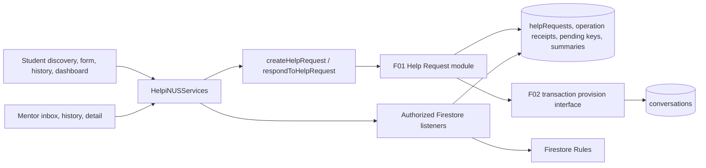
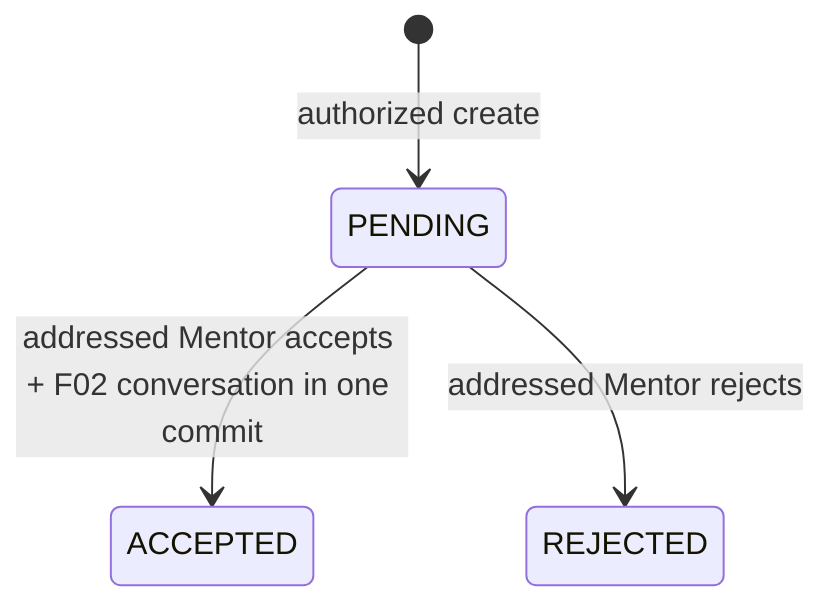

# Technical Design Document — S2-D2-F01 Help Request Management

**Status:** Approved  
**Date:** 2026-10-16  
**Owner / workstream:** Developer 2 / Sprint 2 F01  
**Approver / approval date:** Developer 2 / 2026-10-16  
**Approval reference:** Developer 2's “approve” reply in this TDD conversation, followed by explicit clarification that approval applies to the newer on-disk revision with pre-approval SHA-256 `343A0357DFE48A8348DC704DAEB75CF23E2B5C5FB2494F6FEEC0008E48290271`.  
**Approval scope at TDD approval:** Technical design only; the separate Requirements-to-Tests draft then remained unapproved. Later approvals and ownership authorization are recorded in §16; this TDD approval itself did not authorize implementation, branch, commit, push, PR, or F02 delivery.  
**Ownership authorization amendment:** On 2026-10-16 Developer 2 reported Developer 1's explicit approval for Developer 2 to make all necessary shared/Developer 1-owned edits within approved S2-D2-F01 and S2-D2-F02 scope. This replaces the per-file approval dependency in the earlier design; no direct Developer 1 message was inspected here.  
**Source PRD:** Approved 2026-10-16; [Mission Brief](../../mission-brief/S2-D2-F01-help-request-management.md), [Grilling Decisions](GrillingDecisions.md), [PRD](PRD.md)  
**Authorization:** The TDD is approved for the next planning gate. The Requirements-to-Tests draft requires its own review and approval before any later implementation authorization.  
**Code evidence:** `CS3227-2610-MP3-mentor-dashboard` at `770586a6f6f70ec6a6b82576184f848cca218183` (dirty; untracked Sprint 2 specs), plus worktree and workflow inspection on 2026-10-16. This is **not** an approved F01 implementation parent.

## 1. Technical overview and authority

F01 adds a private, selected-Mentor request workflow and three-state request lifecycle. Browser components use the existing `HelpiNUSServices` seam: callables for trusted creation/decision, Firestore listeners for participant reads. A backend Help Request module owns eligibility, normalized input, tuple uniqueness, idempotency, request transitions, and Student summary counts. F02 supplies a small transaction participant for conversation provisioning; F01 owns the decision transaction. No client writes a request or its private coordination records.

Authority is Mission Brief → GD-01–GD-18 → approved PRD → Sprint 2 F01/F02 specs → code evidence. This design covers the **actual approved PRD: FR-01–FR-12, NFR-01–NFR-07, AC-01–AC-45**. The task's “6 NFR / 44 AC” count predates the approved NFR-07/AC-45 visual amendment. No product behavior is changed here.



The F01 module's public backend interface is `create(actor, normalizedInput)` and `respond(actor, helpRequestId, response)`. It hides Firestore paths, transaction retries, receipts, keys, summary maintenance, and F02 write ordering. The only cross-feature seam is F02's real `provisionForAcceptedRequest(tx, request)` transaction participant. A mock implementation is useful for isolated tests but cannot satisfy release evidence. The frontend's existing generic `callables.invoke` needs no new callable transport abstraction; a narrow `helpRequests` read/subscription member is justified because three views use the same authorized query and cleanup behavior.

## 2. Existing components and reuse

| Current evidence at dashboard worktree | F01 design |
| --- | --- |
| `ProtectedRoute`, `AppShell`, `ServiceProvider`, `useServices`, `firebaseServiceProxy`, `mockServices` | Reuse role shell and service injection. Add guarded routes/nav, request read subscriptions, deterministic mock fixtures. Guards help navigation; backend and Rules authorize independently. |
| `MentorDiscoveryPage` exposes selected Mentor ID and a module **filter** but its dialog stores only a label and says submission is unavailable. | Replace placeholder handoff with an explicit route state containing Mentor ID and optional selected `moduleId`; form requires an actual supported module choice. Re-resolve module metadata and trust backend validation at submit. |
| `/student/requests` is `WorkspacePage`; Mentor has no request route. | Add Student form/history/detail and Mentor pending/decided/detail routes. Reuse page headings, cards, buttons, inputs, status pills, Icon, responsive shell. |
| `StudentDashboard` uses `mockDashboard.requests` even in Firebase mode; Mentor dashboard is profile-focused. | Replace **only** Student request summary with F01 persisted data; optionally add a small Mentor inbox link/count from F01. Leave unrelated preview widgets outside this feature. |
| `callable`, `requireRole`/`requireCurrentMentor`, `createHelpRequest`/`respondToHelpRequest` stubs | Keep callable wrapper/error conventions. Replace only the two stubs with F01 handlers. Keep `closeHelpRequest` unavailable. Recheck authoritative account state inside each operation and before receipt replay. |
| Shared `HelpRequest` permits null Mentor and `CLOSED`; F02 `Conversation.helpRequestId` is nullable. | Coordinate minimal schema strengthening for F01 creation and final F02 conversation. Keep dormant closure symbols but never create/transition to `CLOSED`. |
| Rules permit active participant request reads and deny client writes; conversation Rules currently use participant array alone. | Preserve request read principle and direct-write denial; make list query, private coordination paths, summary read, and F02 parent/participant checks explicit. |

Frontend CSS should extend the existing `App.css` tokens/classes and Mentor dashboard/profile conventions, rather than create a separate visual system. Existing tests in `src/frontend/src/test`, `src/functions/src`, `src/functions/integration-tests`, and `src/functions/rules-tests` are the verification patterns. This design does not claim those tests currently cover F01.

| Inspected visual source | Exact reuse in F01 |
| --- | --- |
| `src/frontend/src/index.css` | Use the existing system font and `--ink`, `--muted`, `--line`, `--paper`, `--canvas`, `--green`, `--green-dark`, `--green-soft`, `--amber-soft`/`--amber-ink`; preserve global `:focus-visible` and reduced-motion behavior. |
| `AppShell.tsx` and `App.css` | Keep desktop sidebar, mobile navigation, skip link, `main-content`, and role-specific navigation. Add Mentor Requests to both navs, and reuse `.button`, `.button-primary`, `.button-secondary`, `.page-heading`. |
| `StudentDashboard.tsx` and `App.css` | Retain `.summary-strip`, `.content-section`, `.section-heading`, `.request-list`, `.request-icon`, `.request-copy`, `.status-pill`, `.status-accepted`, `.inline-empty`; feed the request panel from F01 subscriptions. Add a deliberate rejected status treatment consistent with existing colors, not an unstyled label. |
| `MentorDashboard.tsx` / `MentorDashboard.css` | Match `.mentor-dashboard-header`, `.mentor-dashboard-card`, `.mentor-dashboard-card-heading`, `.mentor-dashboard-panel` spacing/hierarchy for inbox and decided history; keep its profile-first layout intact. |
| `MentorProfilePage.tsx` / `App.css` | Follow `.mentor-profile-card`, `.mentor-profile-edit-card` input/textarea focus and invalid patterns, `.mentor-profile-feedback`, `.mentor-profile-empty`, `.mentor-profile-dialog` confirmation/focus restoration, and `white-space: pre-wrap` for plain-text detail. Reuse patterns, not profile-specific class names blindly. |
| `MentorDiscoveryPage.tsx` / `App.css` | Preserve `.mentor-controls` module select, `.mentor-state`/`.mentor-notice` retry feedback and 44 px discovery action; replace the placeholder dialog with the request route handoff. |

## 3. Component responsibilities and interfaces

| Module | Interface and responsibility |
| --- | --- |
| `HelpRequestForm` / Student route | Uses `/student/mentors/:mentorId/request?moduleId=<id>` so selected IDs survive navigation and refresh. A per-Student session-storage record preserves the discovery display name and draft, but is cleared on account change and is never authorization evidence. It loads the chosen Mentor's active public profile with the existing Rules-permitted `mentorProfiles/{mentorId}` get, resolves supported modules with `modules.getById`, and holds stable UUID/uncertain state. If a direct link lacks safe display context, show a neutral Mentor-ID-free heading until backend confirmation or send the Student to discovery; do not invent a Mentor name. |
| `StudentRequestHistory` / `StudentRequestDetail` | Uses owner-scoped listener/page query; renders status, times, Mentor name snapshot and catalogue code/fallback. Detail subscribes to one document. Accepted conversation entry appears only with F02's verified route contract. |
| `StudentDashboard` F01 panel | Subscribes to Student summary plus a bounded recent request page. Shows exact server-maintained open count and recent persisted list with explicit “View all”; never mixes `mockDashboard.requests` into F01 UI. |
| `MentorRequestInbox` / `MentorDecidedHistory` / detail | Uses owner-scoped pending and decided queries; displays Student display-name snapshot only; confirmation dialog for accept/reject; reconciles uncertain acceptance before success. |
| Frontend `helpRequests` service member | `subscribeStudentPage(uid, cursor?, observer)`, `subscribeMentorPendingPage(uid, cursor?, observer)`, `subscribeMentorDecidedPage(uid, cursor?, observer)`, `subscribeDetail(id, observer)`, `subscribeStudentSummary(uid, observer)`; returns unsubscribe, parses canonical records, gives error callbacks. Callers still obtain `uid` from current session; Firestore Rules bind it to Auth UID. No client mutation method. |
| Backend F01 service/repository | Private transaction helpers for create/decision. Validate current actor and account/profile/catalogue records; read/write request, receipt, tuple key, summary. No extra public repository layer or generic workflow framework. |
| F02 provision interface | Within **the same Firestore transaction**, deterministic conversation document at `conversations/{helpRequestId}`; writes immutable `helpRequestId`, `studentId`, `mentorId`, membership, timestamps. F02 owns its schema/Rules and later messaging/UI. |

Frontend callbacks must carry a session generation keyed by Auth UID and role. On sign-out, role/eligibility change, or route unmount, unsubscribe, clear private state, and discard late promises/snapshots. A listener error is `failed`/`denied`, never `empty`.

## 4. Authoritative data and persistence

### 4.1 Request document

`helpRequests/{serverGeneratedId}` is authoritative. IDs are fresh opaque server-generated Firestore document IDs; the submitted UUID is an **operation ID**, not a caller-chosen request ID. The persisted `HelpRequest.id`, response `helpRequest.id`, decision input `helpRequestId`, F02 `helpRequestId`, tuple-key target and receipt result all refer to that server-generated ID. The document contains:

| Field | Value / invariant |
| --- | --- |
| `id` | Equals document ID; generated once server-side. |
| `studentId`, `mentorId` | Non-null immutable UIDs; Student from authenticated caller, Mentor from selected ID after trusted eligibility check. |
| `moduleId` | Canonical exact catalogue document ID; immutable; no client code/snapshot is compatibility evidence. |
| `title`, `description` | Outer-trimmed nonblank plain text, at most 120/2,000 JS string characters; preserve internal whitespace/newlines. Render as text. |
| `studentDisplayName`, `mentorDisplayName` | Server-sourced **historical display snapshots** from authorized `users` records at creation, not identities. These let private participant lists display names without exposing `users/{otherUid}` or email. Later name changes do not rewrite history. This is a wire/storage design choice, not a new product identity rule. |
| `status` | `PENDING`, `ACCEPTED`, or `REJECTED` for F01-created records. `CLOSED` stays a dormant shared legacy symbol; no F01 path creates or handles it as an active view. |
| `createdAt`, `updatedAt` | Server transaction time, persisted as Firestore `Timestamp`; equal at creation. Terminal update changes `updatedAt` once. Shared/frontend representation is existing UTC ISO strings after adapter conversion. Idempotent repeats write nothing. |

Use `Timestamp.now()` generated inside the transaction attempt; no client timestamp or `serverTimestamp()` transform is necessary for a cross-document equality assertion. It is authoritative server code time, with Firestore commit atomicity. If stronger commit-clock semantics are required during implementation, coordinate a compatible server transform; the product requirement is server-controlled, not exact equality to commit timestamp.

Historical module display resolves `modules/{moduleId}` when authorized and valid; if absent/invalid/unavailable, show exactly **“Module information unavailable”** and retain `moduleId` internally. No code snapshot or guessed code. Inactive metadata may still show its verified catalogue code on historical records; inactivity only prevents *new* submission.

### 4.2 Coordination records

| Path | Purpose and lifecycle |
| --- | --- |
| `helpRequestOperations/{studentId}/operations/{operationId}` | Private, immutable receipt with normalized payload SHA-256 fingerprint and result (`CREATED` with request ID, or `DUPLICATE` with existing request ID). Retain indefinitely; no TTL that could make an old UUID create again. Rules deny all client access. |
| `pendingHelpRequestKeys/{keyHash}` | One lock per length-prefixed `(studentId, mentorId, moduleId)` SHA-256 tuple, storing those IDs and pending request ID. Exists **iff** an F01 request for the tuple is `PENDING`. Created in create transaction; deleted in terminal decision transaction. Rules deny clients. Hash avoids unsafe document-path characters and delimiter ambiguity. Before enabling creation, audit real pending records and backfill keys or prove the collection empty. |
| `helpRequestSummaries/{studentId}` | Server-maintained exact `pendingCount`, `acceptedCount`, `rejectedCount`, `openCount = pending + accepted`, `updatedAt`. Create increments pending; terminal decision decrements pending and increments the selected terminal count in the same transaction. Student-only read; no client write. A pre-release backfill/audit is needed if real legacy request data exists. |

Receipt replay after any outcome first checks current caller authorization, then fingerprint and stored ownership. A duplicate receipt remains a duplicate even if its referenced request later becomes terminal; the Student must start a **new operation ID** for a genuinely new request. Receipt stores no question text, only fingerprint and IDs. No client can read coordination paths. The tuple record is an integrity aid, not the public request source.

### 4.3 Queries, order, pagination, indexes

| View | Exact collection query (all with `limit(20)`) | Composite index fields in `firestore.indexes.json` |
| --- | --- | --- |
| Student history/recent dashboard | `studentId == auth.uid`, `orderBy(createdAt, desc)`, `orderBy(documentId, desc)` | `studentId ASC, createdAt DESC, __name__ DESC` |
| Mentor pending | `mentorId == auth.uid`, `status == PENDING`, `createdAt ASC`, document ID ASC | `mentorId ASC, status ASC, createdAt ASC, __name__ ASC` |
| Mentor decided | `mentorId == auth.uid`, `status in [ACCEPTED, REJECTED]`, `createdAt DESC`, document ID DESC | `mentorId ASC, status ASC, createdAt DESC, __name__ DESC` (verify `in` plan in Emulator before release) |

The explicit document-ID tie-breaker makes equal timestamps stable; matching `startAfter(lastCreatedAt, lastDocumentId)` advances a page. Keep a cursor per query and replace/reset it when owner/status filter changes. First page is live with `onSnapshot`; additional pages may also subscribe while visible, capped to one listener per loaded page and unsubscribed on navigation. Merge by request ID and re-sort; when a status transition removes an item from a pending page, refill via the next bounded query so a short page is not called complete. `hasMore` is determined by an additional page probe or full page size, with the latter labelled “more may be available”; only `hasMore=false` after an exhausted query means complete. For live mutation across page boundaries, invalidate later cursors and re-page from the first page when ordering/membership changes rather than trusting stale offsets. Student dashboard list shows a bounded preview; exact count comes from the summary document, not the preview length. No client-wide unbounded scan.

The indexes above are proposed; their exact Firestore-generated `__name__` representation should be validated with Emulator index diagnostics. Firestore implicitly appends document name to composite indexes, so an explicit matching mode may be redundant. Do not claim deployment without checking. Request detail uses a direct document listener. Catalogue metadata uses existing `modules.getById`; cache only within current session and clear on account change.

## 5. Trusted callable contracts

The callable names are existing wire scaffolding; the result envelopes and explicit UUID field below are proposed **wire choices**, not additional product requirements. Both inputs are strict objects. Invalid extra fields, especially `studentId`, are rejected rather than ignored. `canonicalDocumentIdSchema` should be reused for exact Mentor/module/request document IDs; its existing refinement rejects slashes, backslashes, controls, `.`/`..`, and reserved `__...__` IDs. Trimming an ID would change its meaning. Text outer trimming is intentional and happens before fingerprinting.

**Wire identity compatibility:** Current `src/shared/src/callables.ts` defines `createHelpRequest.requestId` as a UUID, whereas `respondToHelpRequest.helpRequestId` is the persistent request ID and its separate `requestId` UUID is another operation token. The current create/respond handlers are unavailable stubs; the only inspected F01 consumer is the shared schema test. Developer 1's reported shared-file authorization covers the proposed F01 create/respond UUID input rename to `operationId`, retention of `helpRequestId` for the persistent ID, and strict rejection of the old `requestId` key within this feature scope. Update shared schemas/types/contract tests, F01 callable callers, mock/proxy fixtures and frontend adapters together before enabling the handlers. Do **not** rename `updateOwnMentorProfile.requestId` or dormant `closeHelpRequest.requestId` as part of F01. If an additional consumer is discovered at the implementation baseline, inventory it and resolve its technical compatibility before changing the wire; do not silently reinterpret its UUID as a persisted request ID. A created result always carries the server-generated `helpRequest.id`; receipt IDs remain private.

| Callable | Proposed request | Proposed result |
| --- | --- | --- |
| `createHelpRequest` | `{operationId: UUID, mentorId: non-null exact ID, moduleId: exact ID, title: string, description: string}` | `{kind:'created', helpRequest}` for first commit or authorized unchanged replay; `{kind:'duplicate', existingHelpRequestId, currentStatus}` for a distinct blocked attempt. The latter is **not** submission success. On a later replay, `currentStatus` is freshly read, so a once-pending referenced request may now be terminal. |
| `respondToHelpRequest` | `{operationId: UUID, helpRequestId: exact ID, response:'ACCEPTED'|'REJECTED'}` | `{kind:'decided'|'already_decided', helpRequest, conversationId: string|null}`. `conversationId` is non-null only for real integrated `ACCEPTED`; `{kind:'conflict', actualStatus:'ACCEPTED'|'REJECTED'}` for opposite terminal response. |

The decision UUID is a client reconciliation token for one intended action. Backend decision idempotency is **per request and requested outcome**, so a same-outcome repeat from the authorized addressed Mentor returns the stored result even with a new UUID; the opposite outcome conflicts. No decision-operation receipt is needed because the immutable terminal status is the durable result, and a rejected conflict must not write anything. A decision UUID does not grant permission or select a different request; the UI retains the original request ID, outcome and UUID as one frozen attempt while it reconciles. The create UUID has stronger payload-fingerprint semantics because creation otherwise could produce a new request.

Creation path: parse → `requireRole(STUDENT)` → recheck current Auth user/email verification and authoritative `users/{uid}` (synthetic `@example.test` exception only in Functions Emulator) → transaction. On a new operation, transaction reads receipt, tuple key, current Student/Mentor user records, `mentorProfiles/{mentorId}`, `modules/{moduleId}`, Student summary, and any referenced request before writes. Confirm Student/Mentor active roles, exact IDs/emails, Mentor profile active and containing the active module. If receipt exists, reauthorize **before** returning; compare normalized fingerprint and ownership. If key exists, verify it points to a pending request for the same tuple, create duplicate receipt, return duplicate. If key is absent, write request, key, success receipt and summary atomically. Corrupt key/request mismatch fails closed for support repair; do not delete it opportunistically.

Decision path: parse → `requireCurrentMentor` plus current authoritative `users/{uid}` and Auth verification → transaction reads request, pending key, summary, and deterministic conversation doc for **either** decision. Verify `mentorId == caller.uid` before returning any status. A new pending decision checks only **current Mentor account authorization**, not current module/profile; later changes do not auto-reject. Reject first requires absent conversation, then writes request terminal status/update time, deletes matching key and updates summary. Accept additionally asks the real F02 provision interface to create the deterministic conversation in that same transaction; F01 writes `ACCEPTED` only in that commit. A terminal same-outcome call writes nothing and returns stored status after authorization and verifying the associated conversation exists and matches immutable IDs for acceptance or is absent for rejection. Opposite outcome returns conflict without mutation.

Stable frontend error taxonomy:

| Class | Callable code / structured detail | UI handling |
| --- | --- | --- |
| Malformed fields/changed operation payload | `invalid-argument`, `fieldErrors` or `reason: OPERATION_ID_REUSED` | Keep draft; field correction or start a new intended operation. |
| Signed out / current role-status-verification lost / not addressed Mentor | `unauthenticated`, `permission-denied`, or `failed-precondition` with non-sensitive `reason` | Clear private data on protected denial; refresh session/access guidance. Do not reveal another request's existence. |
| Stale Mentor/module selection | `failed-precondition`, `reason: SELECTION_INELIGIBLE` | Explain refresh/reselect; no partial write. |
| Tuple duplicate / opposite terminal response | Structured `duplicate` or `conflict` result **after authorization** | Say the attempted question was not delivered, keep draft, link the own referenced request with its current status; or show actual terminal status to addressed Mentor. |
| Transient contention/unavailable/unknown response | `aborted`/`unavailable`/`deadline-exceeded`/`internal` without private diagnostics | Preserve UUID/payload; reconcile authoritative state; retry same operation. No false success. |

The wrapper `mapError` must preserve deliberate `HttpsError` results. Do not expose raw Firestore errors or whether an unauthorized request ID exists. `not-found` may be used only after actor authorization if it cannot become an existence oracle; a generic permission result is safer for foreign IDs. Frontend checks `kind` and output schema, never infers success from a resolved HTTP response alone.

## 6. Duplicate prevention, idempotency and races

**Chosen mechanism:** a Firestore transaction over the tuple key and immutable operation receipt. Firestore queries alone cannot serialize absence: two distinct operations could both see an empty query and create separate requests. A deterministic document key is a contention point and a transaction read/write precondition. Firestore retries a transaction when a read document changes; all writes commit atomically. Every transaction callback is side-effect-free outside Firestore because it may rerun. [Firebase transaction guidance](https://firebase.google.com/docs/firestore/manage-data/transactions) documents these properties.

```mermaid
sequenceDiagram
  participant A as Student attempt A
  participant B as Student attempt B
  participant T as Firestore transaction
  A->>T: read own receipt and tuple key (absent)
  B->>T: read own receipt and tuple key (absent)
  A->>T: create request, key, receipt, summary
  T-->>A: committed CREATED
  B->>T: conflicting read retries
  T-->>B: key now points to PENDING; commit duplicate receipt
  B-->>B: keep draft, link existing request
```

| Scenario | Deterministic outcome |
| --- | --- |
| Two different UUIDs, same tuple, different/same text | One transaction creates pending request/key; the other retries and returns duplicate, with no new request. |
| Same UUID/input, overlapping or later retry | Per-Student receipt makes one durable outcome; replay returns it after current auth and fingerprint check. |
| Same UUID, changed normalized payload | Reject; never return previous success/duplicate or create a new request. Raw outer-whitespace differences normalize to the same intended content. |
| Lost create response | UI may inspect own detail if ID known; otherwise repeat same callable UUID. Receipt recovers the exact result even after tuple request becomes terminal. |
| Terminal predecessor then new UUID | Decision deletes tuple key atomically; new transaction after terminal commit may create a fresh pending request. If it races, transaction serial order determines whether duplicate or fresh creation wins. |
| Transaction exhausts retries/temporary failure | No partial writes; UI treats outcome as uncertain until same-operation reconciliation/retry. |

Alternative A, a query for existing pending requests, loses the distinct-operation race. Alternative B, using operation UUID as request ID, solves only same-operation retries. Alternative C, a permanent tuple document without conditional release blocks valid later requests or requires another state machine. The chosen pending-key + receipt pair separately enforces business uniqueness and retry identity.

## 7. State transition and F02 atomic integration



| Current state / action | Result | Writes |
| --- | --- | --- |
| `PENDING` / authorized accept | `ACCEPTED` plus exactly one matching conversation | Request status/time, deterministic conversation, delete key, summary in one transaction. |
| `PENDING` / authorized reject | `REJECTED`, no conversation | Request status/time, delete key, summary in one transaction, **only after** proving the deterministic F02 conversation document is absent. |
| `ACCEPTED` / accept | `already_decided`; same conversation ID | None; verify conversation integrity first. |
| `REJECTED` / reject | `already_decided`; no conversation | None; verify the deterministic conversation document is absent first. |
| `ACCEPTED` / reject or `REJECTED` / accept | `conflict` with actual status | None. |
| Any state / unauthorized caller; `CLOSED` scaffold | Deny or fail closed; no F01 transition | None. |

F02's transaction participant interface is conceptually `provisionForAcceptedRequest(tx, {helpRequestId, studentId, mentorId, acceptedAt}): {conversationId}`. It must pre-read `conversations/{helpRequestId}` **before any transaction write** (F01 orchestrator can gather reads and pass snapshots) and either create it with server-controlled immutable parent/membership or validate an existing exact match. The deterministic path gives at most one conversation per request; F02 Rules and server code prohibit arbitrary second conversation docs with the same `helpRequestId`. Prefer a schema with `studentId`, `mentorId`, required `helpRequestId`, and optional redundant participant array derived from them. F02 must not independently accept requests. F01 does not write messages or implement chat UI.

Transaction read phase: current actor/request/tuple/summary and deterministic conversation snapshot (and any F02 prerequisite) are read first for **both** pending outcomes. In the pending accept branch, an already-existing conversation is an integrity error, not a success shortcut. In the pending reject branch, a pre-existing conversation is also an integrity error: abort with a non-success integrity failure, leave request `PENDING`, key and summary unchanged, and do not delete or overwrite the unexpected document. The same absence check applies to a `REJECTED` same-outcome replay; it cannot return `already_decided` for corrupt data. Alert support for investigation/repair; no new product status or client cleanup path is introduced. Write phase creates conversation only for acceptance and updates request/summary/key atomically. Thus a provision error or transaction abort leaves the request `PENDING` with no **new** conversation; a committed accept has both. For same-outcome replay, validate accepted request and conversation together; if preexisting corrupt accepted-without-conversation data is found, fail closed, alert support, and block production until migration/repair. Never report success from request status alone. For concurrent accept/reject, one transaction wins the request read; the other retries and sees terminal state. For concurrent accepts, the loser returns the same linked conversation without modifying timestamps.

Separate post-commit provisioning with an outbox/saga would allow a durable `ACCEPTED` interval without conversation and need a new visible intermediate state or compensating rollback that the PRD does not approve. The single transaction is recommended. Firestore's read-before-write and retry constraints are documented by [Firebase](https://firebase.google.com/docs/firestore/manage-data/transactions). The F02 helper's exact TypeScript ownership/import location needs Developer 1/F02 coordination, but its transactional behavior and data invariants are fixed here.

The acceptance result includes the conversation ID only after the committed request/conversation pair is verified. F02 Rules must require accepted parent and matching immutable IDs for conversation **and message** access; a participant array by itself is insufficient. F02 must Emulator-test its actual conversation-list query under these Rules. If a direct list cannot prove each external parent is accepted, F02 should expose a trusted, paginated participant-list projection/callable that checks each parent server-side, while keeping direct conversation/message reads and writes parent-gated. This fallback belongs to F02; F01 only provides accepted request context and deterministic conversation ID. A client may navigate from accepted request detail to F02's route only when that integrated route exists and authorization succeeds. Mock provisioning can exercise F01 orchestration in isolation but production acceptance remains gated by real F02 persistence, Rules and end-to-end evidence.

## 8. Rules and authorization design

Request `get` and `list` require current authenticated verified active account with authoritative `users/{uid}` email/role/status matching the token, then `(role == STUDENT && studentId == uid) || (role == MENTOR && mentorId == uid)`. Keep direct `create/update/delete` false. List queries always include the corresponding owner equality; status/order clauses further narrow but never replace owner constraint. Firestore Rules evaluate a query's **potential** results and are not filters, so a broad collection listener must fail even if its current documents happen to be owned by the caller. [Firebase Rules/query guidance](https://firebase.google.com/docs/firestore/security/rules-query) confirms this. Bound list queries to limit ≤20 in Rules if compatible with existing query tests; direct detail `get` remains separate. Dashboard summary permits only matching Student UID get/list as needed; private receipt/key paths have no allow rules.

Existing Rules `activeUser()` does not check the stored role against request participant role for a request, and `users/{uid}` self-read is broader than request access; the F01 request clause should explicitly bind role to the matching identity. Admin SDK bypasses Rules, so handlers repeat active role, verification, ID ownership, Mentor compatibility at create, and current addressed Mentor account at decision/replay. F01 does **not** recheck profile/module at decision (GD-07). A detected eligibility loss clears frontend state; a remote account change not observed by a listener need not be instantaneously detected on an idle page, but every backend operation and Rules read is checked. Rules changes must keep direct-document and owner-list policies equivalent; no denormalized `active` flag on requests can substitute for current account records.

Security verification must include get/list/listener from another Student and Mentor, guessed ID, unverified/inactive/wrong-role actor, stale token email, broad query, malformed owner query, direct create/update/delete, private coordination access, and accepted-parent/membership checks in F02. Use an actual owner-scoped live query in Rules Emulator, not just `getDoc` tests. The current synthetic emulator exception is for trusted Functions handlers only; production verification stays mandatory and Rules tests use explicit verified claims.

## 9. Frontend flow, UX and recovery

Discovery navigates to `/student/mentors/:mentorId/request?moduleId=<id>` with actual selected IDs and a per-Student session-storage display/draft record. The form reloads the selected Mentor's active public profile and module choices. The filter is only a suggested selection if its **ID** is carried and still in that Mentor's supported IDs; a label alone never selects a module. The chosen Mentor is visible from trusted current data where available, or from clearly non-authoritative discovery context while metadata reloads; if safe context is unavailable after a direct link, require reselection rather than inventing a name. The Student may deliberately return to discovery to change Mentor. Missing/inactive/failed metadata disables submit with reselect/retry guidance. The backend makes the final eligibility check. Form labels, inline errors, character limits, preserved newlines, confirmation/error status region, focus management and 44 px touch targets follow existing theme.

The form generates one UUID when a valid intended submit starts, freezes normalized payload for that operation, disables accidental double-submit, and keeps draft/UUID on timeout. Editing after an uncertain send cannot silently reuse that UUID for changed payload; reconcile the old attempt first or explicitly start a new intended attempt (new UUID). A duplicate result keeps the attempted draft, says no new request was created, and links to the existing **own** request detail with its freshly read `currentStatus`; a replay may find that request terminal. `created` navigates to/read-verifies persisted detail. Creation auth denial clears private data and refreshes session. Service unavailability offers same-operation retry without claiming failure or success.

Mentor detail shows Student display-name snapshot, never email/UID. Buttons require confirmation and one chosen action. On uncertain acceptance, keep the decision UUID and action, display checking state, inspect the authorized request plus F02 conversation outcome, then retry same action if still pending/uncertain. Show success only when integrated accepted+conversation is verified. A stale opposite decision displays actual terminal status and routes to decided detail. Rejection success requires persisted `REJECTED`; no conversation link. Closed/ineligible account cannot decide. Later module/profile changes do not disable a valid pending decision.

Student history, Mentor pending and decided views use separate status sections with loading, complete empty, partial loaded, loading-more, error, denied and live-update announcements. Live first pages/details/summary use authorized `onSnapshot`. Subsequent pages retain cursors and explicit Load more, never claiming all records loaded until exhausted. Listener callbacks and callable results compare session generation; unsubscribe/clear on unmount, account switch and detected denial. Detail does not fall back to showing stale private content after permission loss. Metadata failure displays approved fallback and retry where applicable. Reuse AppShell navigation and visual language; inspect desktop and 320 px mobile empty/populated/loading/error states later.

## 10. Verification design and release evidence

The later Requirements-to-Tests document will name cases; this design identifies levels without generating it now.

| Level | Critical evidence |
| --- | --- |
| Backend unit | Text normalization/bounds/newlines, canonical ID validation, fingerprint stability, key encoding, status table, error mapping, current-auth replay, historical metadata fallback. |
| Callable + Emulator integration | Actual create/reject/accept persistence, authority of `users`/Auth/profile/module, no partial writes, independent operation receipts, terminal predecessor/new request, summary counts, stale selection, timestamp stability. |
| Race/fault Emulator | Barrier-start distinct create UUIDs for one tuple; same UUID and changed payload; lost response retry; simultaneous accept/accept and accept/reject; forced transaction abort/contention; F02 provision failure; deterministic conversation uniqueness. Assert persisted documents, not only callable outputs. |
| Rules Emulator | Authorized `get`, owner query and `onSnapshot`; broad/cross-account query denial; direct writes and coordination reads denied; session/role/verification changes; F02 pending/rejected/forged-member conversation and message denial. Exercise F02's **actual** list query under parent-gated Rules; if denied, verify trusted paginated projection fallback. |
| Frontend component | Discovery context/form validation/draft retention; each history/inbox state; decision confirmation, duplicate/conflict/unresolved copy; dashboard persisted counts; listener unsubscribe and old-account callback discard. Deterministic mocks labelled isolated. |
| Integrated F01/F02 | Real transaction helper, exactly one linked conversation, immutable membership, accepted-parent Rules, retries/races, authorized entry for both actors; a mock cannot satisfy release. |
| Manual UX | Keyboard and assistive-technology smoke checks; focus/status announcements; laptop and 320 px responsive screenshots/observations of empty/populated/loading/error screens against HelpiNUS design tokens. |

Actual results belong in later guides, log, feature ledger and handoff; planned checks are not passes. Release is blocked until real F02 provisioning, Rules, persistence and end-to-end exactly-one evidence exist (GD-16). Test public seams through callables, authorized service subscriptions and F02 transaction interface; use Emulator for Firestore concurrency instead of a bespoke fake that cannot prove it.

## 11. Implementation ownership and coordination

No existing worktree is an approved implementation parent. The dashboard checkout is `royden/feat-mentor-dashboard` at `770586a` with `.gitignore`, `package.json` changes and untracked `scripts/` and Sprint 2 specs; `master` is `4613e61` with `package-lock.json` modified. Before later implementation, Developer 2/coordinator must inspect current remote/branch state, identify the latest **committed and approved** within-sprint parent SHA (or reviewed `origin/master` for a new sprint), create an isolated F01 feature worktree/branch from that exact checkpoint, and import the approved SDD bytes per workflow. This TDD does not choose `770586a` as parent or mutate any worktree.

Proposed Developer 2 feature-local files in the later worktree: `src/frontend/src/pages/StudentHelpRequest*`, `MentorHelpRequest*`, focused F01 CSS/tests; `src/functions/src/helpRequests.ts` (private service/repository helpers may live in this module initially); F01 callable unit/Emulator tests and deterministic mock fixtures. Exact names can follow the approved parent tree; no duplicate service/repository wrappers should be created merely for layering.

**Authorized shared integration scope — keep edits necessary for F01/F02 and verify them:**

| Exact file | Smallest required change and reason | Expected verification |
| --- | --- | --- |
| `src/shared/src/domain.ts` | Keep `CLOSED` symbol dormant; strengthen F01 `HelpRequest` Mentor to non-null and add server-sourced name snapshot fields if using direct private lists. Coordinate F02's required `Conversation.helpRequestId` and immutable participant representation separately. | Schema/contract tests, legacy fixture compatibility strategy, no working close path. |
| `src/shared/src/callables.ts` | Make create `mentorId` required exact canonical ID, strict inputs, normalized title/description; define discriminated create/decision results and conflict/duplicate semantics. Rename only the F01 create/respond UUID wire key from ambiguous `requestId` to `operationId`, retaining decision `helpRequestId` as persistent ID. Keep unrelated F04 and dormant close contracts unchanged; coordinate consumers before activation. | Shared schema tests, legacy-key rejection and callable/frontend parsing tests. |
| `src/functions/src/index.ts` | Replace only two unavailable F01 registrations with handlers; keep close stub. | Callable invocation/auth tests. |
| `src/frontend/src/services/contracts.ts`, `firebaseServices.ts`, `firebaseServiceProxy.ts`, `mockServices.ts` | Add narrow request/summary subscriptions and deterministic mock/proxy support; remove F01 dashboard reliance on mock requests. | Adapter/cleanup/session tests. |
| `src/frontend/src/routes/appRoutes.tsx`, `components/AppShell.tsx`, `pages/MentorDiscoveryPage.tsx`, `pages/StudentDashboard.tsx`, optionally `pages/MentorDashboard.tsx`, `App.css` | Add guarded request routes/nav, real discovery handoff and dashboard request panel using established visual system; preserve unrelated widgets. | Route, UI, mobile/a11y regression tests. |
| `firestore.rules`, `firestore.indexes.json`, `src/functions/rules-tests/access.test.ts` | Owner-role request list/get, summary read, private-path denial, required composite indexes; F02 conversation parent checks coordinated with F02 owner. | Rules Emulator owner/cross-account/listener/direct-write and F02 hostile-access tests; index query smoke checks. |

`src/functions/src/auth.ts` may need a small reusable current-Student/Auth verification helper analogous to `requireCurrentMentor`; make only the necessary scoped change if current helpers cannot safely be reused. `src/shared/src/contracts.test.ts`, `src/functions/integration-tests/callables.test.ts`, and frontend service tests require coordinated updates. Developer 1's reported authorization permits Developer 2 to make the necessary shared architecture, Rules, index, service, route and integration edits within the approved F01/F02 scope; no further per-file ownership approval is required. Preserve existing behavior and update affected tests/docs. Implementation still needs its separate Developer 2 authorization and reviewed worktree parent. Mentor discovery/profile and module catalogue must be present at that baseline; F02 real provision interface and Rules are a release dependency. No shared file is edited by this TDD.

## 12. Risks, alternatives, open technical coordination

1. **Account changes during a callable.** `requireRole` is a precheck, not a transaction lock over Firebase Auth state. Recheck `users/{uid}` in the transaction and current Auth disabled/email-verified state immediately before it; Rules independently gate reads. A concurrent administrative Auth disable between check and commit has a narrow race that cannot be serialized with Firestore; the acceptance gate should test reachable revocation behavior and document this limit. It does not authorize a different lifecycle.
2. **Name snapshot freshness.** Historical display snapshots avoid private cross-user reads and callable enrichment. If schema compatibility or privacy review makes extra fields unsuitable, use an authorized trusted read projection for Mentor detail/list instead; do not expose Student `users/{uid}` or email through Rules. This is a technical coordination alternative, not an open product decision.
3. **Existing-data integrity and migration.** Before enabling create, inspect any real `helpRequests`: establish the pending-key invariant for every valid pending tuple, reject/repair duplicate pending tuples, and identify null-Mentor/`CLOSED` legacy records without silently changing their lifecycle. Backfill exact Student summary counts from real records before displaying a zero summary as truth. If no real F01 data exists, document the empty-collection audit and initialize missing summaries to zero. Mock request arrays are not migration data.
4. **F02 transaction and list ownership.** F02 must supply a transaction-compatible provision helper and accepted-parent Rules. Its direct conversation-list query may be denied by Rules potential-result or dependent-read constraints; test it in Emulator and use an F02-owned trusted paginated projection if needed. If F02 cannot join one transaction, bring an equivalent protocol for approval **before** release; a post-commit saga that leaves accepted-without-conversation is not acceptable.
5. **Inactive Mentor account.** Pending records may be stranded; no automatic decision or extra status is approved. Support/future lifecycle policy is separate.
6. **PRD editorial correction.** In PRD §10, “F02 availability” should read “availability of F02 Conversation Management integration” to avoid confusion with Mentor appointment availability. Propose this edit to Developer 2; do not change the approved PRD in this task.

No material product contradiction was found. Shared-file ownership approval is recorded in §16 and is no longer a blocker. Remaining gates are separate implementation authorization, a reviewed implementation parent, approved F02 planning before F02 implementation, real F02 transaction/Rules integration, and later evidence. These are delivery dependencies, not permission to weaken the approved request behavior.

## 13. Traceability and design review checklist

| Approved requirement | Design location | Acceptance criteria addressed |
| --- | --- | --- |
| FR-01 | §§2–3, 9 | AC-01–AC-03 |
| FR-02 | §§4.1, 5, 9 | AC-02–AC-04 |
| FR-03 | §§4–6 | AC-01–AC-06 |
| FR-04 | §§4.2, 6 | AC-07–AC-08 |
| FR-05 | §§4.2, 5–6, 9 | AC-09–AC-11 |
| FR-06 | §§3–4, 9 | AC-12–AC-16 |
| FR-07 | §§3–4, 9 | AC-17–AC-20 |
| FR-08 | §§5, 7 | AC-21–AC-25 |
| FR-09 | §§5, 7–8 | AC-26–AC-27 |
| FR-10 | §§3–4, 8–9 | AC-28–AC-31 |
| FR-11 | §§3, 5, 7, 9–10 | AC-22, AC-24, AC-32–AC-36 |
| FR-12 | §§5, 8, 10 | AC-05–AC-06, AC-10–AC-11, AC-29–AC-31, AC-37–AC-41 |
| NFR-01–NFR-02 | §§4–8, 10 | AC-06–AC-11, AC-23–AC-24, AC-29–AC-41 |
| NFR-03–NFR-04 | §§2, 9–10 | AC-42 |
| NFR-05 | §§7, 10 | AC-36, AC-43 |
| NFR-06 | §§10–11 | AC-44 |
| NFR-07 | §§2, 9–10 | AC-45 |

| Decision | Preserved in design | Decision | Preserved in design |
| --- | --- | --- | --- |
| GD-01 | §§4.2, 6 tuple key | GD-10 | §§4.1, 9 display name only |
| GD-02 | §5 submit eligibility | GD-11 | §§4.1, 7 dormant close |
| GD-03 | §§4.1, 5 canonical module ID | GD-12 | §4.3 ordering/ties |
| GD-04 | §§4.1, 5 text bounds/newlines | GD-13 | §§3, 4.3 decided view |
| GD-05 | §§4.1, 7 status/timestamps only | GD-14 | §§3, 4.3, 9 live listeners |
| GD-06 | §§7, 9 uncertain acceptance | GD-15 | §§3–4 dashboard data |
| GD-07 | §§5, 7–8 later eligibility | GD-16 | §§7, 10 production gate |
| GD-08 | §§5–6, 9 duplicate feedback | GD-17 | §§5–6, 9 same UUID recovery |
| GD-09 | §§5, 7 first decision wins | GD-18 | §§4.1, 9 missing metadata label |

| AC | Technical location / planned evidence | AC | Technical location / planned evidence | AC | Technical location / planned evidence |
| --- | --- | --- | --- | --- | --- |
| AC-01 | §§3, 9 selected Mentor/module UI | AC-16 | §§4.1, 9 terminal display/time | AC-31 | §8 cross-account Rules |
| AC-02 | §§4.1, 5 normalized plain text | AC-17 | §4.3 oldest pending query | AC-32 | §§7–8 parent-gated chat |
| AC-03 | §§5, 9 field/backend validation | AC-18 | §§4.1, 9 Student name only | AC-33 | §7 immutable F02 link/members |
| AC-04 | §5 stale selection rejection | AC-19 | §§3, 4.3 decided query/detail | AC-34 | §§6–7 concurrent accept |
| AC-05 | §§5, 8 caller auth | AC-20 | §§4.3, 9 partial/error states | AC-35 | §§3, 7 F02 route handoff |
| AC-06 | §§4–5 persisted request | AC-21 | §7 reject transaction | AC-36 | §§7, 10 real-F02 gate |
| AC-07 | §6 distinct-operation race | AC-22 | §7 atomic conversation | AC-37 | §§5, 8 decision denial |
| AC-08 | §§5–6, 9 duplicate/terminal | AC-23 | §7 same/opposite races | AC-38 | §8 direct-write denial |
| AC-09 | §§5–6, 9 lost reply recovery | AC-24 | §§7, 9 unresolved acceptance | AC-39 | §§5, 8 backend auth |
| AC-10 | §§4.2, 6 receipt/fingerprint | AC-25 | §7 dormant close | AC-40 | §§5, 8 replay/read revocation |
| AC-11 | §§5, 8 replay reauthorization | AC-26 | §§5, 7 no retroactive rejection | AC-41 | §§7–8 F02 hostile access |
| AC-12 | §§4.1, 4.3 history/detail | AC-27 | §§5, 8 account denial | AC-42 | §§9–10 accessibility/mobile |
| AC-13 | §§4.3, 9 partial/error states | AC-28 | §§4.3, 9 live membership | AC-43 | §10 distinct evidence levels |
| AC-14 | §§4.1, 9 metadata fallback | AC-29 | §§3, 9 cleanup/generation | AC-44 | §§10–11 later handoff |
| AC-15 | §§3, 4.2 dashboard summary | AC-30 | §§8–9 denial/failure UX | AC-45 | §§2, 9–10 visual review |

This is design traceability; the later Requirements-to-Tests artifact will map individual tests and actual evidence.

## 14. Independent read-only design review

An independent agent reviewed this draft against the approved Mission Brief, GD-01–GD-18, PRD, Sprint 2 F01/F02 specs and repository code without editing files. Its decision-receipt finding led to the simpler per-request/status decision idempotency design in §5: repeat/conflict calls perform no writes. Its terminal duplicate-replay finding led to the `currentStatus` result and terminal-aware UI wording in §§5 and 9. It also identified the pending-key migration audit, exact visual reuse mapping, and F02 Rules/list-query risk; these are addressed in §§2, 4.2, 7, 10 and 12. The reviewer retracted an ID-validation concern after confirming the shared canonical-ID refinement.

Final consistency check: all 12 FRs, all **7** approved NFRs and all **45** approved ACs have a design location above; GD-01–GD-18 remain intact. F01 creates only `PENDING`, `ACCEPTED` and `REJECTED`; it has no closure, withdrawal, automatic rejection or F02 messaging. Business duplicate prevention and operation idempotency use separate records. Admin SDK authorization is explicit and separate from Rules. Acceptance and conversation provisioning share one transaction; release still requires actual F02 integration evidence. The remaining items in §12 are coordination and delivery gates, not unresolved product decisions.

## 15. Reconciliation record — 2026-10-16

The canonical local PRD at `Dev2-local-SDD/docs/features/S2-D2-F01/PRD.md` is Approved, SHA-256 `26CD3EB24ADD4C572C69780A018E7579750185F34E3E826D6597E423498C246B`. The PRD chat `01a1409c-18dc-7532-b228-1444876c608f` records Developer 2's explicit NFR-07/AC-45 amendment request, the revised Draft (pre-approval-metadata SHA-256 `BE43F5115BD0E718029BDA32F816EDDA1399952A090C5F62FB329EF93632A662`), and the subsequent human “approved” reply on 2026-10-16. The approved file contains FR-01–FR-12, NFR-01–NFR-07 and AC-01–AC-45. The earlier 6-NFR/44-AC copy predates that approval. Section 13 maps all approved IDs, including NFR-07/AC-45.

This reviewed revision clarifies the three identities and proposes the explicit F01 `operationId` wire key (§§4.1, 5, 11), with coordinated consumer updates. It also requires the reject transaction and rejected replay to detect any unexpected deterministic conversation before reporting success (§7). These are technical integrity and compatibility clarifications within the approved lifecycle; the Mission Brief, decisions and PRD were not edited. Requirements-to-Tests covers both negative paths and keeps real F02 evidence separate from isolated mocks.

**Approval metadata and editorial alignment:** The status and approval reference above record approval of the pre-header revision identified by its hash. The duplicate-feedback sentence in §9 was aligned with that revision's existing `currentStatus` contract; it does not change the duplicate policy or create a new product behavior.

## 16. Ownership authorization addendum — 2026-10-16

Developer 2's ownership update in the F01 reconciliation/RTT conversation reports that Developer 1 explicitly approved all necessary Developer 2 edits to shared or Developer 1-owned files for S2-D2-F01 Help Request Management and S2-D2-F02 Conversation Management. The stated scope includes shared schemas and callable contracts, Cloud Functions, Firestore Security Rules and indexes, frontend services, routes, dashboards and integration code. This is Developer 2's direct report of Developer 1 approval; no original Developer 1 reply identifier was supplied or independently inspected. It supersedes earlier **per-file ownership approval** requests in this TDD, including §11 and the shared-contract request in §5. It does not change F01 product behavior, the F01/F02 boundary, the transaction/release invariant, or any FR/NFR/AC mapping.

The grant is bounded to necessary F01/F02 implementation and integration changes. Preserve unrelated functionality; update affected tests and documentation with contract changes; resolve technical dependencies in the existing architecture. This authorization is **not** a separate instruction to begin implementation. F01 implementation still requires its established planning/package and implementation gates; F02 implementation requires its own approved planning artifacts. The pre-amendment approved TDD SHA-256 was `D815773B7D20074A7C9826952617C4938BB3E597EBF684E02F3AE25F7BA4E703`, preserved in the dated 2026-10-16 F01 backup. This narrow ownership amendment is made at Developer 2's explicit request on 2026-10-16; the current hash must be recorded in the subsequent handoff and new backup.
