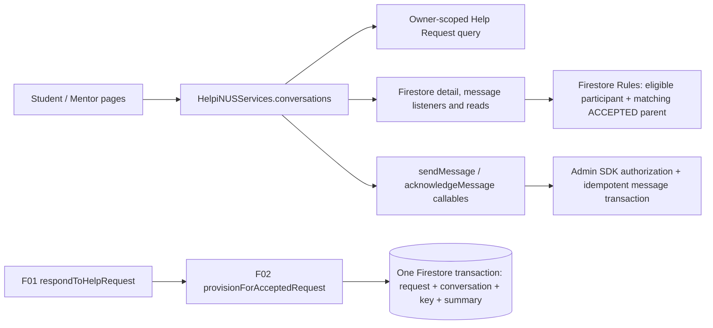

# Technical Design Document — S2-D2-F02 Conversation Management

**Status:** Developer 2 approved; complete F02 SDD package separately approved 2026-10-16; Git publication pending  
**Draft date:** 2026-10-16 (Asia/Singapore)  
**Approval date:** 2026-10-16 (Asia/Singapore)  
**Approval reference:** Developer 2's “approve TDD without moving on to RTT” reply in this TDD conversation approved the independently reviewed pre-approval-metadata TDD with SHA-256 `C4600F8EC37AE42299A1C771FA76828D65C25B0AB1A5BCAADE9DC5C86CD99703`. No durable reply identifier is claimed.  
**Approval scope:** This TDD's technical design and proposed public test seams only. Requirements-to-Tests was explicitly deferred by this TDD approval; the RTT and complete SDD package were separately approved later on 2026-10-16. Implementation, Git publication and release remain separate gates.  
**Feature owner / workstream:** Developer 2 / Sprint 2 F02  
**Source PRD:** Developer 2 approved for TDD planning on 2026-10-16; complete package separately approved later that day.  
**Scope of this artifact:** Technical design only. Requirements-to-Tests, implementation, test execution, Git publication, and release remain separate gates. No result below claims a test passed.

## 1. Authority, baseline, and design boundary

The governing product sources are the approved [F02 Mission Brief](../../mission-brief/S2-D2-F02-conversation-management.md), its owner-approved [read-receipt amendment](../../mission-brief/S2-D2-F02-conversation-management-amendment-draft.md), the original [F02 specification](../../../workflow/specs/sprint-2/S2-D2-F02-conversation-management-spec.md) and owner-approved [specification amendment](../../../workflow/specs/sprint-2/S2-D2-F02-conversation-management-amendment-draft.md), [GD-01–GD-11](GrillingDecisions.md), and the [approved F02 PRD](PRD.md), in that PRD's stated order. The bounded GD-11 amendment is approved even though the amended source bodies retain historical “proposed” language; their approval headers and `workflow/handoffs/royden/S2-D2-F02.md` record provenance. F01's approved [TDD](../S2-D2-F01/TDD.md) and [RTT](../S2-D2-F01/RequirementsToTests.md), Sprint 1 ADR-001/003/004, and actual F01 code constrain integration. No F01 product decision is reopened.

Inspected implementation: `CS3227-2610-MP3-conversation-management`, branch `royden/feat-conversation-management`, HEAD `bb2e7c2ae1c4a8556716be62cfafd052d8789045`; the checkout already contains unrelated uncommitted workflow and imported-SDD changes. `src/functions/src/helpRequests.ts` has the real F01 decision transaction but production `src/functions/src/index.ts` omits its provision argument, so acceptance returns `F02_UNAVAILABLE` before writes. Rejection remains operational. `firestore.rules` authorizes accepted-parent conversation `get` and message reads, denies conversation list, and allows direct message create under a narrower baseline policy; no production F02 UI, send idempotency, read receipt, or real provisioner exists. `src/frontend/src/routes/appRoutes.tsx` has a Student conversation placeholder and no Mentor chat route. This document designs target behavior; it does not treat mock dashboard conversations or F01's injected test adapter as delivered integration.

F01 owns Help Request creation/decision, pending tuple key, summary counters, and terminal replay/conflict. F02 owns the deterministic conversation document, message/receipt contract, chat authorization, and Student/Mentor chat experience. One accepted request has one conversation at `conversations/{helpRequestId}`; two accepted requests between the same people remain separate. F02 never changes Help Request status or introduces closure, booking, message editing/deletion, notifications, previews, unread counts, or a recipient-device delivery claim. The original `CLOSED` symbol remains dormant.

## 2. Architecture and public interfaces



The frontend's deep `conversations` module hides Firestore snapshots, pagination cursors, pair-validation, reconciliation, and retry storage from pages. Its public interface returns role-safe models and typed outcomes, not raw documents. Proposed TypeScript shapes are illustrative contracts to be finalized without widening behavior:

```ts
type ChatListRow =
  | { kind: 'ready'; requestId: string; otherParticipantName: string; moduleId: string; title: string; acceptedAt: string }
  | { kind: 'support_needed'; requestId: string; acceptedAt: string };
type ChatCursor = { acceptedAt: string; requestId: string }; // opaque to pages in practice
type ChatPage = { rows: ChatListRow[]; next: ChatCursor | null; complete: boolean };
type ChatDetail = { requestId: string; studentId: string; mentorId: string; otherParticipantName: string; moduleId: string; title: string; description: string };
type SavedMessage = { id: string; conversationId: string; senderId: string; body: string; createdAt: string; readAt: string | null };
type ChatOutcome<T> = { kind: 'ok'; value: T } | { kind: 'denied' | 'unavailable' | 'integrity' | 'transient'; value?: never };

conversations.subscribeList(role, uid, onPage, onError): () => void;
conversations.loadMoreList(cursor): Promise<ChatPage>;
conversations.subscribeDetail(requestId, onDetail, onError): () => void;
conversations.subscribeMessagePage(requestId, cursorOrNull, onPage, onError): () => void;
conversations.getMessageFromServer(requestId, messageId): Promise<SavedMessage | null>;
conversations.send(requestId, messageId, normalizedBody): Promise<SavedMessage>;
conversations.acknowledge(requestId, messageId): Promise<{ readAt: string }>;
```

Only the service module sees a cursor's Firestore `Timestamp` and document ID. `subscribe*` delivers initial-loading resolution separately from empty data and supplies an unsubscribe. `subscribeMessagePage` uses `cursorOrNull == null` for the live newest page; for an older page it opens a bounded live query after the returned page cursor, streams subsequent message/receipt changes through `onPage`, and returns that page's unsubscribe. The page coordinator owns the returned unsubscribe functions and releases all of them when chat context changes; it merges page callbacks by saved message ID. It may return a `support_needed` row only after an authorized accepted parent is known and the deterministic conversation cannot be validated. A direct detail entry uses the same pair validator; a guessed ID cannot obtain a different answer that reveals foreign data. `send` and `acknowledge` use the existing typed callable transport. Pages own focus, viewport observation and visible local-pending placement; the service owns durable operations and stale-result guards. The real Firebase adapter, lazy proxy and deterministic mock implement the same interface. A mock is limited to component evidence.

The backend has three narrow seams: F01's existing `respondToHelpRequestHandler(..., provision?)`; F02's synchronous `provisionForAcceptedRequest(tx, acceptedStoredRequest, preReadConversation): string`; and authenticated `sendMessage` / `acknowledgeMessage` callables. The provision helper may use only transaction writes, requires the already-read absent conversation snapshot, creates at the request ID, returns that ID, and makes no independent transaction, network call, or request-status write. Its synchronous signature fits F01's current invocation and Firestore read-before-write rule. The send and acknowledgement handlers hide message document layout, authorization, retry/replay, and timestamp from callers.

### Explicit ADR-003/004 reconciliation

Sprint 1's direct-access matrix allowed Rules-gated message creation. F02's approved GD-02 adds a single trim-and-4,000-character Unicode policy, while GD-01/08 add same-ID replay, authoritative absence checks, and durable uncertainty. Firestore Rules `String.trim()` and `size()` are not a sufficient cross-runtime specification of JavaScript normalization and Unicode length for adversarial direct writes; Rules also cannot compare an existing document's body on a create replay. The F02 design therefore narrows **F02 message creation** to an authenticated callable and denies direct client message creation in Rules. This is a technical change to the Sprint 1 proposed access matrix, expressly permitted as a send-path choice by the F02 specification; it does not loosen access or change the approved product text policy. Developer 2's TDD approval must cover this documented architecture reconciliation. Live reads stay direct Firestore listeners. The receipt is also a callable so messages remain immutable to direct clients. If this cross-feature architecture reconciliation is rejected, the design returns for approval; implementation must not silently switch paths.

## 3. Persistence grammar and invariants

| Path | Owner and exact F02 fields | Invariants |
| --- | --- | --- |
| `helpRequests/{requestId}` | Existing F01 strict record; `updatedAt` becomes the authoritative acceptance time on ACCEPTED. | F01 owns all writes. Status remains `PENDING`, `ACCEPTED`, or `REJECTED`. Student/Mentor IDs and request ID are immutable. |
| `conversations/{requestId}` | `{ id: requestId, helpRequestId: requestId, studentId, mentorId, participantIds: [studentId, mentorId], createdAt: acceptedAt, updatedAt: acceptedAt }`, Firestore `Timestamp`s. | Created only by F01's acceptance transaction; parent and role-specific IDs copied from that request. `participantIds` is redundant compatibility data, ordered Student then Mentor. No direct client write or mutable status/list metadata. `createdAt == updatedAt == helpRequests.updatedAt` at creation. |
| `conversations/{requestId}/messages/{messageId}` | `{ senderId, body, createdAt, readAt: null | Timestamp }`; document path supplies request and message IDs. | Server creates once. `senderId` is authenticated actor, body is normalized text, `createdAt` authoritative server `Timestamp`. Only `readAt` may change from null to authoritative server time through recipient-authorized acknowledgement. No client direct create/update/delete; no other server mutation. Historical absent `readAt` parses as null for compatibility, never as Read. |

The shared legacy `conversationSchema` and `messageSchema` are still consumed by older dashboard/mocks. Add strict F02 persisted/wire schemas or a versioned refinement rather than changing the nullable-parent generic shape in a way that breaks unrelated consumers. The F02 body validator must replace the legacy Zod `.max(4000)` UTF-16-code-unit check for this feature so supplementary-plane characters follow the approved 4,000-character policy. Parse Firestore `Timestamp` to ISO only at a service/callable return seam; persistence remains native `Timestamp`. Reject malformed stored fields as integrity errors. The deterministic path prevents ordinary duplicate creation; the provision helper uses `tx.create`, never overwrite. An alternate conversation ID carrying the same `helpRequestId` is prohibited by the trusted writer and never usable: Rules require document ID, `id`, and `helpRequestId` to equal the parent ID. A release audit also queries legacy/corrupt alternate-parent records; Rules alone do not prove global absence of arbitrary admin-created duplicates.

`messageId` is a fresh cryptographically random UUID for each **new intention**, generated before local retry-record persistence and validated as a canonical opaque ID by the callable. A replay must use the same conversation path, ID, sender and normalized body; differing content or identity **at that path** is a conflict, not a second send. A retry record is bound to its original request ID and cannot be retargeted by the official client. The server's uniqueness and replay guarantee is within one conversation, as the approved specification requires; random UUID generation makes accidental reuse across conversations negligible but is not a global uniqueness constraint. Message IDs are not sequential and do not encode time, user, or text. F02 does not add a separate message operation receipt: the message document itself is the durable idempotency record.

Text normalization is `String.prototype.trim()` on the submitted Unicode string; length is counted as Unicode code points (`Array.from(normalized).length`) and must be 1–4,000. This makes the approved word “characters” deterministic for supplementary-plane characters. Preserve internal spaces, tabs and line breaks exactly after outer trimming; no HTML or Markdown interpretation. The shared F02 validator and callable use the same pure normalization function. The UI may prevalidate but cannot authorize. Direct SDK writes are denied, so no divergent Rules text grammar can admit malformed content. A UTF-8 byte cap is not substituted for the approved character cap. The serialized Firestore document remains below Firestore's document limit at 4,000 code points, including multibyte characters.

Read receipt uses `readAt` on the message. The only mutation is null/absent → one server `Timestamp`, made in a transaction by the recipient callable; the body, sender, created time, path and parent are never rewritten. Repeated acknowledgement returns the original persisted `readAt` without a new write. This permits the existing bounded message listener to deliver receipt changes with no unbounded receipt listener or per-message fan-out. A historical message with no receipt remains Sent forever unless the official app later actually observes and acknowledges it; no import or backfill infers a read.

## 4. Atomic acceptance and anomaly handling

Production `src/functions/src/index.ts` must wire the real F02 helper to F01's `respondToHelpRequestHandler`; enabling the Mentor Accept control follows verified integration, not merely the presence of a function export. Preserve F01's transaction read phase: authoritative Mentor record, request, deterministic conversation snapshot, pending key, and Student summary are read **before any write**, including on reject. F01 rechecks addressed Mentor/current eligibility and pending coordination. In the pending accept branch, F02 receives the accepted copy with F01's `updatedAt`, asserts absent deterministic conversation, and queues `tx.create(conversationRef, exactSchema)`. F01 then queues status update, key deletion and summary update in the **same** transaction. A throw, contention exhaustion, or failed commit persists none of those writes. No outbox or post-commit repair window is introduced.

The existing F01 terminal replay code checks only `helpRequestId`, Student/Mentor IDs and ordered `participantIds`; it does **not** yet validate stored `id`, native timestamps or the full F02 schema. Integration must add one pure `assertMatchingAcceptedConversation(acceptedRequest, conversationSnapshot)` function in the F02-owned Functions module and call it from F01's accepted terminal branch **before** either `already_decided` or opposite-outcome `conflict` returns. It checks snapshot document ID, stored `id`, parent ID, exact Student/Mentor and ordered participant IDs, native `createdAt`/`updatedAt` equality to the accepted request's `updatedAt`, and strict field grammar. The frontend pair validator and F02 callables use the same contract, though Rules independently enforce their expressible authorization subset. This is a required F01 integration edit, not a claim about current code. It preserves F01's read-before-write order and produces its existing integrity failure without a repair or timestamp/summary write. Rejection creates no conversation; pending reject and rejected replay reject any pre-existing deterministic conversation. A pending accept with an existing conversation is an integrity error, never a shortcut to success. Existing accepted-without-conversation and mismatched pairs are not repaired on open or replay. They produce generic support-needed state for that authorized accepted request; an audit identifies them before production acceptance is enabled. Repair/backfill requires separate review.

After a lost acceptance reply, the UI retains F01's decision identity/action, refreshes the authorized request and deterministic conversation, and confirms only a valid accepted pair. `PENDING` means no confirmed acceptance and permits the same F01 decision retry; `REJECTED`/opposite terminal status shows the actual conflict; malformed or missing accepted pair shows support guidance. A client never creates a conversation or updates the request as reconciliation.

## 5. Authorization, Firestore Rules, and trust

The authorization predicate for conversation, message, list projection, send, and receipt is the **current** authenticated user plus `users/{uid}` with correct role, `ACTIVE` status, verified current Auth email matching the stored email, and a matching `ACCEPTED` Help Request. The request and conversation must have the same ID, Student ID and Mentor ID; `participantIds` must exactly equal `[studentId, mentorId]`. The Student UID must be the request Student; the Mentor UID must be the request Mentor. Profile/module changes alone do not revoke F01 decision authority or rewrite chat membership. If a user later becomes ineligible, historical reads and sends suspend until restored, without deleting records. F01's narrow Auth/Firestore race limit remains documented, not silently solved by a client guard.

Rules for `conversations/{id}` keep direct `get` only for the accepted matching pair, `list` false, and all direct writes false. Rules for `/messages/{messageId}` allow direct `get` and bounded `list` only when the parent conversation and request satisfy the same predicate; direct create/update/delete are false. A message query must use a limit no greater than 20. The rule must verify parent existence before dereferencing and must fail closed on malformed data. A direct `get` or listener with guessed ID can yield only a generic denied/unavailable UI state. Client-side membership arrays are never trusted alone. Receipt status is delivered as part of authorized message reads; no separate public receipt path exists.

Admin SDK bypasses Rules. `sendMessage` and `acknowledgeMessage` therefore independently validate Firebase Auth identity and current verification/email/disabled state, then read `users/{uid}`, Help Request, conversation and target message inside their own Firestore transaction **before any write**. They repeat the role/status/email, accepted-parent, exact-ID and membership checks. They do not authorize from a frontend route or a stale `participantIds` array. Missing/foreign IDs receive the same existence-safe `permission-denied` response. The send handler validates canonical ID and normalized body before transaction mutation; on a same-ID existing document it still performs current authorization before returning a saved replay. A malformed or divergent existing document is an integrity/conflict outcome, never overwritten. The acknowledgement handler requires the actor be the **other** participant from `senderId`, verifies target message existence and schema, and updates only `readAt` if null. No server can prove viewport visibility or human attention; the official client enforces its approved trigger, and the trust boundary states this limitation visibly in documentation.

Rules are not filters. In particular, a `conversations` collection query whose possible results include a pending, foreign, or corrupt parent cannot be authorized merely because current documents look safe. The list design instead queries **F01 Help Requests** with existing owner-scoped Rules: role-specific equality on `studentId` or `mentorId`, `status == 'ACCEPTED'`, `orderBy(updatedAt, desc)`, `orderBy(documentId(), desc)`, `limit(20)`. The accepted request is the authorized list index and acceptance time authority. For each returned request, a bounded direct `get` of `conversations/{requestId}` proves the pair; a missing/denied/malformed matching pair becomes a generic support-needed row, while healthy rows render. No foreign conversation fields are displayed. If a conversation `get` is denied, revalidate the own parent/session before classifying a pair anomaly; if parent access is also denied, clear all private state. This preserves list authorization no broader than direct detail and makes anomalies visible without a new server projection. The same parent-gated validator is used on direct route entry. The Rules Emulator must prove the actual request query and direct conversation/message reads, including stale flags and broad-query denial.

## 6. List, detail, history, and real-time queries

### Conversation list

The first owner-scoped accepted-request page uses `onSnapshot` so a newly accepted request appears without refresh. New messages do not change `helpRequests.updatedAt`, so they do not reorder rows. Older pages use `getDocs` with `startAfter(last updatedAt, documentId)` and the same owner/status/order/limit, with ID-keyed merging to avoid duplicate rows as the live first page shifts. The cursor is built from authoritative Firestore `Timestamp`, not a rounded ISO string. A page of 20 is an implementation size, not a product count/latency promise. `hasMore` is known only by fetching a 20-item page and optionally probing the next bounded page; alternatively use a 21-document query only if Rules are raised to exactly 21. This design chooses a 20-item page plus a separate `limit(1)` probe so Rules stay at 20. An empty first authorized page is truly empty; empty older page means exhausted. Query/index errors preserve loaded rows with a visible partial/failure state and Retry; they never imply completion. Every fetched accepted request yields either one ready row or one support-needed row, so anomalies do not silently shrink or hide the page.

Required indexes are new `helpRequests` composites for `(studentId ASC, status ASC, updatedAt DESC, __name__ DESC)` and `(mentorId ASC, status ASC, updatedAt DESC, __name__ DESC)` as accepted by Firestore's index planner. Verify both actual client queries in Emulator and deploy/index readiness before enabling F02. Do not infer from existing `createdAt` request indexes. Module code/label uses the existing `modules.getById` adapter; request title, module ID, and historical other-party display-name snapshot provide list context without a new cross-user `users` read. Conversation list does not read message bodies or maintain preview/unread metadata.

### Detail and history

Routes `/student/conversations/:requestId` and `/mentor/conversations/:requestId` share one page implementation under existing role guards. Open by authoritative request ID, subscribe to the own request and deterministic conversation, validate the pair before showing private detail or starting the composer/message listener, and clear on parent loss, mismatch or denial. Display request title/description, module label and role-appropriate historical display-name snapshot. A direct route runs this same sequence; no list visit is required. Pending/rejected request detail has no chat link. Accepted request detail exposes a link only after pair verification, and F01 uncertain acceptance never fabricates one.

Message history uses `orderBy(createdAt, desc), orderBy(documentId(), desc), limit(20)` on the known conversation's `messages` subcollection. Reverse each confirmed page to display oldest-to-newest by `(createdAt, messageId)`. “Load earlier” adds a page with `startAfter(last Timestamp, documentId)` until exhausted. Page cursors use native timestamps; equal-time IDs make boundaries deterministic. **Every loaded page retains its own bounded `onSnapshot` listener**, including older pages, so a later `readAt` update to any loaded sender message reaches the open view without refresh. The first page is the moving newest-20 window; each older page is anchored by its immutable newer-page cursor and has a limit of 20. Store page ownership by ID and deduplicate across neighboring listeners. Initial work stays bounded, and all listeners unsubscribe on route/account/service change. The Rules limit applies to each query. A listener error marks that page stale/partial and offers Retry; it does not erase other healthy pages. If a live-window shift evicts a message, retain its already-seen saved ID and anchor an additional bounded page so it remains subscribed while loaded. If reconnect creates a gap between live and older loaded segments, mark the gap as loading/partial and fetch bounded intervening pages until overlap before claiming a continuous history. Never stitch disconnected pages and call them complete. Merge all saved records by ID; a listener copy and local pending copy with the same ID collapse to one confirmed row only after authoritative persistence. Saved order does not use listener arrival or client clock. Unresolved local bubbles follow confirmed history in local submission order. No unbounded initial scan is required; cumulative listeners may grow with explicitly loaded history and live arrivals, and must be released on exit. The single-field timestamp plus document-ID order should use built-in indexes; add an explicit index only if the Emulator/deployment planner demands one.

## 7. Message send, replay, and local recovery

`sendMessage({ requestId, messageId, body })` has this sequence: (1) authenticate and validate IDs; (2) normalize/validate text once under the shared F02 function; (3) in a Firestore transaction read current actor record, accepted request, conversation and exact message document; (4) deny before private disclosure if authorization fails; (5) if the message exists with identical immutable sender/body/path and valid schema, return its saved record without writing; if it differs, fail with ID-reuse/integrity; (6) otherwise `tx.create` the message with `Timestamp.now()` and `readAt: null`; (7) return the committed saved record. A transaction retry or concurrent same-ID call converges on one document. Distinct IDs are distinct intended sends, even if text is equal. No request, conversation, F01 summary or list-order timestamp is updated by a send. Confirmed persistence is established only by the callable's committed response, a server-backed same-ID read, or an authorized listener record with matching ID/content; a local write attempt is never “Sent.”

Before invoking the callable, the client creates a per-intention account-scoped `sessionStorage` record `{version, uid, requestId, messageId, normalizedBody, localSequence, state}`. Use separate `f02-send:<encoded uid>:<messageId>` keys and one owner marker rather than a single overwrite-prone queue blob. Persist and read back that record **before** dispatch. If storage throws, the readback fails, or an existing key conflicts, preserve existing records, do not send the new intention, and show capacity/recovery guidance. There is no fixed pending count. No private text is stored in `localStorage`. `localSequence` is an in-session monotonically increasing display order only; it is not authoritative message chronology. On confirmed save, reconcile by ID and remove the retry key. If removal fails, a future restore rechecks the same ID and removes it; it does not duplicate the message.

On refresh/navigation, verified same-account session restoration validates stored record grammar, associates records only with that user's conversation, and does **not** start network operations before session and parent eligibility are confirmed. On sign-out, account switch, detected denial, service swap, or lost role/verification, remove every F02 retry key and the owner marker and clear in-memory text, even if an old callback later returns. On a malformed private record, fail closed for that record and avoid sending it; report recoverability without showing it to another account. A browser session that truly ends has no recovery promise.

For unknown outcomes (timeout, disconnect or dropped response), show question-mark/Retry while keeping original ID and body. On reconnect or manual Retry, run a **server** `getDocFromServer` of that ID under current Rules; a cached absence is insufficient. If saved and immutable fields match, merge to Sent or Read and clear the retry record. If the server confirms absent while current parent/account access still passes, invoke the same-ID callable automatically on reconnection or manually on Retry. An in-flight first attempt may race that retry; transactional `create`/replay still leaves exactly one document. If the server is unavailable, remain uncertain and do not claim a definitive failure. Invalid text, changed intention/ID, denied access, and ID conflict are definitive failures with distinct feedback; a changed body requires a new intention and ID after the user explicitly edits/re-submits. Multiple pending sends operate independently; one failure cannot silently discard another. After a listener and callable settle out of order, the map keyed by message ID and authoritative saved order determine the final display.

## 8. Read acknowledgement and sender statuses

`acknowledgeMessage({ requestId, messageId })` is an authenticated callable transaction. It reads actor/user, accepted request, conversation and message before writing. Only the participant opposite `senderId` may acknowledge; an own, foreign, missing, malformed, or nonaccepted-parent message is denied with no mutation. If `readAt` already exists, return that same persisted timestamp without another write. Otherwise update **only** `readAt` to the server transaction time. A lost reply reconciles from the message listener/direct authorized server read; retry is safe. Read failures leave the sender at Sent and do not invent blue ticks.

The official page sets an `IntersectionObserver` on **persisted incoming** bubbles only. It submits once per message when the chat route is active, the document is foreground (`visibilityState == 'visible'` and focused), the eligible account/session is current, and the bubble intersects the scroll viewport. Stop observation on unmount, background, role/account change or denial; reevaluate when foregrounded. A loaded offscreen historical message and a background tab do not trigger acknowledgement. The observer is a client behavior rule, not a server proof of human attention. A modified recipient client may acknowledge early or withhold acknowledgement; no security claim exceeds authenticated recipient authorization.

Only the sender's bubbles show status: one grey tick while local send is unresolved and actively Sending; question mark with Retry when persistence is uncertain; distinct failure affordance for definitive failure; two grey ticks/“Sent” when persisted; two blue ticks/“Read” only when nonnull `readAt` is observed as persisted. Received bubbles have no sender ticks. No status is called Delivered. Persisted historical messages with `readAt` absent/null remain Sent, with no backfill. Both eligible clients receive live receipt changes for **every loaded page** through that page's bounded listener, including older history.

## 9. Frontend integration and accessibility

Reuse `ProtectedRoute`, `AppShell`, `ServiceProvider`, `useServices`, `firebaseServiceProxy`, `mockServices`, existing F01 request detail/list patterns, `HelpRequestPages.css`, `MentorDashboard.css`, and `index.css` tokens. Replace the Student `/student/conversations` placeholder, add Mentor `/mentor/conversations` navigation and both role detail routes, and link only verified accepted request details. Keep Firebase SDK calls inside service adapters. Preserve existing Student/Mentor dashboards and F01 request flows; do not interpret `mockServices` dashboard samples as actual chats. Use existing page/card, button, notice, status, typography, focus and mobile navigation conventions before adding chat-specific layout. The 320 px view must keep list, context, history, composer and retry controls accessible without horizontal clipping; multiline bodies wrap while preserving line breaks (`white-space: pre-wrap` or equivalent) and render as React text, not HTML.

Each view has explicit initial loading, authorized empty, ready, partial/stale, recoverable failure, denied and support-needed states. A support row is generic and has no chat link or corrupt details; healthy rows stay usable. A transient listener failure may retain already loaded same-account history **marked stale** with Retry after current eligibility revalidation; a permission denial clears history, composer, local pending records and all listeners. Initial failure never renders “No messages.” Use an epoch keyed by service instance, UID, role, request ID and route generation. Unsubscribe on every key change and ignore late callbacks, callable results and server reads whose epoch changed. `ServiceProvider` already clears F01 drafts on account changes; extend that same session lifecycle to F02 retry records without erasing them on ordinary same-account navigation/refresh.

Use semantic list and message grouping, labels for composer/send/paging/retry, visible focus, and focus retention after prepending older history. Preserve scroll anchor/height rather than forcing the user to the bottom when loading earlier; do not auto-scroll while they read older records. Announce an incoming persisted message briefly with sender context through a restrained live region, once per new ID, without reading body aloud or repeatedly announcing all history on initial load. Sender statuses have accessible text in addition to colored ticks. “Load more” and “Load earlier” are keyboard buttons with loading and exhausted semantics. Manual browser observations at laptop and 320 px, keyboard and screen reader, long multiline text, receipt visibility, loading/empty/denied/stale/retry states are required later; this design does not claim those checks occurred.

## 10. Failure taxonomy and recovery table

| Condition | Durable state | Service/UI outcome | Recovery |
| --- | --- | --- | --- |
| F02 helper absent, provision throws, or F01 transaction aborts | `PENDING`, no new conversation; key/summary unchanged | Acceptance unavailable/uncertain, never success | Restore real helper or retry same F01 action after authoritative check. |
| Acceptance reply lost after commit | `ACCEPTED` plus matching conversation | Checking, then accepted only after pair read | Same F01 action replays without write; bad pair goes to support. |
| Accepted request missing/mismatched conversation | Existing anomaly unchanged | Generic support-needed row; detail denied; healthy rows continue | Support audit and separately reviewed repair, no client repair. |
| Same message ID already saved with matching fields | One saved document | Return/reconcile original; no new timestamp | Remove local retry record when observed. |
| Same ID reused with different body/actor at the **same conversation path** | Existing message unchanged | Definitive conflict; no old-ID retry of changed text | New explicit intention gets new ID after user edit. |
| Official client attempts to retarget an existing retry record to another parent | No write from that retry record | Local validation rejects the retarget; server still validates the new path independently | Reopen the original authorized chat or make a distinct new intention with a fresh ID. |
| Send reply lost before/after commit | Absent or one saved message | Question-mark/Retry until server read | If saved merge; if server-confirmed absent and eligible, retry same ID. |
| Offline or server absence unprovable | Unknown | Uncertain, never Sent/definitive Failed | Retry server reconciliation when connected. |
| Retry storage cannot save/verify another record | Existing records intact; no new send | Pause new sends and explain recovery | Free session capacity/resolve records, then submit. |
| Transient listener/index/network failure | Persisted state unchanged | Loaded same-account data marked stale/partial; Retry | Revalidate eligibility, resubscribe and fill any history gap. |
| Denial, sign-out, account/service/route change | Persisted state unchanged | Clear private UI, stop listeners; no stale callback | Restore eligibility and reopen through authorized path. |
| Receipt reply lost or write fails | Null or one persisted `readAt` | Sender remains Sent until persisted receipt observed | Recipient can retry same acknowledgement; no fabricated Read. |

Errors are typed at the service seam: `invalid_message`, `id_reused`, `denied`, `integrity`, `unavailable`, and `transient/unknown`. `permission-denied`/`unauthenticated` and detected eligibility changes clear private state; `failed-precondition` from corrupt pair maps to generic support guidance only after parent authorization; `invalid-argument` identifies text/ID input without leaking a target; transport timeouts remain uncertain until server reconciliation. Unknown Firebase errors are not automatically treated as definitive failed sends. Logs and UI omit message bodies, foreign document content, and full private retry records.

## 11. Verification seams and implementation handoff

Public test seams for the later RTT are: (a) F01 response callable with the **real** F02 provision helper and persisted transaction state; (b) authenticated send/acknowledge callables with Firestore Emulator; (c) actual client SDK owner-list/detail/message queries under Rules Emulator; (d) `HelpiNUSServices.conversations` through Firebase and deterministic mock adapters; and (e) role pages through user-visible behavior and browser accessibility/mobile observation. These are proposed for Developer 2 confirmation at TDD approval before RTT fixes case names. Internal transaction stages, React hooks, and private helpers are not separate public test seams. A mock cannot prove the transaction, Rules, live two-client delivery, or receipt authorization.

Planned vertical red–green sequence after separate implementation authorization: first real F01 acceptance pair/abort/replay; then Rules-gated owner list and fail-closed anomaly; then bounded detail/history and equal-time ordering; then one callable send and same-ID replay; then multiple session-recoverable uncertain sends; then two-client listener convergence; then recipient-only persisted acknowledgement/viewport trigger; then access-loss, accessibility, responsiveness and F01 regressions. Each slice starts with one failing observable-behavior test and minimal implementation, followed by independent review. No tests are written in this documentation phase.

The later RTT must map every approved FR-01–FR-23, NFR-01–NFR-09, AC-01–AC-44 and GD-01–GD-11 to stable cases and required evidence classes. It must include F01's previously integration-blocked TC-022–TC-025, TC-028–TC-035 and broader TC-046, using the real helper rather than an injected mock. Release evidence must distinguish unit/component mock, Firestore Emulator, Rules Emulator, real F01/F02 transaction and fault/race, two-client live subscriptions, Node 22 CI, manual desktop/320 px keyboard/screen-reader observations, and regressions. A real-data accepted-pair audit precedes production acceptance enablement; any anomaly or needed backfill is a separate reviewed path. After behavior is verified, the implementation handoff must update `docs/UserGuide.md`, `docs/DeveloperGuide.md`, the feature log and ledger with actual behavior, commands, environment, outcomes, persisted-state assertions and limitations. Those future deliverables are part of AC-44; this TDD does not claim they exist or authorize writing them now. An independent verification agent later checks the complete PRD→RTT→executed-evidence crosswalk; the orchestrator remediates in-scope gaps and does not call planned or blocked cases passed.

## 12. Traceability crosswalk

| Approved IDs | Design locations | Acceptance IDs |
| --- | --- | --- |
| FR-01, FR-02, FR-03; NFR-02, NFR-08 | §§3–5, 10 | AC-01–AC-10 |
| FR-04, FR-05, FR-06 | §§2, 5–6, 9 | AC-06, AC-09–AC-15 |
| FR-07, FR-08, FR-09 | §§2–3, 5–7, 9 | AC-10, AC-16–AC-22 |
| FR-10, FR-11 | §§2–3, 5, 7, 10 | AC-23–AC-28 |
| FR-12, FR-13, FR-14, FR-15; NFR-03, NFR-04 | §§6–8, 10–11 | AC-19–AC-22, AC-29–AC-36 |
| FR-16, FR-17, FR-18; NFR-01 | §§3, 5, 7, 9–10 | AC-07, AC-17, AC-26–AC-28, AC-37–AC-41 |
| FR-19, FR-20, FR-21 | §§3, 5, 8–10 | AC-30–AC-31, AC-40–AC-43 |
| FR-22, FR-23; NFR-06, NFR-07 | §§2, 6, 9–10 | AC-08, AC-15, AC-17–AC-18, AC-34, AC-37, AC-42 |
| NFR-05 | §§5–6 | AC-13, AC-15, AC-18–AC-20 |
| NFR-09 | §11 | AC-44 |

The individual acceptance-criterion destinations remove ambiguity from the grouped ranges above. These are design locations, not executed test results:

| AC | Design location and observable obligation | AC | Design location and observable obligation |
| --- | --- | --- | --- |
| AC-01 | §§3–4: atomic accepted pair/key/summary | AC-23 | §§3, 7: normalized saved sender/time/body |
| AC-02 | §§4, 10: provision abort preserves pending | AC-24 | §§2–3, 5, 7: UI/callable/direct-SDK invalid text |
| AC-03 | §§4, 10: lost acceptance reply reconciles pair | AC-25 | §§3, 9: literal multiline/markup rendering |
| AC-04 | §§1, 4, 10: no helper remains unavailable | AC-26 | §§3, 5, 7: forged sender/time/parent denial |
| AC-05 | §4: accepted replay/race no write | AC-27 | §§3, 5: direct conversation/message mutation denied |
| AC-06 | §§3–6: one ID per request, role entry | AC-28 | §§4–5: trusted authorization independent of UI |
| AC-07 | §§3–5: reject/conflict/alternate ID denial | AC-29 | §§6–7: two-client persisted live exchange |
| AC-08 | §§4–6, 10: missing pair support row | AC-30 | §§6, 8: live persisted recipient receipt |
| AC-09 | §§4–6: bad pair isolated from healthy rows | AC-31 | §§7–8, 10: lost send reply, same-ID Sent |
| AC-10 | §§4–5: no client repair or guessed-ID access | AC-32 | §§7, 10: server-absent then same-ID retry |
| AC-11 | §§5–6: own ready/support rows, context | AC-33 | §§5, 7: revoked or changed-intent retry denied |
| AC-12 | §§4, 6, 9: accepted detail links same chat | AC-34 | §§7, 9–10: multiple session pending states |
| AC-13 | §6: acceptance order, ties, Load more | AC-35 | §§7, 10: capacity pause, records retained |
| AC-14 | §6: live accepted-list addition | AC-36 | §§7, 9: account switch clears retry state |
| AC-15 | §§6, 9–10: list loading/partial/exhausted/failure | AC-37 | §§6, 9–10: stale listener state and Retry |
| AC-16 | §§3, 6: validated context and prior messages | AC-38 | §§5, 7, 9: eligibility loss and restoration |
| AC-17 | §§5–6, 9–10: parent denial clears detail | AC-39 | §§2, 7, 9: epoch/late-callback discard |
| AC-18 | §§6, 9: bounded Load earlier and focus | AC-40 | §§5–6, 8: direct/broad/foreign denial |
| AC-19 | §§6–7: durable later-session history | AC-41 | §§3, 5, 8: recipient-only receipt mutation |
| AC-20 | §6: equal-time/ID page order | AC-42 | §§8–9: visual, keyboard, screen-reader states |
| AC-21 | §§6–7: concurrent pending/saved convergence | AC-43 | §§6, 8: viewport/background and delayed receipt |
| AC-22 | §§6–7: reload same-ID collapse | AC-44 | §11: separated release evidence and guides |

| Grilling decision | Design locations | Preserved decision |
| --- | --- | --- |
| GD-01 | §§3, 7 | One opaque ID per intention; same-ID reconciliation/replay. |
| GD-02 | §§2–3, 7 | Outer trim, valid inner whitespace, 4,000 Unicode characters, text rendering. |
| GD-03 | §§5, 7, 9 | Current eligibility suspends historical access; restore only if still matched. |
| GD-04 | §§4–6, 10 | Bad pair fails closed as generic row; healthy pairs usable; no client repair. |
| GD-05 | §§6–7 | Server timestamp+ID saved order; local pending region; ID dedupe. |
| GD-06 | §6 | Bounded recent history and accessible Load earlier. |
| GD-07 | §§5–6 | Authorized, live, newest-acceptance list; bounded Load more; no preview/unread. |
| GD-08 | §7 | Multiple durable session pending sends, uncertainty and same-ID automatic retry, capacity pause. |
| GD-09 | §§9–10 | Mark transient history stale; clear on detected denial. |
| GD-10 | §9 | Accessible 320 px chat and brief sender-context announcement. |
| GD-11 | §§3, 5, 8–9 | Sender-only truthful Sending/Sent/Read; viewport-triggered recipient receipt; no inferred reads. |

## 13. Independent review, remediation, and approval gate

An independent read-only reviewer compared the on-disk draft with the approved F02 Mission Brief/amendments, Grilling Decisions, PRD and specification, F01 TDD/RTT integration contract, actual repository code, and every FR/NFR/AC/GD trace destination. The first review held the draft for two material and one minor finding: older loaded sender messages lacked live receipt updates; the TDD assumed a stronger F01 accepted-replay validator than the code implements; and a UUID statement implied global rather than per-conversation uniqueness. The coordinator revised §§2–4, 6, 8 and 10 to add bounded live listeners with callback/unsubscribe ownership for every loaded page, require an explicit F01 strict pair-validator integration edit, and scope message replay to its conversation path. Re-review also tightened the same-path failure row, the older-page service interface, and AC-44's future guide/handoff obligation. No approved product behavior changed.

The independent reviewer then reported **PASS** for the substantive reviewed draft at SHA-256 `92EF1862DECF9C52B7FBEA54981AD3AE8E6B34D323D88C5F8ADC2F4D14918CC7`, with no remaining material product, security, Rules/query or traceability contradiction. A final metadata check passed on the complete reviewed pre-approval-metadata draft at SHA-256 `C4600F8EC37AE42299A1C771FA76828D65C25B0AB1A5BCAADE9DC5C86CD99703`. The reviewer did not approve the design for Developer 2, run tests, or verify implementation. Developer 2 subsequently approved that exact TDD version as recorded in the header. Stop before Requirements-to-Tests as expressly requested; no implementation or Git publication follows from this approval.
